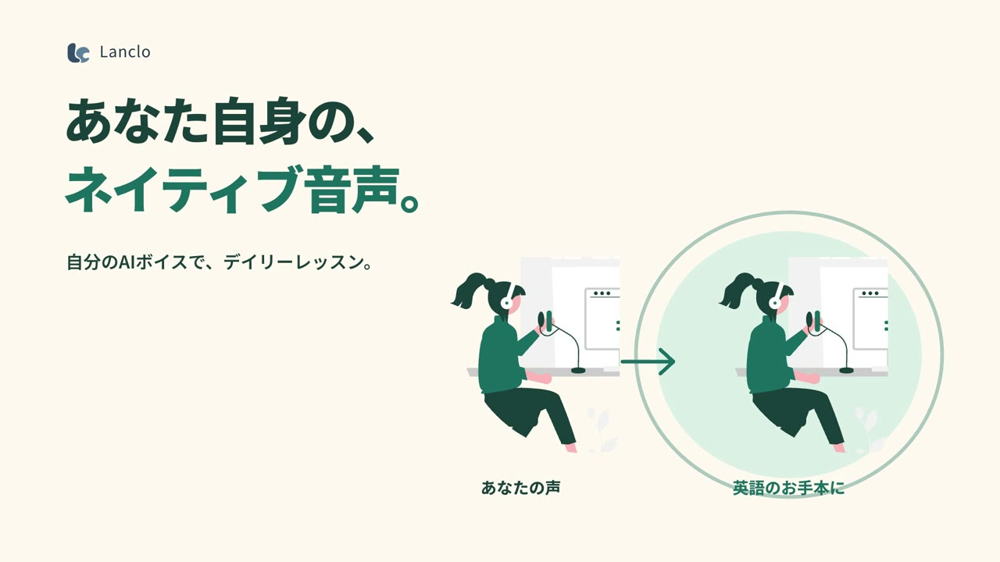

<div align="center">

# Tetsuya Open Works

**日本語** · [English](README.md)

**Web・映像・スライド。完成物から、つくり方まで。**

コードとAIでつくる作品集。完成物と、判断・プロンプト・動かせるソースを一緒に公開します。

[▶ ギャラリーを見る](https://videos.maepace.com/) · [作品一覧](#作品) · [スタイルを探す](styles/README.md) · [自分で作る](docs/REPRODUCE.md)

</div>

## 作品

[](https://videos.maepace.com/films/lanclo-daily/)

**Lanclo — 自分の声で、毎日の英語を。** · 1:09 · 日本語

[動画・制作ノート・台本・プロンプト](https://videos.maepace.com/films/lanclo-daily/) · [ソースと制作記録](films/lanclo/README.ja.md)

A Japanese product film about your own AI voice, personalized lessons, and daily news.

完成動画はHTML/SVGとGSAPによるアニメーションをHyperFramesでレンダリング。人物はunDraw、ナレーションはGemini TTSを使用しています。

**Lanclo One line — 1本の線で、全部見せる。** · 0:26 PV（16:9）＋ 機能ショート（9:16） · 文字と英語字幕

[ソース・再制作用プロンプト・スタイル](films/lanclo-one-line/README.ja.md)

Duolingoのスペック広告 "The Path" の構成を借り、1本の線とカメラ移動で機能を見せる。全フレームと音をPython（pycairo・numpy）で生成。

**Mimi 3D — マスコットを、ソフビのように。** · Blender・3Dキャラクター

[制作過程・プロンプト・レビュー](films/mimi-3d/README.ja.md) · [3Dキャラクター制作ガイド](docs/3D-CHARACTER-WORKFLOW.ja.md)

2DのMimiをBlenderのPythonだけで3Dに。Claude CodeとCodexで9往復レビューし合って仕上げた。

**自分の声、むり — Mimi 2Dショート** · 0:15 縦型 · 2D（Codex＋Rive＋HyperFrames）

[制作過程・プロンプト・ソース](films/mimi-jibun-no-koe/README.ja.md) · [2Dキャラクターアニメ制作ガイド](docs/2D-CHARACTER-ANIMATION.ja.md)

録音した自分の英語が恥ずかしいMimiが、自分の声のお手本で驚き、練習して、点数と直すポイントで納得するまで。

**think が sink に — Mimiショート2本目** · 0:15 縦型 · 2D（Codex＋Rive＋HyperFrames）

[制作過程・プロンプト・ソース](films/mimi-think-sink/README.ja.md) · [Mimiショート共通キット](kits/mimi-short/README.md)

"I sink so!" と言うたびにシンクが落ちてくる。自分の声の正しい "I think so." と th の直し方1つで、シンクが消える。

**道を聞かれて固まる — Mimiショート3本目** · 0:15 縦型 · 2D（Codex＋Rive＋HyperFrames）

[制作過程・プロンプト・ソース](films/mimi-michi/README.ja.md) · [Mimiショート共通キット](kits/mimi-short/README.md)

英語で道を聞かれて氷漬けになったMimiが、自分の声で答えを練習して、氷を割る。

## この動画制作フローを使う

[専用スキルの導入と制作手順](docs/VIDEO-WORKFLOW.ja.md)を公開しています。Lancloの改善例を見ながら、自分の動画へ応用できます。構成・改善・記録を支えるスキルで、レンダラーや音声APIは別途必要です。

## この作品集の使い方

1. **作品から入る** — 気になるサムネイルから、ねらいと見どころを読む。
2. **プロンプトを見る** — `PROMPT.md`で全体の指示、`NARRATION.md`でセリフ、`TTS-PROMPTS.json`で演技指示を読む。
3. **スタイルを借りる** — `STYLE.md`を参考に、題材・ブランド・素材を自分のものへ置き換える。
4. **ソースを動かす** — [再編集手順](docs/REPRODUCE.md)に沿ってプレビューする。

`PROMPT.md`は制作中の判断を完成形へ統合した再制作用プロンプトです。最初に一度だけ入力した原文ではありません。音声生成入力は個人の登録IDを除いて保存しています。

## ギャラリー

ビルド不要の静的サイトを[`site/`](site)に用意しています。サブドメインにもサブディレクトリにも配置できます。公開先：**https://videos.maepace.com/**。

```sh
npm run dev
# http://localhost:4173
```

最新版は `site/media/lanclo-daily-r26.mp4`、初期版は `site/media/lanclo.mp4`、番外編は `site/media/lanclo-osaka.mp4` に配置してください。完成MP4・音声はGitに含めず、[公開手順](docs/PUBLISHING.md)に沿って配信します。

## ファイル構成

```text
films/
  lanclo/    作品の入口・最新版の台本・プロンプト
    source/  最新版の編集ソース
    extras/  大阪弁などの番外編
    history/ 以前の版の記録
skills/      共有できる動画制作スキル
styles/      次の作品にも使えるビジュアルスタイル
site/        ポートフォリオ用の動画ギャラリー
scripts/     ギャラリーのビルドと公開前チェック
docs/        再編集・公開・ライセンスの案内
templates/   新しい作品を追加する雛形
```

[新しい作品を追加する](docs/ADDING-A-FILM.md)

## 参考とライセンス

構成の参考は [Lemo-Opuscar](https://github.com/lemomo-ai/lemo-opuscar)。見本動画とスタイル、制作プロンプトをセットで見せる考え方を参考にしました。説明文とサイト実装はこの作品集向けに制作しています。

本リポジトリの自作コード・文書は[MIT](LICENSE)。動画、第三者素材、ブランド、本人の声には別の条件が適用されます。[ライセンスの適用範囲](docs/LICENSING.md)と各作品の `CREDITS.md` を確認してください。


## Web・スライド・再現用ソース

[Lanclo LPのソースと制作ノート](projects/lanclo-lp/README.md) · [制作解説スライド](https://videos.maepace.com/slides/lanclo-making/) · [公開用ハンドオフスキル](skills/open-creative-handoff/SKILL.md)

同じプロジェクトを、Web・映像・解説スライドから見る構成です。過去の映像は制作記録であり、現在の製品仕様の保証ではありません。

サイト全体のビルド: `npm ci --prefix projects/lanclo-lp/source` の後、`npm run check && npm test && npm run build`。映像入りの公開には、別途配布している許諾済みのリリースMP4を使います。

## LP・Web制作の標準

[Astro＋TypeScriptを基本にした制作フロー](docs/WEB-WORKFLOW.ja.md) · [導入できるWeb制作スキル](skills/lp-create/SKILL.md) · [制作記録テンプレート](templates/web/REPRODUCTION.md)

Impeccableを主なデザイン支援、Taste Skillを必要に応じた別案・批評に使います。実際の使用工程・版・プロンプト・固定ソースを残し、過去作への未確認の使用実績は追加しません。

## LPスキルをまとめて導入

このリポジトリで `python3 scripts/install-lp-skills.py` を実行すると、**lp-create・Impeccable・Taste Skill**を同時に導入できます。更新も同じコマンドです。[導入・更新・保守の手順](docs/LP-SKILL-INSTALL.ja.md)を参照してください。
