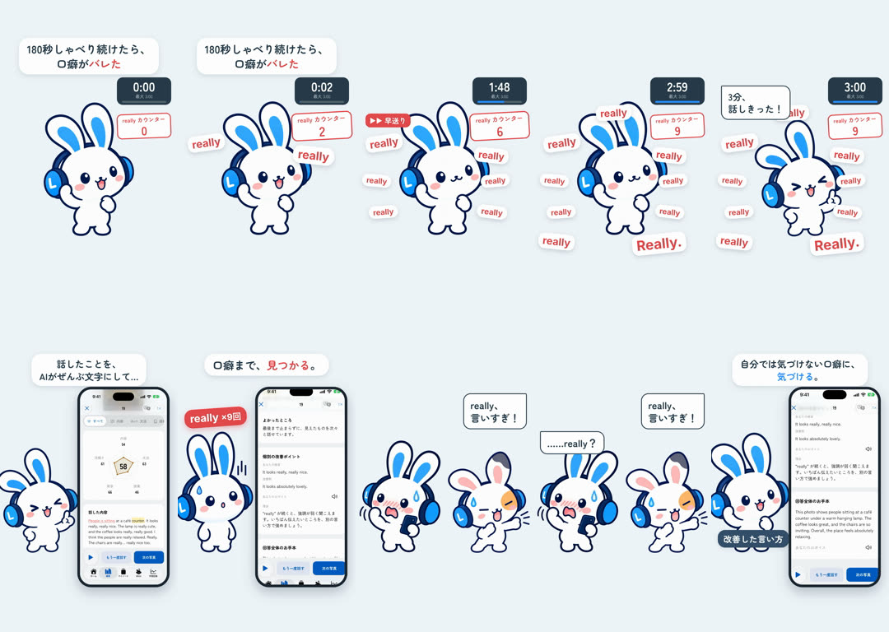

# 180秒しゃべり続けたら — 2D Mimi ショート

[English](README.md) · **日本語**

1フレーム目からフック「180秒しゃべり続けたら、口癖がバレた」。写真描写（最大 3:00 の自由スピーチ）でMimiがカフェの写真について話し続け、タイマーが3:00まで進む（早送り）。言うたびに "really" が飛び出し、9個たまる。「3分、話しきった！」のあと、実アプリ（シミュレーター）のフィードバック：話した内容の文字起こし（really が9回、動画側のバッジで数える）と、"It looks really, really nice." を指摘する個別の改善ポイント。友だち「really、言いすぎ！」Mimi「……really？」。改善した言い方 "It looks absolutely lovely." をオーナーの声で。「自分では気づけない口癖に、気づける。」

021「3分、話しつづけて」（3分の挑戦・フランス人の友だち・アウトプット仮説）、024「Mimiはずっと見てる」（複数の日記にまたがる癖のレポート）とは別の切り口：1回の3分スピーチと、そのフィードバックでの口癖のバレ方（コメディ）。

0:20.0 / 1080×1920 / 60fps / 英語はすべてオーナー本人の登録音声（`learner` と `us`）/ 既存の公式2Dポーズ + GSAP、実アプリ + HyperFrames

2本：日本語のみ（`mimi-180.mp4`）と英語字幕つき（`mimi-180-en.mp4`）。完成版はLancloのGoogleドライブ `002.SNS/033. Talked for 180 Seconds/`（`Talked180_2026-10-21.mp4`、`Talked180_EN-subs_2026-10-21.mp4`、素材は `Talked180_assets/`）。

- [PROCESS.md](PROCESS.md) / [PROMPT.md](PROMPT.md) / [source/](source/README.md) / [CREDITS.md](CREDITS.md)
