# 制作過程 — 2Dマスコットを、Blenderでソフビ風3Dにする

LancloのマスコットMimi（2Dイラスト）を、Blender 5.2のPythonスクリプトだけで3Dモデルにした過程の記録です。実際の指示（依頼者の言葉）、AIに渡したプロンプト、レビューの往復、採否の判断を、起きた順に残します。完成形をもう一度作るための統合プロンプトは [PROMPT.md](PROMPT.md)、汎用の手順は [3Dキャラクター制作ガイド](../../docs/3D-CHARACTER-WORKFLOW.ja.md) にあります。

- 期間：2026-10-20（1日）
- 役割：Claude Code（モデリング・描画・判断）、Codex（`codex-p`。参照画像の生成とアートディレクターとしてのレビュー）
- 道具：Blender 5.2 LTS（ヘッドレス、Cycles/Metal）、ImageMagick、Apple M5 Pro
- 正本：完成モデルはLanclo本体リポジトリ `design/mimi-3d/`（非公開）。このフォルダは公開用の記録と、v1時点のソースの写し

## 1. なぜ3Dか

参考にしたのは韓国のクリエイターHyungmemeのショート（ソフビ風のペンギンとアヒルの日常ネタ）。ツールは公表されていないが、どのカットでも形と模様が崩れないこと、質感と光が一貫していることから3D CGと判断。AI動画だけではMimiの細部（「L」、耳の色、頬）が崩れやすいので、**Mimiを一度3Dで作り、毎回それを呼び出す**方針にした。

依頼者の言葉：

> AI動画ではなくBlendarとか3Dでやってるのかな？どうしたらいける？
> いいね。それでいこうか。編集はHyperFrameでいけるのでは？またCodexも使えるからそれで画像とか生成してもいいし

## 2. 参照画像をCodexで作る

2Dの正面寄りのイラストしかなかったため、Codexの画像生成で2枚作った。プロンプトは [prompts/01-codex-reference-images.txt](prompts/01-codex-reference-images.txt)。

1. **三面図**（正面・斜め・横・後ろ）— 形と比率の参照。
2. **ソフビ風の仕上がり見本**（9:16）— 目標の見た目。以後のレビューはすべてこの画像との比較。

依頼者はこの見本を見て「このレベルにしあげたいね」と目標を確定した。

注意：最初の実行で `codex exec -i a.png -i b.png "prompt"` と書いたら、`-i` が後続の引数をすべて画像として読み、プロンプトが渡らなかった。プロンプトは標準入力で渡す（`codex-p exec --image a.png,b.png - < prompt.txt`）。また、依頼者の個人アカウントで動く `codex-p` を使う（途中で指摘を受けて切り替えた）。

## 3. モデルを組む（v0〜v4）

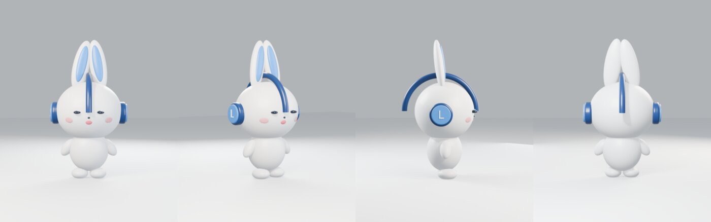

- 球の組み合わせで最初の形を作り、正面・斜め・横・後ろを描画して三面図と比べる。
- 目が小さい、耳が開いていない、バンドの向きが90度違う、色がくすむ、を順に直した（v1〜v2）。
- 露出の設定で白が飛ぶ・灰色になる問題があり、Standard表示＋露出補正に落ち着いた（v3〜v4）。

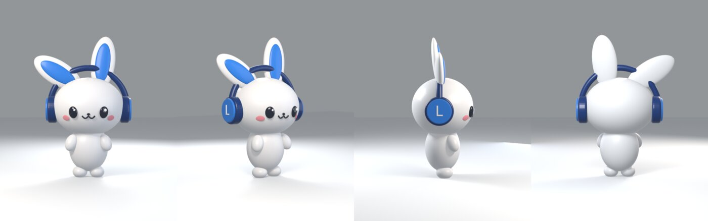

## 4. 「このレベル」に寄せる（v5〜v8）

目標を見て作り直した点：

- **体を1つの塊に**：頭・胴・足・腕を結合し、ボクセルで再構成してなめらかにする（首の継ぎ目が消える）。
- **骨組み**：root / torso / head / 左右の耳 / 左右の腕。体は自動ウェイト、顔とヘッドホンは頭に固定。
- **顔を表面に乗せる**：目・鼻・口の位置は、顔の表面に向けて光線を飛ばして決める（`surface()`）。
- **Cycles**：最初は露出が強すぎて真っ白（`process/03`）。低解像度・少サンプルで露出だけ先に合わせるようにした。

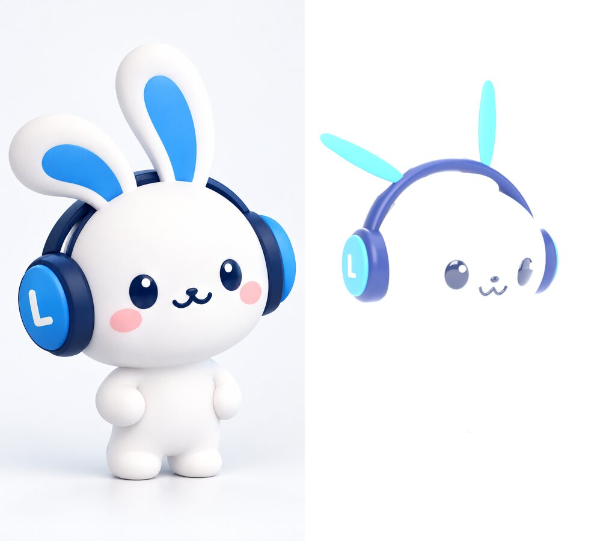
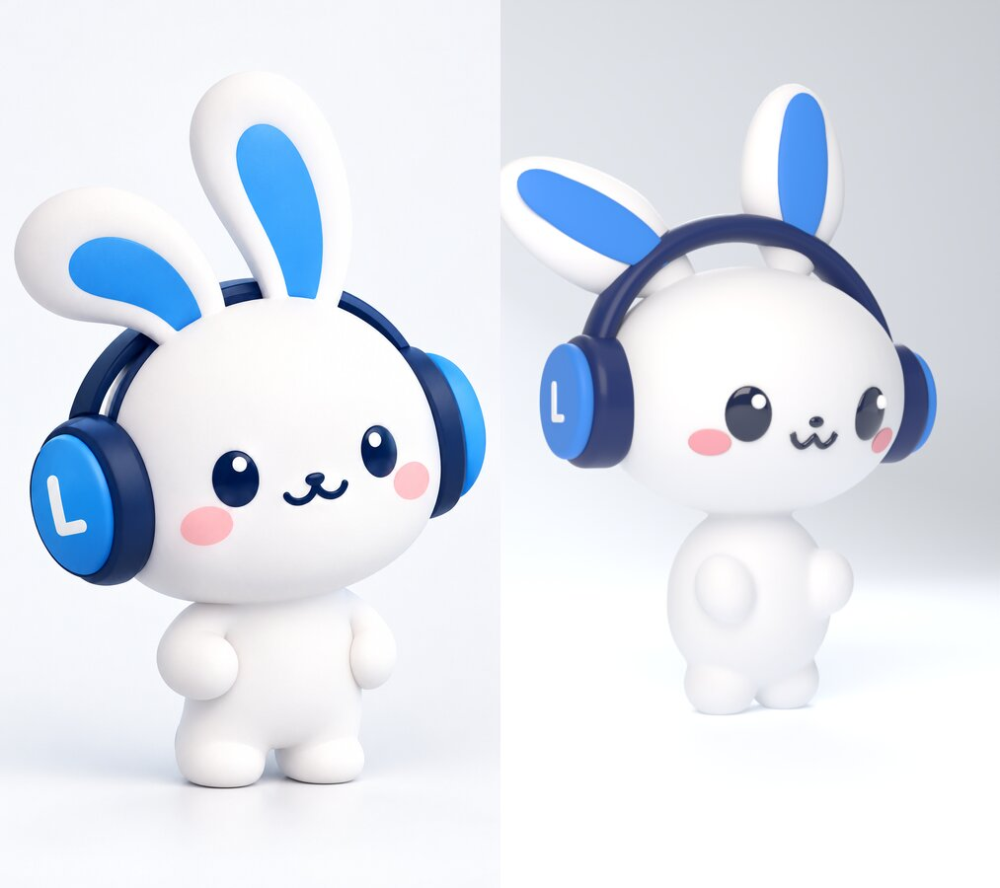

依頼者の指摘（v6のあと）：

> まだ体がほそかったり、ヘッドホンが耳を貫通していたり、顔に生気がなかったり

- 体：胴と足を太くし、頭を体に沈めて首をなくした。
- 貫通：**部品同士の交差を数値で検出するスクリプト**（`check_overlap.py`、BVH）を作った。原因はバンドを後ろに倒すつもりが前に倒していた符号ミス。以後、変更のたびに交差0を確認。
- 生気：目を大きく前に出し、光の映り込みを入れ、ほっぺを円盤からシェーダーのぼかしに変えた。

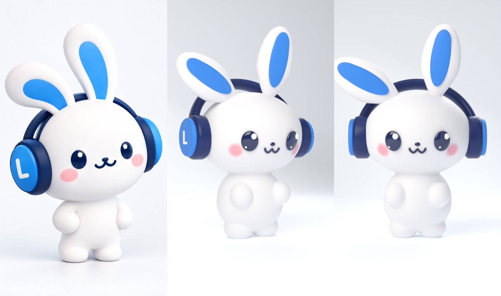
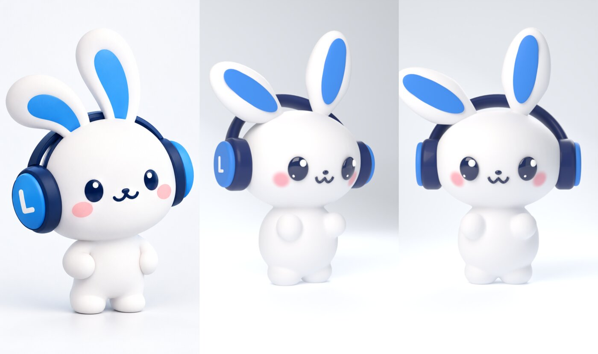

## 5. スキルとツールを取り込む

依頼者の言葉：

> スキル作りというかスキル取り込みだよね？違う？出回ってないの？ちゃんと探して

GitHub上のBlender関連スキルは50件以上あった。動画シリーズを量産する前提で選んだもの：

| 取り込んだもの | 用途 |
|---|---|
| mcp-for-blender（旧blender-mcp） | ClaudeとCodexから、起動中のBlenderを見ながら操作する |
| blender-production-skills | 背景・シーン作り（部屋、駅など） |
| OpenAI公式 hyperframes プラグイン | Codex側の編集 |

img2threejs（画像からコードで3Dを組む、段階ごとの検証つき）は出力がThree.jsなので動画の主役にはしなかった。ただし「参照と比べて合格しないと進まない」進め方は取り入れた。

## 6. レビューし合う（9往復）

依頼者の言葉：

> 色味とか目の感じとかまだ寄せれない？これが最高傑作？
> というかレビューしあって

**往復の形**：Claudeが直して描画 → 目標と並べた画像と `mimi.py` を `codex-p` に渡し、厳しめのアートディレクターとして「差の大きい順に、関数名と数値つきで」指摘させる → Claudeが採否を判断して反映 → 交差チェック。1往復は `scripts/review_round.sh` 1本で回る。

| 往復 | 主な指摘 | 判断 |
|---|---|---|
| 1 | 光で白が飛ぶ、耳が薄い、目が平たい、口が尖った「W」、カップが小さい | ほぼ採用。**胴を細くする案は不採用**（依頼者が「細い」と言ったばかり）。直立した耳を内側に倒す案も不採用（目標は外向き） |
| 2 | 耳パネルの先細り計算の座標の取り違え（実バグ）、頭をもっと大きく、口を丸い山に | 採用 |
| 3 | 頭の傾き、垂れ耳を低く広く、顔のパーツを上に、手、光の偏り | 採用。構図の角度は提案が前回と逆向きに変わり始めた |
| 4 | 角度を戻す、手がボクシンググローブ、耳パネルが浮いている | 手・耳は採用。**角度は判断を固定** |
| 5 | 耳パネルに白い穴（平らな板を曲面に貼った限界） | 面を切り出す方式に変更 |
| 6 | 切り出した縁が階段状 | **色をシェーダーで塗り分ける方式に変更**（縁がなめらかで、表面ともずれない） |
| 7 | 先細りの上限が効いていない（実バグ）、カップと「L」をもっと大きく | 採用。光の提案が前回と逆向きになったので、光と構図をレビュー対象から外した |
| 8 | 耳パネルの形、手、目、白の陰影 | 光以外を採用 |
| 9 | 垂れ耳の細さ、足先、ほっぺの輪郭、「L」 | 採用。手の大きさも往復していたので中間値で固定 |
| 最終 | **SHIP**。任意の仕上げ3点（垂れ耳の青、手の丸み、目の大きさ） | 採用して最終版 |

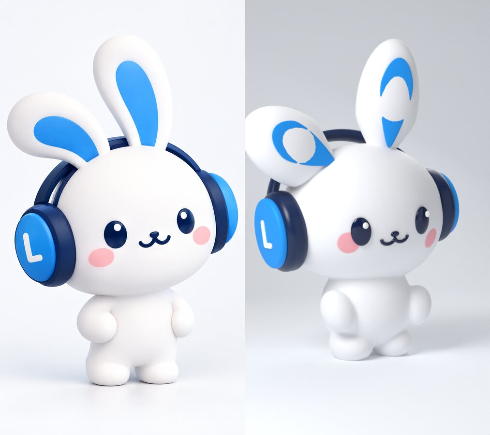
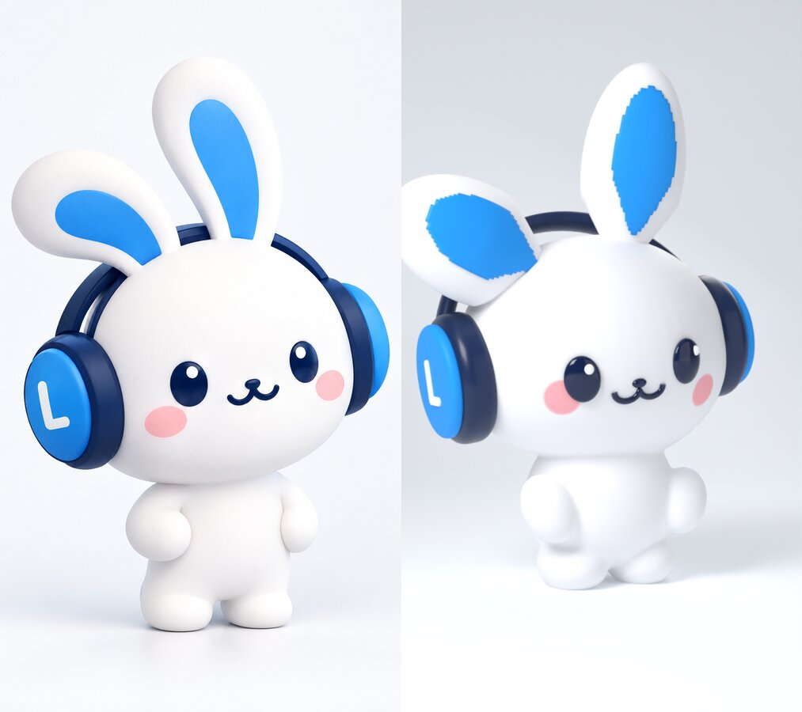
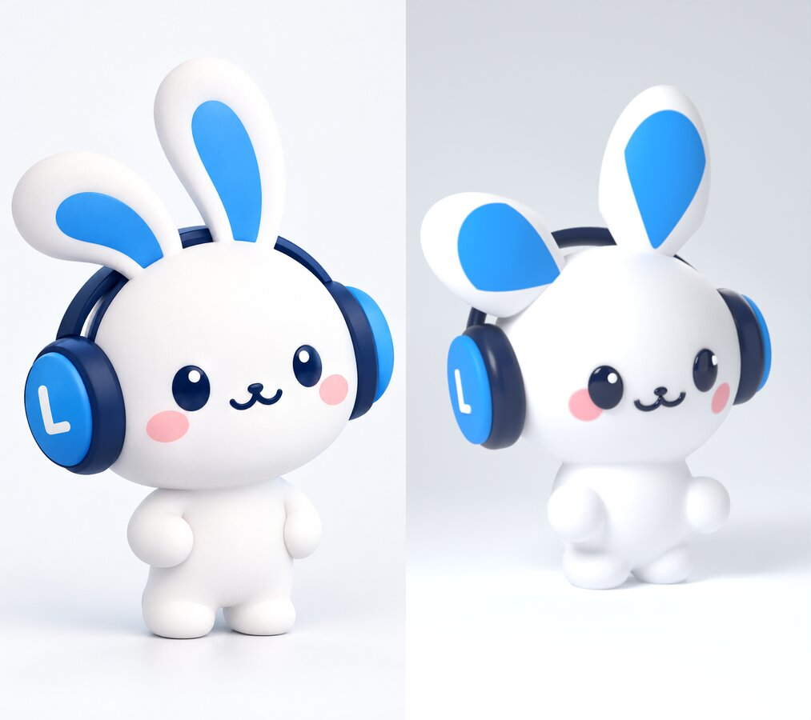

レビュー原文：[reviews/](reviews/)（往復1〜2は要約、3〜9と最終判定は原文）。プロンプト：[prompts/](prompts/)。

### レビューで学んだこと

- **AIのレビューは往復する**。構図・光・手の大きさは、前回と逆の提案が出始めた。2回反転したら判断者が値を固定し、プロンプトに「固定済み・壊れていない限り触れない」と書く。
- **依頼者の決定はプロンプトに書く**。書かないと、レビューが前の決定を覆そうとする。
- **数値つきで出させる**と、そのまま反映でき、採否も判断しやすい。
- **実バグを見つけることがある**（座標の取り違え、上限の効いていない計算）。レビューはコードも読ませる。
- **平らな模様はジオメトリでなくシェーダーで描く**（耳の内側、ほっぺ）。

## 7. 完成

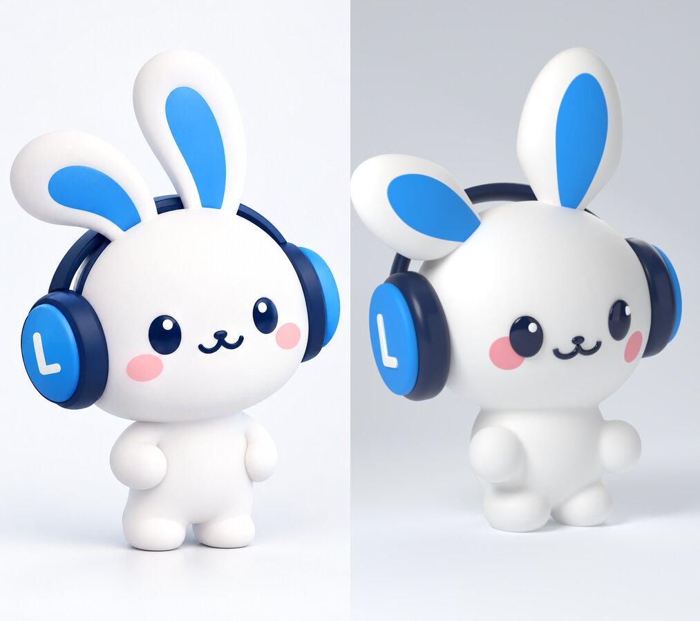
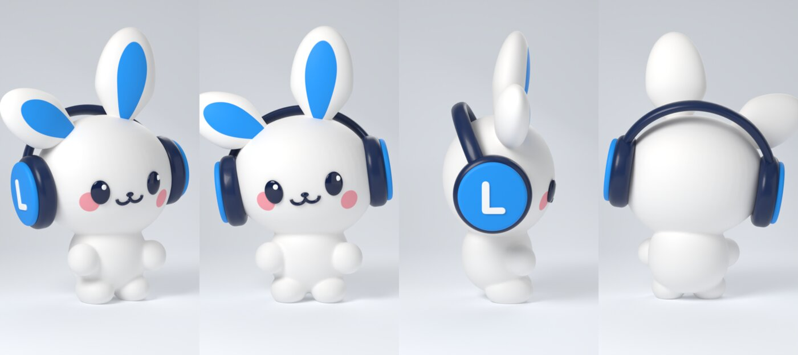

依頼者の言葉：

> めちゃくちゃいい。これをちゃんと正本として残そう。

骨組みの動作確認（跳ぶ・着地・手を振る）：

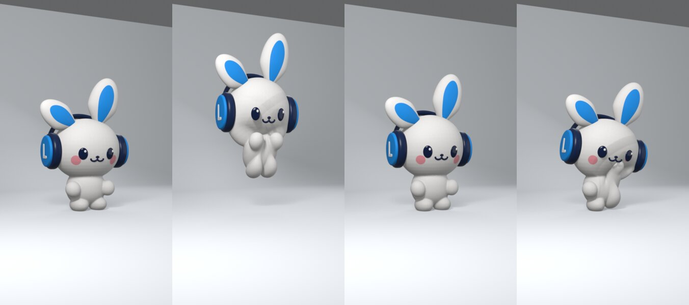

既知の制限：手を高く上げると肩が伸びる。演技のアップの前にウェイトを調整する。
