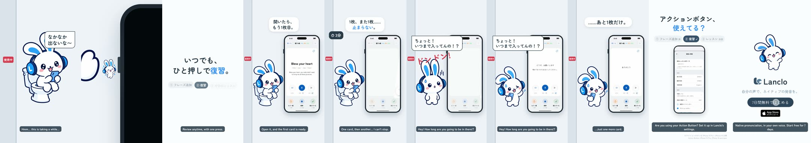

# Action Button ② — Start review (in the toilet)

**English** · [日本語](README.ja.md)

Part of the Action Button series (① Add a phrase, ② Start review, ③ Today's lesson; see [①](../mimi-action-add/README.md) for the shared hook, copy card and settings close). Mimi is stuck on the toilet ("なかなか出ないな〜"). One press on the Action Button, a tiny Mimi opens the screen, and review is already running: "Bless your heart" from ① comes up, then card after card while a clock races to 25 minutes, until someone bangs on the door: 「ちょっと！いつまで入ってんの！？」. "…Just one more card." Copy: 「いつでも、ひと押しで復習。」

0:16.8 / 1080×1920, 60 fps / two cuts: Japanese only, and with English subtitles / 2D Mimi beside a simulator recording / no voices (the Kokoro Japanese voice was garbled, so lines are speech bubbles)

Rebuild: [source/README.md](source/README.md). Process: [PROCESS.md](PROCESS.md). Credits: [CREDITS.md](CREDITS.md). Final MP4s in Lanclo's Google Drive `002.SNS/012. Action Button 2 - Start Review/`.
