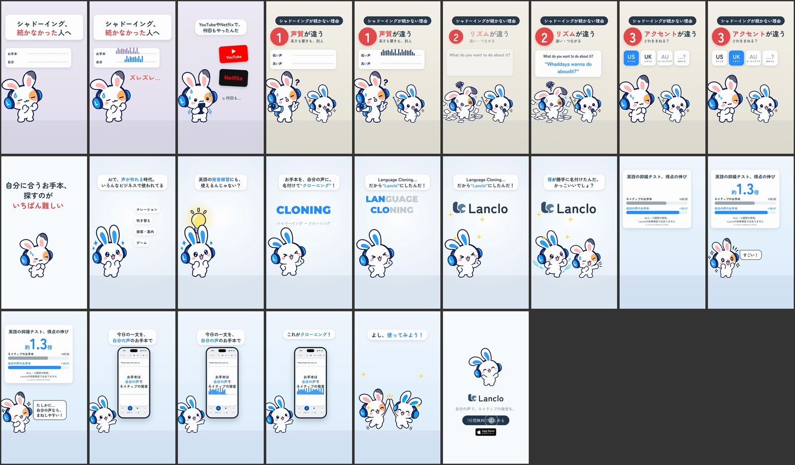

# クローニング：自分の声でするシャドーイング

[English](README.md) · **日本語**

**完成版（v3、2026-10-23、オーナー承認済み）。** シャドーイングが続かなかった人に向けた Lanclo の価値訴求（#067）。1フレーム目から「シャドーイング、続かなかった人へ」、お手本が先に進み友だちが遅れる2本のレーン（ズレズレ…）。赤いYouTubeと黒いNetflixのタイル（色だけ本物に似せ、ロゴなし）の横で友だち「YouTubeやNetflixで、何回もやったんだ。でも、難しかった…」。続かない理由を番号つきで（アクセントが最後）：1 声質（低い声と高い声）、2 リズム（速くつながる文、"Whaddaya wanna do aboudit?"）、3 アクセント（"I can't park the car." を US→UK、AU、…？ どれをまねる？）→「自分に合うお手本、探すのが いちばん難しい」。Mimiのひらめき：AIで声が作れる時代、いろんなビジネスで使われている、英語の発音練習にも使えるのでは？ 画面の SHADOWING に線が引かれて CLONING に書き換わる：「名付けて"クローニング"！」、続いて CLONING の上に LANGUAGE が落ち、LAN と CLO が残って Lanclo のロゴに：「Language Cloning…だから"Lanclo"にしたんだ！」「僕が勝手に名付けたんだ。かっこいいでしょ？」。LPと同じ文言の研究カード（英語の抑揚テスト、得点の伸び 約1.3倍。ネイティブのお手本 +65.52 / 自分の声のお手本 +86.61。66人・12週間の研究。Lancloの効果検証ではありません。Li, Lian & Yodkamlue 2020）、友だち「すごい！」「たしかに…自分の声なら、まねしやすい！」。実際のデイリーレッスンで自分の声のお手本、「これがクローニング！」「よし、使ってみよう！」、エンドカード。

0:35.6 / 1080×1920・60fps / 日本語のみと英語字幕つきの2本 / 2DのMimiと友だち（ライブラリのポーズのみ）、デイリーレッスンの新しいシミュレーター録画（QAフィクスチャ）/ 英語はすべてオーナーの登録済みLancloボイス

作り直し：[source/README.md](source/README.md)。制作の経緯：[PROCESS.md](PROCESS.md)。プロンプト：[PROMPT.md](PROMPT.md)。クレジット：[CREDITS.md](CREDITS.md)。完成版は Lanclo の Google ドライブ `002.SNS/067. Cloning - Shadowing but in Your Own Voice/`（`Cloning_2026-10-23.mp4`、`Cloning_EN-subs_2026-10-23.mp4`、録画と声は `Cloning_assets/`）。
