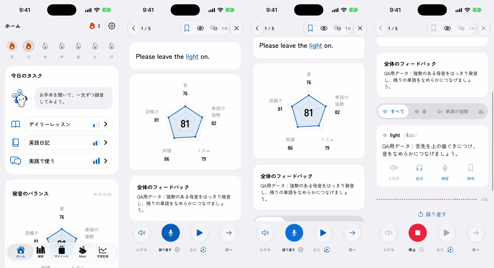
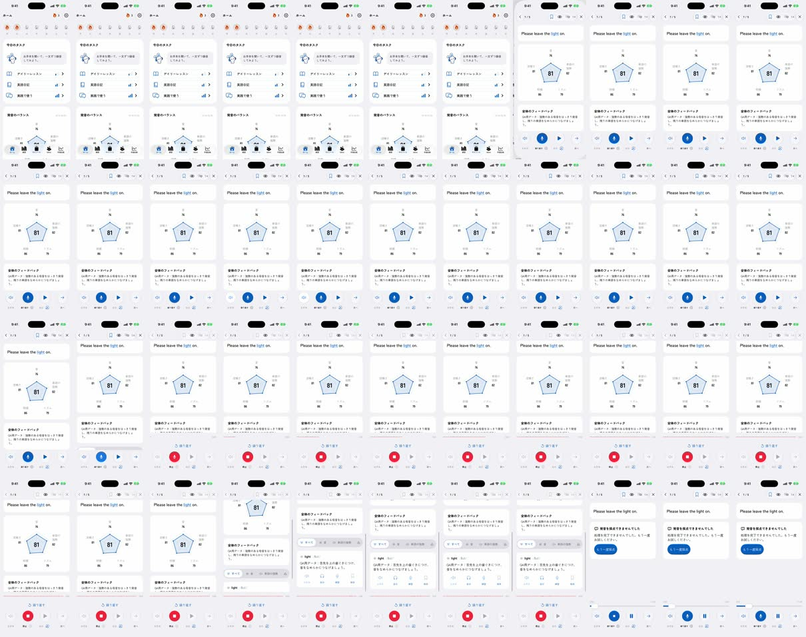

# 制作過程 — 「積読」（Mimiショート 6本目・デイリーレッスン・実画面）

アプリの中心機能、デイリーレッスンをMimiが実際に使う回の記録です。統合プロンプトは [PROMPT.md](PROMPT.md)。実画面の撮り方は5本目の [mimi-shashin/PROCESS.md](../mimi-shashin/PROCESS.md)。

- 制作日：2026-10-20
- 役割：Claude Code（構成・録画・演技・音・編集・判断）、Codex（`codex-p`：本の山の作画、レビュー）
- 道具：Xcode・iOSシミュレーター（XCUITest、`simctl io recordVideo`）、Rive CLI 1.6.0、HyperFrames 0.8.181、Kokoro TTS（のちにオーナー本人の声へ差し替え）、ffmpeg

## 1. 依頼

> じゃあ次はデイリーレッスンにしようか

（その前に依頼していたウィジェット・アクションボタンの回は、実機の画面録画が安定せず「一旦あとでやろうか」で保留。）

## 2. 話

デイリーレッスンの価値は「毎日やることが決まっていて、自分の声のお手本で練習でき、すぐ採点される」こと。悩みは、英語の本を買っても読まない「積読」にした。本の山が崩れる絵で1秒目に伝わり、「やることはアプリが決める」へつながる。

本の山は新しい小道具として、既存の絵柄（ノートの小道具）を渡してCodexに描かせた（[prompts/01-codex-book-tower.txt](prompts/01-codex-book-tower.txt)）。動きは編集側で付ける。

## 3. 画面を録る

録画の仕組みを共通キットに移してから最初の回。操作手順は `testDailyWalkthrough`：ホーム → デイリーレッスン → お手本 → 録音 → 採点 → 次へ。キャッシュの作り直しを含む初回ビルドで約15分、録画そのものは1分半。

途中で起きたこと：

- デモデータでは、録り直した後の採点が「発音を採点できませんでした」になる。録り直す前の画面（81点の採点と直す音）だけで組んだ。
- デモデータのフィードバックには「QA用データ」という文字が入る。依頼者の以前の指摘（「デモ表示」のような文字は出さない）に合わせ、白い目隠しで隠した。

Mimiの言い間違いはL/Rの1語だけ（"Please leave the right on."）。お手本はアプリの一文 "Please leave the light on." と同じにした。

## 4. レビュー

[prompts/02-codex-final-cut-review.txt](prompts/02-codex-final-cut-review.txt)、[reviews/final-cut-review.md](reviews/final-cut-review.md)、最初の編集：[process/04-first-cut-contact.jpg](process/04-first-cut-contact.jpg)

| 指摘 | 採否 |
|---|---|
| 冒頭で本が見えるまで遅い、字幕が小さい | 採用：最初から本の山を半分見せ、字幕を大きく |
| 「自分の声のお手本」がふつうの再生に見える | 採用：「自分の声が、ネイティブ発音のお手本に。」 |
| 録音の前に81点が見えている | 不採用：実際のアプリの画面配置。採点の場面で寄って見せる |
| スマホをもっと大きく | 不採用：5本目と同じ配置でシリーズをそろえる |
| 直す音のカードの文字が多い | 採用：「right → light／L は、舌先を上の歯ぐきに。」 |
| 目隠しが空のUIに見える | 不採用：周りの白いカードと同じ色で、再生中は目立たない |
| 「まねして、言うだけ。」 | 採用：「まねして、話すだけ。」 |

## 5. 承認と記録

> 一旦それで保存しておいて。

完成動画と、アプリの元の録画・切り出しをLancloのGoogle Drive（002.SNS/009. Unread Books - Daily Lesson、2026-10-21にNotionのIDごとのフォルダへ移動）に保管。台本はNotionのContent Calendarに。本の山はLancloの `design/mimi-2d/props/` に追加。

## 学んだこと

- 機能紹介の悩みは、絵1枚で伝わるもの（積読の山）にすると1秒目が強い。
- QA用デモデータには、2回目の操作に対応していない画面がある。録画の前にどこまで使えるかを確かめ、話をその範囲で組む。
- デモデータの文字は録画側では消せない。編集で隠す位置を切り出しごとに決める。

## 声をオーナー本人の声に（2026-10-21）

> 今まで英語で発音シーンがあった動画、この声で変えて。010以外。

- Kokoroの代役をやめ、学習者とお手本の英語を、Lancloに登録したオーナー本人の声（Gemini `gemini-3.8-flash-tts`、`kits/mimi-short/scripts/ownvoice.py`）に差し替えた。Kokoroはほかの登場人物だけに残す。
- お手本 "Please leave the light on." は `us`、Mimiの言い間違い "Please leave the right on." は `learner`。1回目の言い間違いは "light" と聞こえてしまい（R/Lの混同がLの側に出た）、長さも2.5秒あったため、"right" をはっきりRで、テンポよく、という指示で作り直し。
- 実際の長さに合わせて時間を組み直した（15秒→15.2秒）：お手本は3.75–4.90秒。録音の場面を0.25秒早めて（5.35秒、タップ5.45秒）発話5.71–7.59秒が採点の前に収まるようにし、採点以降を0.2秒後ろへ。録音中の録画は51.0–53.8秒に延長。口パクは新しい声から作り直し。
- 声のWAVは本人の生体データなので、公開リポジトリには入れない。Gitには `source/own-voice.json`（文とアクセント）と `own-voice.receipt.json`（文・指示・ハッシュ。声IDなし）だけ。WAVはDriveの `Mimi_06_Unread_Books_assets/own-voice/`。
