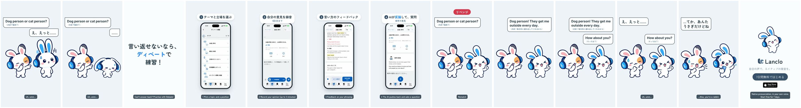

# 英語で言い負かされた — 2D Mimiショート

[English](README.md) · **日本語**

友だちに英語で「Dog person or cat person?」と詰められ、Mimiは答えられずにしぼむ。コピーカード「言い返せないなら、ディベートで練習！」のあと、Lancloのディベート練習の実画面（シミュレーター）：テーマ（お金と幸せ）と立場（賛成）を選ぶ → 自分の意見を録音（1回3分まで）→ 言い方のフィードバック → AIが反対の意見と質問を返す → 返答を録音。リベンジ：同じ質問にMimiは理由つきで即答し「How about you?」と聞き返す。今度は友だちが言葉に詰まり、「…てか、あんたうさぎだけどね」。

0:19.75 / 1080×1920・60fps / 日本語の吹き出し・字幕、英語の台詞（Kokoro）/ 公式2Dポーズ＋GSAP、実アプリ（シミュレーター・QA用データ）＋HyperFrames

2本：日本語のみ（`mimi-debate.mp4`）と英語字幕つき（`mimi-debate-en.mp4`）。下書きはLancloのGoogleドライブ `002.SNS/019. Lost an Argument in English/`（`Debate_draft_2026-10-21.mp4`、`Debate_draft_EN-subs_2026-10-21.mp4`、録画の原本は `Debate_assets/`）。

「勝ち」はコントの場面だけ。アプリは勝ち負けを決めず、意見の正しさも判定しません。

## ファイル

- [PROCESS.md](PROCESS.md)：オーナーの指示と判断
- [PROMPT.md](PROMPT.md)：作り直すための統合プロンプト
- [prompts/](prompts/)：生成に使った入力（英語の台詞。新しいポーズは描いていない）
- [source/](source/README.md)：アプリ録画（操作スクリプト＋録画専用パッチ）、声、音、HyperFrames編集、書き出し手順
- [CREDITS.md](CREDITS.md)：素材と権利
