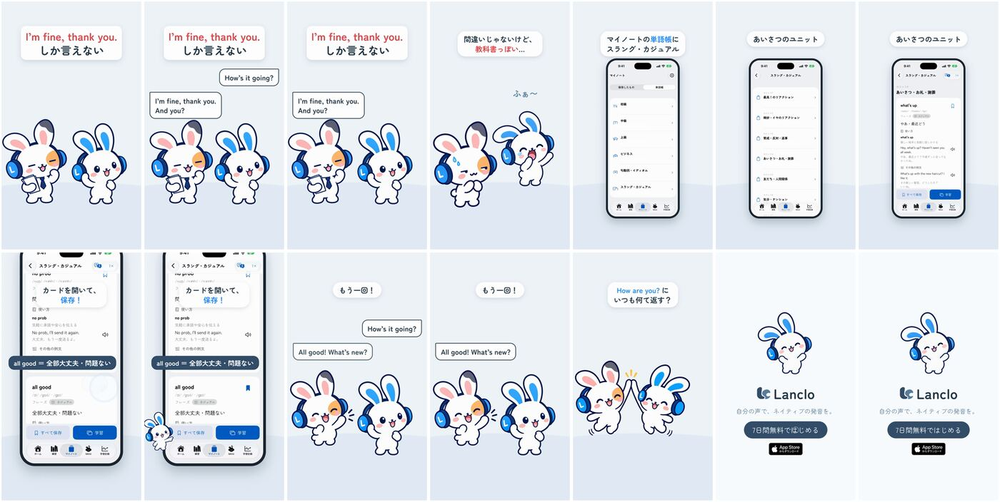

# 「I'm fine, thank you.」の先へ — 2D Mimiショート（ドラフト）

[English](README.md) · **日本語**

状態：**レビュー用ドラフト**（2026-10-23）。

1フレーム目からフック「I'm fine, thank you. しか言えない」。Mimiが「How's it going?」（吹き出し）と聞き、友だちは教科書どおりのロボット口調で「I'm fine, thank you. And you?」（オーナー本人の登録音声）。Mimiはあくび、「間違いじゃないけど、教科書っぽい…」。実際のアプリ（シミュレーター、同梱の単語帳データ）：マイノート → 単語帳 → スラング・カジュアル → ユニット4 あいさつ・お礼・謝罪 → 「all good」（全部大丈夫・問題ない）のカード → 保存。友だちは単語帳に本当にある言い方でやり直し「All good! What's new?」（all good も what's new もユニット4のカード）、ハイタッチ。コメント誘導「How are you? にいつも何て返す？」。エンドカードとCTAのタップ。

0:18.0 / 1080×1920・60fps / 英語2行はオーナーの声、日本語は字幕と吹き出し / 公式2DポーズとGSAP、実アプリ（シミュレーター）＋HyperFrames

Notion Content Calendar ID 065。日本語のみ（`mimi-decks-fine.mp4`）と英語字幕つき（`mimi-decks-fine-en.mp4`）の2本。ドラフトはLancloのGoogleドライブ `002.SNS/065. Beyond Im Fine Thank You/`（`Decks_ImFine_draft_2026-10-23.mp4`、`Decks_ImFine_draft_EN-subs_2026-10-23.mp4`、録画と声のWAVは `Decks_ImFine_assets/`）。

## ファイル

- [PROCESS.md](PROCESS.md)：オーナーの言葉、機能の確認、判断。
- [PROMPT.md](PROMPT.md)：作り直すための統合プロンプト。
- [prompts/](prompts/)：新しいポーズ2つのCodexプロンプトとログ。
- [source/](source/README.md)：アプリ録画、声、音、HyperFramesの編集、手順。
- [CREDITS.md](CREDITS.md)：素材と権利。
