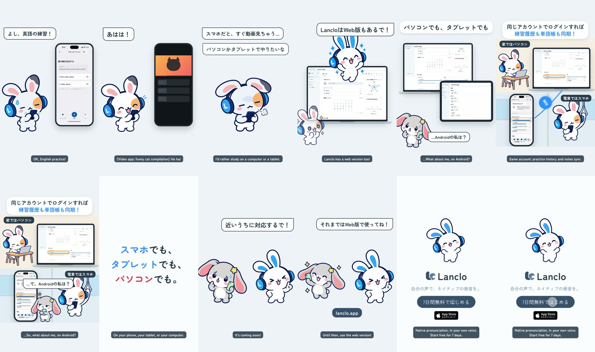

# Phone, tablet or computer — a 2D Mimi short

**English** · [日本語](README.ja.md)

Mimi's friend tries to study on her phone, a video app's notification pulls her away (「あはは！」), and she admits she'd rather study on a computer or a tablet. Mimi bursts out of a laptop screen: Lanclo has a web version (lanclo.app). The real Web app on a computer and a tablet, then the same account at home on the computer and on the train on the phone: the same "And then" habit shows on both, linked by a sync swoosh (「同じアカウントでログインすれば 練習履歴も単語帳も同期！」). Copy card 「スマホでも、タブレットでも、パソコンでも。」. A second friend, a grey lop-eared bunny in the same Lanclo headphones with a mint-green phone, keeps asking 「…Androidの私は？」 three times; Mimi finally promises 「近いうちに対応するで！」「それまではWeb版で使ってね！」 (Android is planned, no date). End card.

0:20.0 / 1080×1920, 60 fps / Japanese speech bubbles and captions / official 2D poses + GSAP, real Web app (local dev server, fixture data) and a real iOS frame + HyperFrames

Two cuts: Japanese only (`mimi-devices.mp4`) and with English subtitles (`mimi-devices-en.mp4`); final files in Lanclo's Google Drive `002.SNS/026. Phone, Tablet or Computer/` (`Devices_2026-10-21.mp4`, `Devices_EN-subs_2026-10-21.mp4`, screen captures in `Devices_assets/`).

## Files

- [PROCESS.md](PROCESS.md) (Japanese): the owner's directions and the decisions.
- [PROMPT.md](PROMPT.md) (Japanese): a consolidated instruction to remake it.
- [prompts/](prompts/): the Codex prompts for the six new poses, the headphone redraw of the lop-eared friend, and their logs.
- [source/](source/README.md): Web capture scripts, screens, poses, sound, HyperFrames edit, build steps.
- [CREDITS.md](CREDITS.md): materials and rights.
