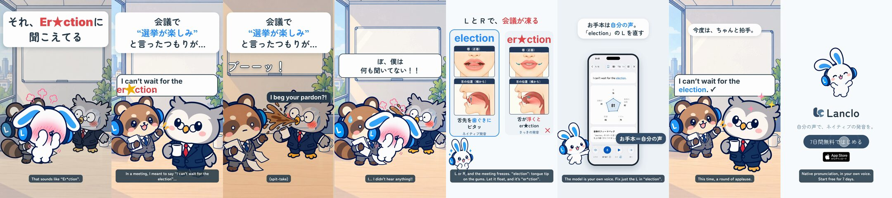

# Pronunciation Disasters 4 - Election / Erection

[日本語](README.ja.md)

Lanclo SNS short #040 (series “Pronunciation Disasters”, episode 4). 20.0 s, 1080×1920, 60 fps, two cuts (Japanese only / English subtitles). Draft, not yet approved.

Scene: a meeting: a tanuki office worker means “I can’t wait for the election” and says “erection”; the owl boss does a coffee spit-take. Mimi slides in, blushing, peeking through her mittens: 「ぼ、僕は何も聞いてない！！」.

Format: the pilot's series template ([mimi-disaster-sit](../mimi-disaster-sit/), branch `feat/mimi-disaster-sit`): punchline first (Mimi's line on frame 1, then a rewind) → the situation hook → the slip → freeze with a quiet record scratch → Mimi pops up → comparison card with the two takes in the owner's own voice and illustrated panels (唇（正面） / 舌の位置（横から）) → a tiny real Lanclo moment → fixed → end card + CTA tap.

| Time (s) | Beat |
|---|---|
| 0.00–1.50 | Punchline first: Mimi's line (それ、Er★ctionに 聞こえてる) over the frozen scene, then ◀◀ rewind |
| 1.50–4.70 | Hook card (the situation) + the scene; the learner's line (owner's voice, `learner` style) from 1.85, the wrong word lands at 3.60 |
| 4.70–6.64 | Freeze: quiet record scratch, the music stops, the listener's reaction pose + Kokoro line at 5.00 |
| 6.64–8.29 | Mimi pops up (slide) and yells |
| 8.29–11.98 | Comparison card: the slip (owner, learner take, word only) at 8.89, the native take (owner, `us`) at 10.47; mouth tips |
| 11.98–16.08 | Real Lanclo lesson (simulator, fixture data): お手本 tapped at 12.58, the native sentence in the owner's voice |
| 16.08–18.73 | Fixed: the line said right, everyone happy |
| 18.73–20.03 | End card, CTA tap at 19.33 |

- Voices: the learner and model takes are the owner's (Tetsuya's) registered Lanclo voice via `kits/mimi-short/scripts/ownvoice.py` (Gemini gemini-3.8-flash-tts); the WAVs are biometric data and are not in Git (Drive `040. Pronunciation Disasters 4 - Election or Erection/Disasters4_Election_assets/own-voice/`). The other character is Kokoro English (`source/assets/voice/`).
- On screen the rude word is always censored with ★; it is audible in the audio (that is the joke).

- Drafts in Lanclo's Google Drive `002.SNS/040. Pronunciation Disasters 4 - Election or Erection/` (`Disasters4_Election_draft_2026-10-21.mp4`, `Disasters4_Election_draft_EN-subs_2026-10-21.mp4`, raw material in `Disasters4_Election_assets/`).
- Rebuild: [source/README.md](source/README.md). Making-of: [PROCESS.md](PROCESS.md). Prompt: [PROMPT.md](PROMPT.md). Credits: [CREDITS.md](CREDITS.md).
