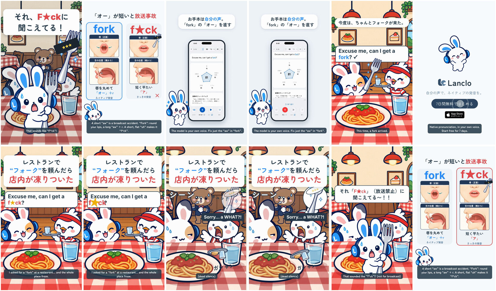

# Pronunciation Disasters 10 - Fork / F*ck

[日本語](README.ja.md)

Lanclo SNS short #051 (series “Pronunciation Disasters”, episode 10). Draft. 18.55 s, 1080×1920, 60 fps, two cuts (Japanese only / English subtitles).

Scene: a cosy family restaurant. Mimi’s Friend raises a hand and calls Pippa (the recurring duck, here a waiter): “Excuse me, can I get a fork?”, but “フォーク” comes out short and flat, a /ʌ/ with no r, so it lands as the F-word. The whole restaurant freezes (Bruno at the next table stops mid-spoon), Pippa drops her tray: “Sorry… a WHAT?!”. Mimi drops in holding a giant fork: 「それ「F★ck」（放送禁止）に聞こえてる〜！！」. Gag object: a giant fork with a censor bar of stars.

Format: the pilot's series template ([mimi-disaster-sit](../mimi-disaster-sit/)), built from episode 5's source ([mimi-disaster-coke](../mimi-disaster-coke/)): punchline first → rewind → hook → slip → freeze → Mimi → comparison card → real Lanclo lesson → fixed → end card + CTA tap. The cast stand behind the restaurant table (the plate's lower part is drawn again in front of them, `#table-front`).

| Time (s) | Beat |
|---|---|
| 0.00–1.50 | Punchline first: 「それ、F★ckに 聞こえてる！」 over the frozen scene, Mimi with a giant fork, the censored fork gag, ◀◀ rewind at 1.1 |
| 1.50–4.50 | Hook 「レストランで “フォーク”を頼んだら 店内が凍りついた」; the Friend's line (owner's voice, learner take) from 1.75, the wrong word's vowel at 4.00 |
| 4.50–6.30 | Freeze: record scratch, Pippa drops the tray (soft clang 4.92), Bruno frozen at the next table, Pippa (Kokoro) “Sorry… a WHAT?!” at 4.80, 「シーン…」 |
| 6.30–7.95 | Mimi drops in with the giant fork and yells |
| 7.95–11.05 | Card 「唇を丸めないと放送事故」: f★ck (短く平たい「ア」, learner take at 8.55) vs fork (唇を丸めて「オー」＋r, native take at 9.85); lips (front) and tongue (side) panels |
| 11.05–14.95 | Real Lanclo daily lesson (simulator, fixture data, capture-only patch): お手本 tapped at 11.65, the sound to fix in “fork” |
| 14.95–17.25 | Fixed: the line said right (native take), a fork arrives |
| 17.25–18.55 | End card, CTA tap at 17.85 |

- Voices: the learner and model takes are the owner's registered Lanclo voice via `kits/mimi-short/scripts/ownvoice.py`; the WAVs are biometric data and not in Git (Drive `051. Pronunciation Disasters 10 - Fork or Fck/Disasters10_Fork_assets/own-voice/`). Pippa's line is Kokoro English (`af_nicole`, `source/assets/voice/`).
- On screen the rude word is always censored with ★; it is audible in the audio (that is the joke).
- The slip was checked by measurement, not Whisper: see [PROCESS.md](PROCESS.md).

- Draft files in Lanclo's Google Drive `002.SNS/051. Pronunciation Disasters 10 - Fork or Fck/` (`Disasters10_Fork_draft_2026-10-22.mp4`, `Disasters10_Fork_draft_EN-subs_2026-10-22.mp4`, raw material in `Disasters10_Fork_assets/`).
- Rebuild: [source/README.md](source/README.md). Making-of: [PROCESS.md](PROCESS.md). Prompt: [PROMPT.md](PROMPT.md). Credits: [CREDITS.md](CREDITS.md).
