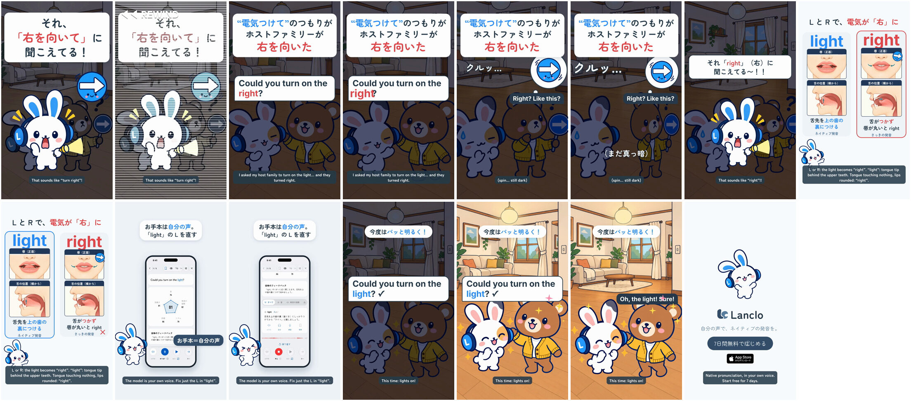

# Pronunciation Disasters 11 - Light / Right

[日本語](README.ja.md)

Lanclo SNS short #052 (series "Pronunciation Disasters", episode 11). 19.75 s, 1080×1920, 60 fps, two cuts (Japanese only / English subtitles).

Scene: at Bruno's home (the recurring bear as the host dad) the room is dark. Mimi's Friend asks "Could you turn on the light?" and it comes out as "turn on the right". Bruno, puzzled, obediently turns RIGHT, holding a right-arrow sign, again and again: still dark. Mimi pops up with a flashlight: 「それ「right」（右）に聞こえてる〜！！」. When the line is said right, the light comes on.

Format: the series template ([mimi-disaster-sit](../mimi-disaster-sit/README.md#series-template-episodes-26)), closest variant [mimi-disaster-rice](../mimi-disaster-rice/) (same L/R pair, reversed: here the target is L).

| Time (s) | Beat |
|---|---|
| 0.00–1.50 | Punchline first: 「それ、「右を向いて」に聞こえてる！」 over the dark frozen scene, Mimi with a flashlight, the kawaii right-arrow sign; ◀◀ rewind at 1.1 |
| 1.50–4.90 | Hook card 「“電気つけて”のつもりが ホストファミリーが 右を向いた」; the learner line (owner's voice, custom learner style) from 1.6, "right" lands at 4.32 |
| 4.90–6.55 | Record scratch, the bed stops; Bruno turns right three times (Kokoro "Right? Like this?" at 5.15), 「クルッ…」「（まだ真っ暗）」 |
| 6.55–8.20 | Mimi spins in with a flashlight and yells |
| 8.20–11.40 | Card 「L と R で、電気が「右」に」: right (slip, learner take at 8.8) vs light (model, `us` take at 10.1); lips (front) / tongue (side) panels |
| 11.40–15.55 | Real Lanclo daily lesson on "Could you turn on the light?" (simulator, capture-only patch): お手本 tap at 12.0, record at 13.37, the flagged word "light /l/" |
| 15.55–18.45 | Said right (owner, `us`), the light comes on at 16.4, Bruno: "Oh, the light! Sure!" |
| 18.45–19.75 | End card, CTA tap at 19.05 |

- Voices: learner and model takes are the owner's registered Lanclo voice via `kits/mimi-short/scripts/ownvoice.py`; WAVs not in Git (Drive `052. Pronunciation Disasters 11 - Light or Right/Disasters11_Light_assets/own-voice/`). Bruno: Kokoro `am_michael` (`source/assets/voice/`).
- Mouth panels (r, l) are reused from episode 3 ([mimi-disaster-rice](../mimi-disaster-rice/)): L = tongue tip on the ridge behind the upper teeth; R = tongue touches nothing, lips slightly rounded.

- Final files in Lanclo's Google Drive `002.SNS/052. Pronunciation Disasters 11 - Light or Right/` (`Disasters11_Light_2026-10-22.mp4`, `Disasters11_Light_EN-subs_2026-10-22.mp4`, raw material in `Disasters11_Light_assets/`).
- Rebuild: [source/README.md](source/README.md). Making-of: [PROCESS.md](PROCESS.md). Prompt: [PROMPT.md](PROMPT.md). Credits: [CREDITS.md](CREDITS.md).
