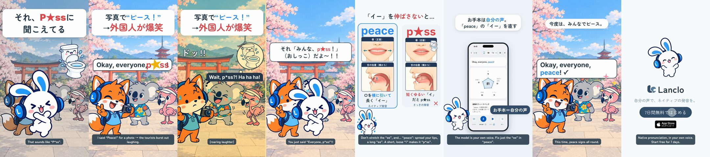

# Pronunciation Disasters 6 - Peace / P*ss

[日本語](README.ja.md)

Lanclo SNS short #042 (series “Pronunciation Disasters”, episode 6). 19.6 s, 1080×1920, 60 fps, two cuts (Japanese only / English subtitles). Draft, not yet approved.

Scene: a sightseeing spot: a fox tourist says “Okay, everyone, peace!” for a photo and it comes out as “piss”; the koala and flamingo burst out laughing. Mimi photobombs the shot with a camera flash.

Format: the pilot's series template ([mimi-disaster-sit](../mimi-disaster-sit/), branch `feat/mimi-disaster-sit`): punchline first (Mimi's line on frame 1, then a rewind) → the situation hook → the slip → freeze with a quiet record scratch → Mimi pops up → comparison card with the two takes in the owner's own voice and illustrated panels (唇（正面） / 舌の位置（横から）) → a tiny real Lanclo moment → fixed → end card + CTA tap.

| Time (s) | Beat |
|---|---|
| 0.00–1.50 | Punchline first: Mimi's line (それ、P★ssに 聞こえてる) over the frozen scene with the cute “what they heard” gag, then ◀◀ rewind |
| 1.50–4.88 | Hook card (the situation) + the scene; the learner's line (owner's voice, `learner` style) from 1.85, the wrong word lands at 4.10 |
| 4.88–6.88 | Freeze: quiet record scratch, the music stops, the listener's reaction pose + Kokoro line at 5.18 |
| 6.88–8.53 | Mimi pops up (photobomb) and yells |
| 8.53–11.70 | Comparison card: the slip (owner, learner take, word only) at 9.13, the native take (owner, `us`) at 10.39; mouth tips |
| 11.70–15.90 | Real Lanclo lesson (simulator, fixture data): お手本 tapped at 12.30, the native sentence in the owner's voice |
| 15.90–18.31 | Fixed: the line said right, everyone happy |
| 18.31–19.61 | End card, CTA tap at 18.91 |

- Voices: the learner and model takes are the owner's (Tetsuya's) registered Lanclo voice via `kits/mimi-short/scripts/ownvoice.py` (Gemini gemini-3.8-flash-tts); the WAVs are biometric data and are not in Git (Drive `042. Pronunciation Disasters 6 - Peace or Pss/Disasters6_Peace_assets/own-voice/`). The other character is Kokoro English (`source/assets/voice/`).
- On screen the rude word is always censored with ★; it is audible in the audio (that is the joke).

- Drafts in Lanclo's Google Drive `002.SNS/042. Pronunciation Disasters 6 - Peace or Pss/` (`Disasters6_Peace_draft_2026-10-21.mp4`, `Disasters6_Peace_draft_EN-subs_2026-10-21.mp4`, raw material in `Disasters6_Peace_assets/`).
- Rebuild: [source/README.md](source/README.md). Making-of: [PROCESS.md](PROCESS.md). Prompt: [PROMPT.md](PROMPT.md). Credits: [CREDITS.md](CREDITS.md).
