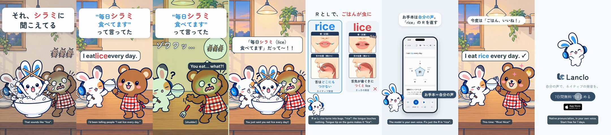

# Pronunciation Disasters 3 - Rice / Lice

[日本語](README.ja.md)

Lanclo SNS short #039 (series “Pronunciation Disasters”, episode 3). 19.2 s, 1080×1920, 60 fps, two cuts (Japanese only / English subtitles). Draft, not yet approved.

Scene: a homestay dinner: Mimi’s Friend proudly says “I eat rice every day” and it comes out as “lice”; Bruno (the recurring bear) as the host dad recoils, scratching his head. Mimi bursts out of a rice bowl with crossed chopsticks.

Format: the pilot's series template ([mimi-disaster-sit](../mimi-disaster-sit/), branch `feat/mimi-disaster-sit`): punchline first (Mimi's line on frame 1, then a rewind) → the situation hook → the slip → freeze with a quiet record scratch → Mimi pops up → comparison card with the two takes in the owner's own voice and illustrated panels (唇（正面） / 舌の位置（横から）) → a tiny real Lanclo moment → fixed → end card + CTA tap.

| Time (s) | Beat |
|---|---|
| 0.00–1.50 | Punchline first: Mimi's line (それ、シラミに 聞こえてる) over the frozen scene with the cute “what they heard” gag, then ◀◀ rewind |
| 1.50–5.03 | Hook card (the situation) + the scene; the learner's line (owner's voice, `learner` style) from 1.85, the wrong word lands at 2.66 |
| 5.03–6.71 | Freeze: quiet record scratch, the music stops, the listener's reaction pose + Kokoro line at 5.33 |
| 6.71–8.36 | Mimi pops up (spin) and yells |
| 8.36–11.49 | Comparison card: the slip (owner, learner take, word only) at 8.96, the native take (owner, `us`) at 10.26; mouth tips |
| 11.49–15.64 | Real Lanclo lesson (simulator, fixture data): お手本 tapped at 12.09, the native sentence in the owner's voice |
| 15.64–17.93 | Fixed: the line said right, everyone happy |
| 17.93–19.23 | End card, CTA tap at 18.53 |

- Voices: the learner and model takes are the owner's (Tetsuya's) registered Lanclo voice via `kits/mimi-short/scripts/ownvoice.py` (Gemini gemini-3.8-flash-tts); the WAVs are biometric data and are not in Git (Drive `039. Pronunciation Disasters 3 - Rice or Lice/Disasters3_Rice_assets/own-voice/`). The other character is Kokoro English (`source/assets/voice/`).
- On screen the rude word is always censored with ★; it is audible in the audio (that is the joke).

- Drafts in Lanclo's Google Drive `002.SNS/039. Pronunciation Disasters 3 - Rice or Lice/` (`Disasters3_Rice_draft_2026-10-21.mp4`, `Disasters3_Rice_draft_EN-subs_2026-10-21.mp4`, raw material in `Disasters3_Rice_assets/`).
- Rebuild: [source/README.md](source/README.md). Making-of: [PROCESS.md](PROCESS.md). Prompt: [PROMPT.md](PROMPT.md). Credits: [CREDITS.md](CREDITS.md).
