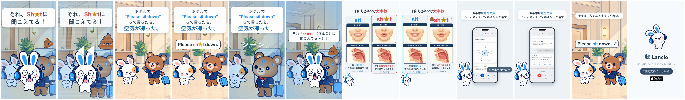

# 発音ディザスター 1 — Sit / Sh*t

[English](README.md) · **日本語**

シリーズ「発音ディザスター」（1音ちがいでとんでもない勘違い）のパイロット。1フレーム目はオチから：凍ったお客さんの前でミミが「それ、Sh★tに聞こえてる！」と叫び、かわいいうんこが跳ねる → ◀◀ 巻き戻して経緯へ。ホテルのロビーでミミの友だちが海外のお客さん（クマ）に親切に席をすすめて "Please sh*t down." 。レコードスクラッチ、お客さんが氷漬けで「シーン…」。ミミが飛び出して「それ「sh★t」（うんこ）に聞こえてる〜！！」。カード1枚で sit と sh★t を、唇（正面）と舌の位置（横からの断面）の2枚ずつのイラストパネルで比べ、オーナーの声の2テイクで聞き比べ。実際の Lanclo デイリーレッスン（"Please sit down." のスコアと「sit」の直す音）→ 言い直してお客さんが座る → エンドカード＋CTAタップ。

0:18.7 / 1080×1920, 60fps / 日本語のみ版と英語字幕版 / 公式2Dスタイル（ポーズとロビーは Codex）+ HyperFrames / 声：オーナーの登録済み Lanclo の声（Gemini `gemini-3.8-flash-tts`）

単語は音声では聞こえる（それがオチ）、画面では星で伏せ字「sh★t」。

再現：[source/README.md](source/README.md)。制作過程：[PROCESS.md](PROCESS.md)。プロンプト：[PROMPT.md](PROMPT.md)。クレジット：[CREDITS.md](CREDITS.md)。ドラフトは Lanclo の Google Drive `002.SNS/037. Pronunciation Disasters 1 - Sit or Sht/`。

シリーズのテンプレート（2〜6話）は [README.md](README.md#series-template-episodes-26) の表を参照。ミミの日本語の一人称は「僕」。
