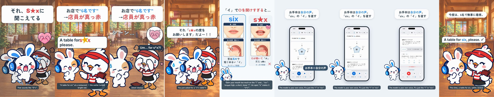

# Pronunciation Disasters 7 - Six / S*x

[日本語](README.ja.md)

Lanclo SNS short #048 (series “Pronunciation Disasters”, episode 7). 20.0 s, 1080×1920, 60 fps, two cuts (Japanese only / English subtitles).

Scene: a restaurant entrance: Mimi’s Friend tells Pippa the host “A table for six, please.” with the i opened toward /e/, and it lands as “sex”. Pippa freezes, blushing, covering her eyes. Mimi jumps in, blushing too.

Format: the pilot's series template ([mimi-disaster-sit](../mimi-disaster-sit/)), copied from episode 6 ([mimi-disaster-peace](../mimi-disaster-peace/)): punchline first → rewind → the situation hook → the slip → freeze with a quiet record scratch → Mimi pops up → comparison card with the two takes in the owner's own voice and illustrated panels (唇（正面） / 舌の位置（横から）) → a tiny real Lanclo moment → fixed → end card + CTA tap.

| Time (s) | Beat |
|---|---|
| 0.00–1.50 | Punchline first: Mimi's line (それ、S★xに 聞こえてる) over the frozen scene with the shy-heart gag, then ◀◀ rewind |
| 1.50–4.88 | Hook card (お店で“6名です” →店員が真っ赤) + the scene; the learner's line (owner's voice) from 1.85, the wrong word lands at 3.45 |
| 4.88–7.31 | Freeze: quiet record scratch, the music stops, Pippa covers her eyes, 「シーン…」, her Kokoro line at 5.18 |
| 7.31–8.96 | Mimi jumps in, blushing: それ「s★xの席を お願いします」だよ〜！！ |
| 8.96–12.13 | Comparison card: the slip (learner take, word only) at 9.56, the native “six” (owner, `us`) at 10.82; /ɪ/ vs /ɛ/ panels |
| 12.13–16.33 | Real Lanclo lesson (simulator, fixture data): お手本 tapped at 12.73, the native sentence in the owner's voice |
| 16.33–18.74 | Fixed: the line said right, everyone happy |
| 18.74–20.04 | End card, CTA tap at 19.34 |

- Voices: the learner and model takes are the owner's (Tetsuya's) registered Lanclo voice via `kits/mimi-short/scripts/ownvoice.py`; the learner take's vowel was edited to a real /ɛ/ (see [PROCESS.md](PROCESS.md)). The WAVs are biometric data and are not in Git (Drive `048. Pronunciation Disasters 7 - Six or Sx/Disasters7_Six_assets/own-voice/`). Pippa is Kokoro English (`source/assets/voice/`).
- On screen the rude word is always censored with ★; it is audible in the audio (that is the joke).
- Final files in Lanclo's Google Drive `002.SNS/048. Pronunciation Disasters 7 - Six or Sx/` (`Disasters7_Six_2026-10-22.mp4`, `Disasters7_Six_EN-subs_2026-10-22.mp4`, raw material in `Disasters7_Six_assets/`).

- Rebuild: [source/README.md](source/README.md). Making-of: [PROCESS.md](PROCESS.md). Prompt: [PROMPT.md](PROMPT.md). Credits: [CREDITS.md](CREDITS.md).
