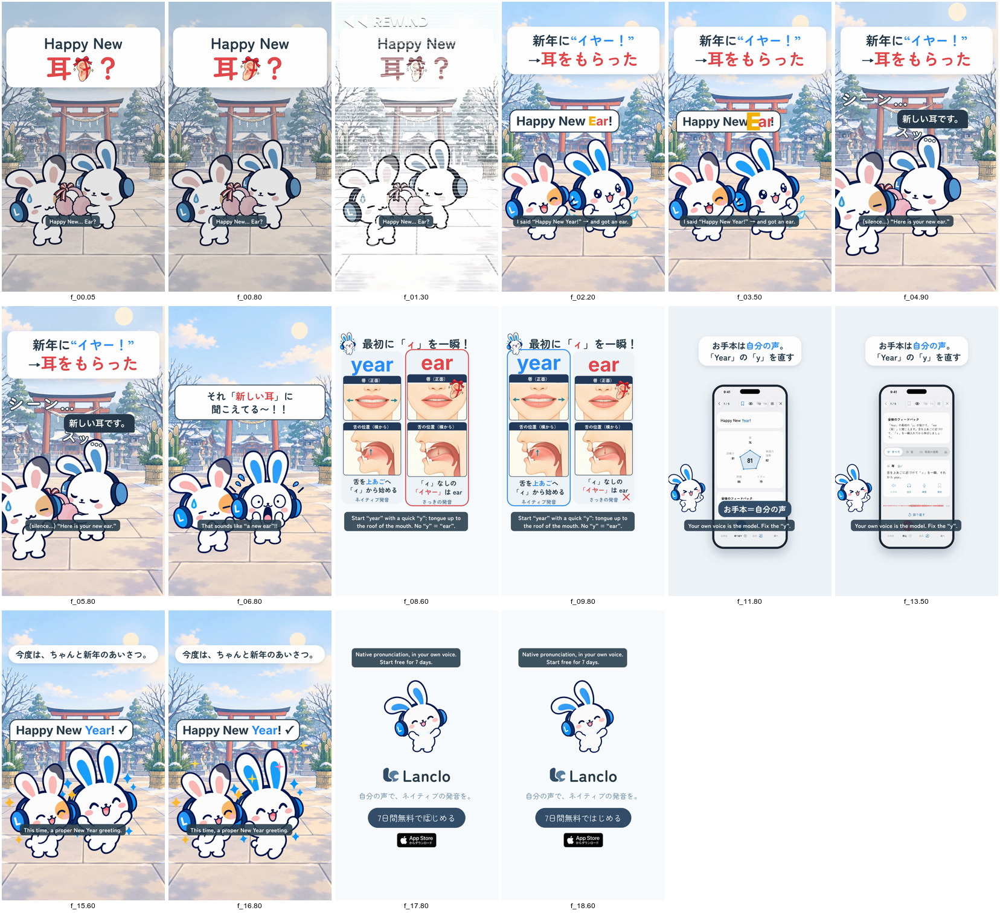

# Pronunciation Disasters 15 - Year / Ear

[日本語](README.ja.md)

Lanclo SNS short #057 (series “Pronunciation Disasters”, episode 15). Final, owner approved on 2026-10-23. 18.8 s, 1080×1920, 60 fps, two cuts (Japanese only / English subtitles). Planned for late December.

Scene: New Year's morning at a snowy shrine. Mimi's Friend waves, “Happy New Year!”, but the katakana 「イヤー」 drops the y glide: “Happy New Ear!”. The air freezes; Mimi bows and solemnly holds out a pair of pink earmuffs (「新しい耳です。」). Then Mimi pops up: 「それ「新しい耳」に聞こえてる〜！！」. Cast: Mimi and the Friend only.

| Time (s) | Beat |
|---|---|
| 0.00–1.50 | Punchline first: 「Happy New 耳（ear icon）？」 over Mimi handing the Friend earmuffs; ◀◀ rewind at 1.1 |
| 1.50–4.20 | Hook card (新年に“イヤー！” →耳をもらった) + the scene; the learner line (owner's voice) from 2.0, “Ear” lands at 3.38 |
| 4.20–6.30 | Freeze: record scratch, Mimi holds out the earmuffs (スッ…), 「シーン…」, 「新しい耳です。」 |
| 6.30–7.90 | Mimi pops up: 「それ「新しい耳」に聞こえてる〜！！」 |
| 7.90–10.90 | Card 最初に「ィ」を一瞬！: ear (learner take) at 8.5, year (owner, `us`) at 9.6; mouth panels /j/ onset (tongue up to the palate) vs a bare 「イ」 |
| 10.90–15.10 | Real Lanclo daily lesson on “Happy New Year!” (simulator, fixture data), お手本 tapped at 11.5 |
| 15.10–17.51 | Fixed: “Happy New Year!”, both jump for joy |
| 17.51–18.81 | End card, CTA tap at 18.11 |

- Voices: the learner and model takes are the owner's registered Lanclo voice via `kits/mimi-short/scripts/ownvoice.py`; WAVs are biometric and not in Git (Drive `057. Pronunciation Disasters 15 - Year or Ear/Disasters15_Year_assets/own-voice/`).
- Cast: Mimi and her Friend (the learner). Mimi's Japanese first person is 「僕」 (she has no first-person line here).

- Final files in Lanclo's Google Drive `002.SNS/057. Pronunciation Disasters 15 - Year or Ear/` (`Disasters15_Year_2026-10-23.mp4`, `Disasters15_Year_EN-subs_2026-10-23.mp4`, raw material in `Disasters15_Year_assets/`).
- Rebuild: [source/README.md](source/README.md). Making-of: [PROCESS.md](PROCESS.md). Prompt: [PROMPT.md](PROMPT.md). Credits: [CREDITS.md](CREDITS.md).
