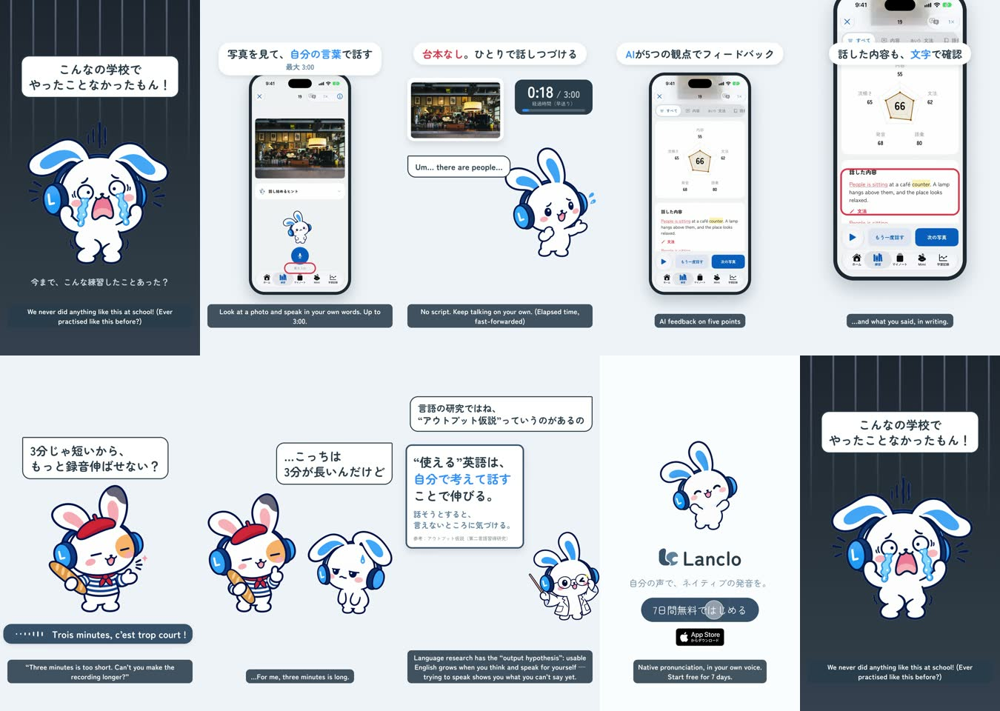

# Keep talking for 3 minutes — a 2D Mimi short

**English** · [日本語](README.ja.md)

Mimi in despair:「こんなの学校でやったことなかったもん！」(we never did anything like this at school!) — ever practised like this before? Lanclo's photo description: look at a photo and speak in your own words, up to 3:00 (the app's own「最大 3:00」). Mimi tries — no script, on her own, the clock fast-forwarded to 3:00 — and gets AI feedback on five points with her words written out. Then her French friend (beret, striped shirt, baguette) tries the app:「3分じゃ短いから、もっと録音伸ばせない？」(three minutes is too short — can't you make the recording longer?). Mimi:「…こっちは3分が長いんだけど」(for me, three minutes is long). Researcher Mimi (lab coat, glasses, pointer) explains the output hypothesis from second-language acquisition research:「“使える”英語は、自分で考えて話すことで伸びる。」「話そうとすると、言えないところに気づける。」(usable English grows when you think and speak for yourself; trying to speak shows you what you can't say yet).

0:21.0 / 1080×1920, 60 fps / Japanese speech bubbles and captions, Mimi's English in the owner's own registered Lanclo voice, the friend's French by Kokoro TTS / official 2D poses + GSAP, real app (simulator) + HyperFrames

Two cuts: Japanese only (`mimi-freespeech.mp4`) and with English subtitles (`mimi-freespeech-en.mp4`); final files in Lanclo's Google Drive `002.SNS/021. Keep Talking for 3 Minutes/` (`Free_Speech_2026-10-21.mp4`, `Free_Speech_EN-subs_2026-10-21.mp4`, raw take and clips in `FreeSpeech_assets/`).

## Files

- [PROCESS.md](PROCESS.md) (Japanese): the owner's directions and the decisions.
- [PROMPT.md](PROMPT.md) (Japanese): a consolidated instruction to remake it.
- [prompts/](prompts/): the Codex prompts for the six new poses and their logs.
- [source/](source/README.md): app capture (walkthrough + cuts), poses, voices, sound, HyperFrames edit, build steps.
- [CREDITS.md](CREDITS.md): materials and rights.
