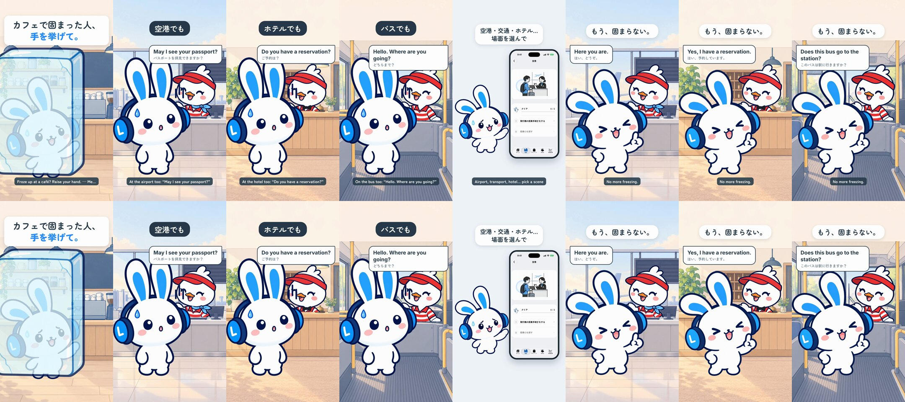

# Frozen Abroad — Roleplay series

**English** · [日本語](README.ja.md)

Follow-up to [Roleplay — Frozen at the café](../mimi-roleplay/README.md) (#17). The hook card asks 「カフェで固まった人、手を挙げて。」 while Mimi stands frozen in a block of ice at the café counter — and a mitten shoots up inside the ice: 「はい…」. Then three quick freezes in places that exist in Lanclo's 会話練習 catalogue: the airport check-in ("May I see your passport?"), the hotel reception ("Do you have a reservation?") and the bus ("Hello. Where are you going?"), each staffed by Pippa the duck (the recurring side cast) with a small role accessory, each ending in カチッ!. Copy 「固まる場面ごと、先に練習。」, the real app (catalogue → 空港 → 飛行機の搭乗手続きをする → the AI partner, a hint, a reply, シチュエーション完了), then the same three places without freezing — "Here you are." / "Yes, I have a reservation." / "Does this bus go to the station?" — 「もう、固まらない。」 Close: 「旅先のどこでも、何度でも。」

0:21.3 / 1080×1920, 60 fps / two cuts: Japanese only, and with English subtitles / 2D Mimi and Pippa the duck as staff beside a simulator recording (QA fixture) / Mimi's English is the owner's registered Lanclo voice; the staff (Pippa) is Kokoro `af_nicole`; everything Japanese is on screen

The brief's hospital scene was replaced by the bus: the app has no hospital scenario (English scenarios: restaurant, café, airport, transport, hotel, shopping, social, work).

Rebuild: [source/README.md](source/README.md). Process: [PROCESS.md](PROCESS.md). Prompt: [PROMPT.md](PROMPT.md). Credits: [CREDITS.md](CREDITS.md). Drafts and the raw take in Lanclo's Google Drive `002.SNS/032. Frozen Abroad - Roleplay Series/`.
