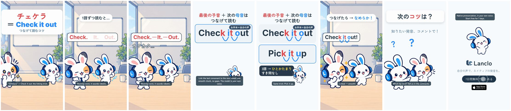

# Pronunciation Hacks 1 - Check It Out

[日本語](README.ja.md)

Lanclo SNS short #072, episode 1 of the new series “Pronunciation Hacks” (one quick, correct pronunciation tip per episode; the CTA asks for the next tip). Draft, 2026-10-23 (awaiting the owner's review). 15.2 s, 1080×1920, 60 fps, two cuts (Japanese only / English subtitles).

Tip: **linking**. A word's final consonant joins the next word's vowel: check‿it‿out, pick‿it‿up. This episode is only about consonant→vowel linking (no flap-T claim; that is a later episode).

Scene: a meeting room with a whiteboard. Frame 1: 「チェケラ ＝ Check it out」 while the smooth model “Check it out!” plays. The Friend reads it like a robot, “Check. It. Out.”, with real pauses (owner's own voice, learner style); each word lights on its measured start, dotted gaps appear in the pauses, 「カクカク…」. Mimi's card: 「最後の子音 ＋ 次の母音は つなげて読む」, arcs drawn under k‿i and t‿o, the model “Check it out!”, then “Pick it up!” the same way (owner's own voice, us), 「3語 → ひとかたまり すき間なし」. Back in the room the Friend says it smoothly, high five. CTA 「次のコツは？」, then the end card.

| Time (s) | Beat id | What |
|---|---|---|
| 0.00–2.00 | `hook` | 「チェケラ ＝ Check it out」「つなげて読むコツ」 from frame 1; model take at 0.2 |
| 2.00–5.10 | `slip` | Learner take “Check. It. Out.” at 2.1 (words at 2.14 / 3.36 / 4.42, pauses ≈0.54 s of silence), 「1語ずつ読むと…」, 「カクカク…」 at 4.5 |
| 5.10–7.30 | `tip` | Card: rule title, “Check it out”, arcs drawn at 5.45 / 5.75, model at 6.1 with the links pulsing on it; お手本＝自分の声 |
| 7.30–9.00 | `model` | “Pick it up” row, arcs at 7.5 / 7.7, model at 7.95; 「3語 → ひとかたまり すき間なし」 |
| 9.00–11.80 | `fix` | The Friend says “Check it out!” smoothly (model take at 9.2), 「つなげたら → なめらか！」, high five at 10.4 |
| 11.80–13.60 | `cta` | 「次のコツは？」「知りたい発音、コメントで！」 |
| 13.60–15.20 | `end` | End card, CTA tap at 14.2 |

- Cast: Mimi and her Friend only, all library poses (no new art). No side cast, no Kokoro, no app shot (the optional daily-lesson shot was skipped for tempo).
- Voices: three lines of the owner's registered voice via `kits/mimi-short/scripts/ownvoice.py`; WAVs are biometric and not in Git (Drive `072. Pronunciation Hacks 1 - Check It Out/Hacks1_CheckItOut_assets/own-voice/`).
- Drafts in Lanclo's Google Drive `002.SNS/072. Pronunciation Hacks 1 - Check It Out/` (`Hacks1_CheckItOut_draft_2026-10-23.mp4`, `Hacks1_CheckItOut_draft_EN-subs_2026-10-23.mp4`).
- Rebuild: [source/README.md](source/README.md). Making-of: [PROCESS.md](PROCESS.md). Prompt: [PROMPT.md](PROMPT.md). Credits: [CREDITS.md](CREDITS.md).

## Series template (episodes 2+)

Episodes 2–4 (water / US flap T, wanna / gonna, milk) copy `source/` to `films/mimi-hack-<slug>/source/`, keep the beat ids and element ids in `hf/index.html`, and swap only the tip. Times live in `source/cues.json` (read by `scripts/mix.py`; the same numbers are at the top of the `<script>` in `hf/index.html`).

| Beat | Ids | Swap per episode |
|---|---|---|
| `hook` 0–2.0 | `#hook` (`.hot`, `.eq`, `.small`), `#scene` (`#plate`, `.learner`, `.other`) | The hook pair (a Japanese “sounds-like” spelling ＝ the English, e.g. 「ワラ ＝ water」), the small line naming the tip, the plate (`PLATE=` in `scripts/art.sh`), the model take under the hook (`HOOK_V`) |
| `slip` 2.0–5.1 | `#say` (`.w` per word or chunk, `.gap`), `#slip-cap`, `#robot` | The learner's wrong reading split into `.w` chunks lit on `LEARNER_WORDS`; the caption naming the mistake; `#robot` is the reaction word (カクカク… here) |
| `tip` 5.1–7.3 | `#card`, `#c-title`, `#row-1`, `.pair` (`.c` / `.v` + `svg` arc), `#c-who` | The rule title and the first example. A `.pair` marks the joined sounds and carries an arc drawn by `draw()`; for a sound change instead of a link (flap T: t → light d), keep the row and recolour or relabel the pair (no arc needed) |
| `model` 7.3–9.0 | `#row-2`, `#c-tip` | The second example and the one-line takeaway |
| `fix` 9.0–11.8 | `#ok-say`, `#ok-cap`, `#both`, `#hearts` | The Friend's line said right (model take reused) and the payoff caption |
| `cta` 11.8–13.6 | `#cta`, `#cta-q`, `#cta-sub` | Usually unchanged: 「次のコツは？」 |
| `end` 13.6–15.2 | `#end` | Unchanged |

Voices: one learner line (custom `style` describing exactly the wrong reading, e.g. word by word with real pauses) and one or two `us` model lines (custom native style naming the target feature) in `own-voice.json`. Cut every take only at measured silence (`TAKES` in `cues.json`: start, length); `scripts/mix.py` asserts the first and last 10 ms of every placement are ≤ −38 dB vs the clip peak. Verify the feature acoustically (silencedetect, RMS envelope, spectrogram: [process/01-takes-waveform.jpg](process/01-takes-waveform.jpg)), never by a transcript. Mimi's Japanese first person is 「僕」. Cast: Mimi and the Friend only.
