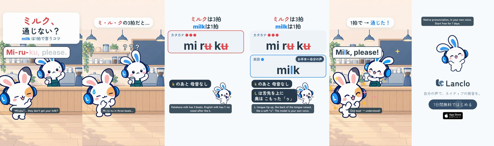

# Pronunciation Hacks 4 - Milk

[日本語](README.ja.md)

Lanclo SNS short #075, episode 4 of “Pronunciation Hacks” (one quick, correct pronunciation tip per episode; the CTA asks for the next tip). Draft, 2026-10-23 (awaiting the owner's review). 15.0 s, 1080×1920, 60 fps, two cuts (Japanese only / English subtitles).

Tip: **milk is one syllable**. Katakana ミルク is three beats (mi-ru-ku, with a vowel after the r and after the k); English “milk” has no vowel after the l or the k. The final L is a dark L: the tongue tip goes up, the back of the tongue is raised, and it often sounds like a soft “u”.

Scene: a café. Frame 1: 「ミルク、通じない？」 while the Friend orders “Mi-ru-ku, please.” in three even katakana beats (owner's own voice, learner style); each beat lights on its measured start. Mimi, the barista (role outfit: dark-teal apron), is puzzled: 「？？？」. Mimi's card: 「ミルクは3拍 / milkは1拍」, three red beat dots for mi-ru-ku and the added u's struck out (「k のあと 母音なし」), then “milk” with one blue dot and the isolated model “Milk.” (owner's own voice, us) twice around the tongue hint 「L は舌先を上に / 奥は こもった「ゥ」」. Back at the counter the Friend says “Milk, please.” in one beat, Mimi hands over a glass of milk: 「1拍で → 通じた！」. CTA 「次のコツは？」, then the end card.

| Time (s) | Beat id | What |
|---|---|---|
| 0.00–2.60 | `hook` | 「ミルク、通じない？」「milk は1拍で言うコツ」 from frame 1; learner take “Mi-ru-ku, please.” at 0.3 (beats at 0.38 / 0.66 / 1.04, “please” 1.76) |
| 2.60–4.20 | `slip` | 「ミ・ル・クの3拍だと…」, Mimi the barista tilts, 「？？？」 at 2.8 |
| 4.20–5.80 | `tip` | Card: 「ミルクは3拍 / milkは1拍」, “mi ru ku” with three beat dots at 4.45 / 4.7 / 4.95, the two u's struck at 5.3, 「k のあと 母音なし」 |
| 5.80–8.40 | `model` | “milk” row with one dot (6.0), model “Milk.” at 6.2 and 7.6, tongue hint at 6.9; お手本＝自分の声 |
| 8.40–11.60 | `fix` | The Friend: “Milk, please.” at 8.6; the milk arrives at 9.6, 「1拍で → 通じた！」 |
| 11.60–13.40 | `cta` | 「次のコツは？」「知りたい発音、コメントで！」 |
| 13.40–15.00 | `end` | End card, CTA tap at 14.0 |

- Cast: Mimi and her Friend only. Two new Mimi barista poses by codex-p (`mimi-barista-confused`, `mimi-barista-serve`, prompt in [prompts/](prompts/)); everything else is library art. No side cast, no Kokoro, no app shot.
- Voices: three lines of the owner's registered voice via `kits/mimi-short/scripts/ownvoice.py`; WAVs are biometric and not in Git (Drive `075. Pronunciation Hacks 4 - Milk/Hacks4_Milk_assets/own-voice/`).
- Drafts in Lanclo's Google Drive `002.SNS/075. Pronunciation Hacks 4 - Milk/` (`Hacks4_Milk_draft_2026-10-23.mp4`, `Hacks4_Milk_draft_EN-subs_2026-10-23.mp4`).
- Rebuild: [source/README.md](source/README.md). Making-of: [PROCESS.md](PROCESS.md). Prompt: [PROMPT.md](PROMPT.md). Credits: [CREDITS.md](CREDITS.md). Series template: [episode 1](../mimi-hack-check-it-out/README.md#series-template-episodes-2).

