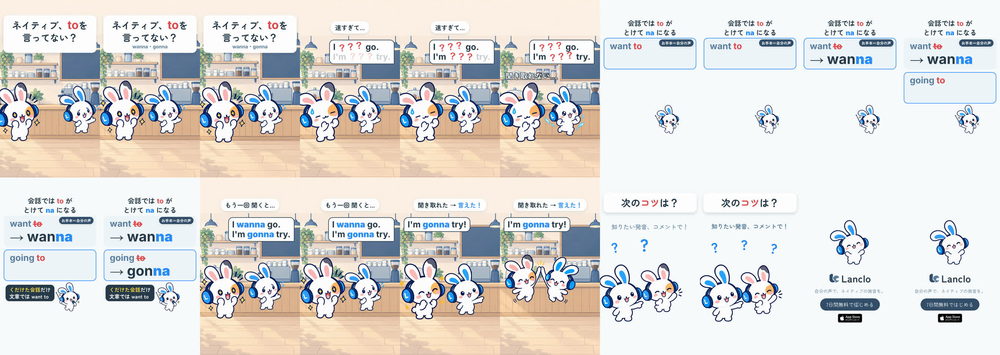

# Pronunciation Hacks 3 - Wanna and Gonna

[日本語](README.ja.md)

Lanclo SNS short #074, episode 3 of “Pronunciation Hacks” (one quick, correct tip per episode; the CTA asks for the next tip). Draft, 2026-10-23 (awaiting the owner's review). 16.9 s, 1080×1920, 60 fps, two cuts (Japanese only / English subtitles). Built from the series template, [films/mimi-hack-check-it-out](../mimi-hack-check-it-out/README.md#series-template-episodes-2).

Tip: in **casual speech** “want to” → **wanna** and “going to” → **gonna** (the “to” melts into “na”). Small note on the card: casual speech only; in writing keep “want to”.

Scene: a cafe. Frame 1: 「ネイティブ、toを言ってない？」 while Mimi says the fast line “I wanna go. I'm gonna try.” (owner's own voice, us). She says it again; the Friend can't catch it: the bubble shows “I ？？？ go. / I'm ？？？ try.”, 「速すぎて…」「聞き取れない…」. Slow-down card 「会話では to が とけて na になる」: slow “Want to.” (the to is struck through) → natural “Wanna.”; slow “Going to.” → “Gonna.”, each in the owner's own voice. Back in the cafe, Mimi says it once more with the words readable, the Friend catches it and answers “I'm gonna try!”, high five. CTA 「次のコツは？」, then the end card.

| Time (s) | Beat id | What |
|---|---|---|
| 0.00–2.00 | `hook` | 「ネイティブ、toを言ってない？」「wanna・gonna」 from frame 1; fast take at 0.15 |
| 2.00–4.50 | `slip` | Fast take again at 2.05; bubble words light on their starts, the reduced words stay red 「？？？」; 「速すぎて…」, 「聞き取れない…」 at 3.8 |
| 4.50–7.00 | `tip` | Card: rule title; “want to” slow at 4.75 (to struck at 6.1), “→ wanna” natural at 6.4; お手本＝自分の声 |
| 7.00–9.70 | `model` | “going to” slow at 7.1, note 「くだけた会話だけ 文章では want to」 at 8.2, “→ gonna” at 8.95 |
| 9.70–13.50 | `fix` | 「もう一回 聞くと…」, fast take at 9.8 with wanna / gonna in blue; the Friend's “I'm gonna try!” at 11.55, 「聞き取れた → 言えた！」; high five at 12.75 |
| 13.50–15.30 | `cta` | 「次のコツは？」「知りたい発音、コメントで！」 |
| 15.30–16.90 | `end` | End card, CTA tap at 15.9 |

- Cast: Mimi and her Friend only, all library poses (no new art). No side cast, no Kokoro, no app shot.
- Voices: six lines of the owner's registered voice via `kits/mimi-short/scripts/ownvoice.py`; WAVs are biometric and not in Git (Drive `074. Pronunciation Hacks 3 - Wanna and Gonna/Hacks3_Wanna_assets/own-voice/`).
- Drafts in Lanclo's Google Drive `002.SNS/074. Pronunciation Hacks 3 - Wanna and Gonna/` (`Hacks3_Wanna_draft_2026-10-23.mp4`, `Hacks3_Wanna_draft_EN-subs_2026-10-23.mp4`).
- Rebuild: [source/README.md](source/README.md). Making-of: [PROCESS.md](PROCESS.md). Prompt: [PROMPT.md](PROMPT.md). Credits: [CREDITS.md](CREDITS.md).

