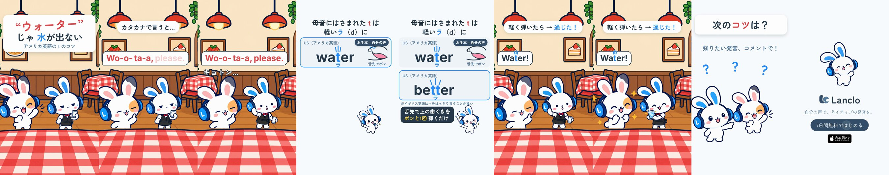

# Pronunciation Hacks 2 - Water (US T)

[日本語](README.ja.md)

Lanclo SNS short #073, episode 2 of “Pronunciation Hacks” (one quick, correct pronunciation tip per episode; the CTA asks for the next tip). Draft, 2026-10-23 (awaiting the owner's review). 15.2 s, 1080×1920, 60 fps, two cuts (Japanese only / English subtitles). Built from episode 1's source ([mimi-hack-check-it-out](../mimi-hack-check-it-out/)), same beat ids and look.

Tip (**US English**, labelled US on the card): a t between vowels after a stressed syllable becomes a quick tap, like a light d / Japanese ラ行 (water, better). UK English usually keeps a clear t (small note only).

Scene: a family restaurant; Mimi plays the waiter (role outfit) holding an empty glass. Frame 1: 「“ウォーター”じゃ水が出ない」「アメリカ英語の t のコツ」. The Friend orders “Wo-o-ta-a, please.” in katakana style (owner's own voice, learner style: hard aspirated t), the waiter goes blank: 「キョトン…」, “Sorry?”. Mimi's card: 「母音にはさまれた t は 軽いラ（d）に」, a tongue-tap icon (舌先でポン), “water” with the own-voice US model “Water.” (the t turns into a blue ラ on the measured flap), then “better”, the UK note and 「舌先で上の歯ぐきを ポンと1回 弾くだけ」. Back in the restaurant the Friend says “Water!” with the tap and the water arrives. CTA 「次のコツは？」, then the end card.

| Time (s) | Beat id | What |
|---|---|---|
| 0.00–2.00 | `hook` | 「“ウォーター”じゃ水が出ない」 from frame 1; the Friend waves for the waiter, Mimi the waiter holds an empty glass |
| 2.00–5.10 | `slip` | Learner take “Wo-o-ta-a, please.” at 2.1 (chunks at 2.18 / 2.98 / 3.76), 「カタカナで言うと…」, the waiter cups an ear at 4.3, 「キョトン…」 at 4.55 |
| 5.10–7.30 | `tip` | Card: rule title, US row “water”, tap mark at 5.45, the tongue taps at 5.75, model “Water.” at 6.1 (flap at 6.43: t → ラ), お手本＝自分の声 |
| 7.30–9.00 | `model` | US row “better” (tap mark 7.5), UK note 7.7, 「ポンと1回 弾くだけ」 |
| 9.00–11.80 | `fix` | The Friend says “Water!” (model take at 9.2), 「軽く弾いたら → 通じた！」, Mimi serves a full glass at 10.4 |
| 11.80–13.60 | `cta` | 「次のコツは？」「知りたい発音、コメントで！」 |
| 13.60–15.20 | `end` | End card, CTA tap at 14.2 |

- Draft v1 gap: the “Better.” model take is **not generated yet** (the shared Gemini TTS daily quota, 100 requests/day, ran out during the batch). The “better” row is shown without its audio. After the quota resets: `python3 kits/mimi-short/scripts/ownvoice.py films/mimi-hack-water/source/own-voice.json` (generates only `us-better`), measure it, set `TAKES["us-better.wav"]` and `BETTER_FLAP` in `source/cues.json` (and `BT` in `hf/index.html`), re-mix and re-render.
- Cast: Mimi and her Friend only. New episode poses: Mimi as a waiter (empty glass, “Sorry?”, serving water) and the restaurant plate with an empty table, drawn with codex-p ([prompts/01-codex-mimi-waiter.txt](prompts/01-codex-mimi-waiter.txt)); library poses for the rest. No side cast, no Kokoro, no app shot.
- Voices: two lines of the owner's registered voice via `kits/mimi-short/scripts/ownvoice.py` (learner + “Water.”); WAVs are biometric and not in Git (Drive `073. Pronunciation Hacks 2 - Water (US T)/Hacks2_Water_assets/own-voice/`).
- Drafts in Lanclo's Google Drive `002.SNS/073. Pronunciation Hacks 2 - Water (US T)/` (`Hacks2_Water_draft_2026-10-23.mp4`, `Hacks2_Water_draft_EN-subs_2026-10-23.mp4`).
- Rebuild: [source/README.md](source/README.md). Making-of: [PROCESS.md](PROCESS.md). Prompt: [PROMPT.md](PROMPT.md). Credits: [CREDITS.md](CREDITS.md).

