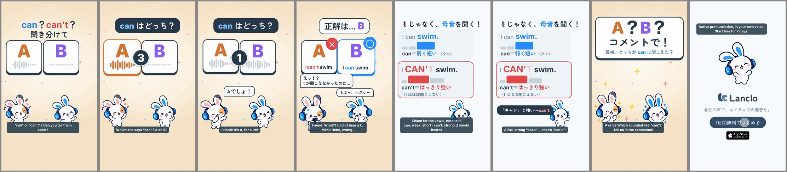

# Can You Hear It? 1 - Can or Can't

[日本語](README.ja.md)

Lanclo SNS short #061, episode 1 of the new series “Can You Hear It?” (a listening quiz; viewers answer A / B in the comments). 16.1 s, 1080×1920, 60 fps, two cuts (Japanese only / English subtitles). Final, owner approved on 2026-10-23.

Two cards, A and B, and the hook 「can？can't？聞き分けて」 on frame 1. A countdown 3-2-1 while the owner's own voice (US model) plays “I can't swim.” (A) and “I can swim.” (B); the question is 「can はどっち？」. The Friend shouts 「Aでしょ！」 (he did not hear a t); the answer is B, Mimi grins 「ふふっ、ハズレ〜」. Mimi's rule card: 「t じゃなく、母音を聞く！」, can＝弱く短い (k'n), can't＝はっきり強い (t はほぼ聞こえない), both lines again. Then 「A？B？コメントで！」 and the end card.

Learning point (US English): in a sentence “can” is weak and short (k'n) and the verb carries the stress; “can't” keeps a full /æ/ vowel and stress, and its t is often barely heard. Listen for the vowel, not the t.

| Time (s) | Beat (id) |
|---|---|
| 0.00–1.80 | `hook`: A / B cards + 「can？can't？聞き分けて」 |
| 1.80–5.40 | `play`: 「can はどっち？」, countdown 3 (A plays at 2.0) → 2 (B at 3.35) → 1; the Friend guesses 「Aでしょ！」 at 4.6 |
| 5.40–7.80 | `reveal`: 正解は… B (5.9), answers under the cards, the Friend shocked 「えっ！？ t が聞こえなかったのに…」, Mimi 「ふふっ、ハズレ〜」 |
| 7.80–13.00 | `rule`: Mimi's card; “I can swim.” at 8.4, “I can't swim.” at 9.7; 「「キャン」と強い→can't」 at 11.1 |
| 13.00–14.70 | `ask`: 「A？B？コメントで！」 / 最初、どっちが can に聞こえた？ |
| 14.70–16.10 | `end`: end card, CTA tap at 15.3 |

- Voices: both lines are the owner's registered Lanclo voice, accent `us`, via `kits/mimi-short/scripts/ownvoice.py` (Gemini gemini-3.8-flash-tts). WAVs are biometric and not in Git (Drive `061. Can You Hear It 1 - Can or Cant/Hear1_Can_assets/own-voice/`). Checked acoustically: see [PROCESS.md](PROCESS.md).
- Cast: Mimi and her Friend only (library poses). Mimi has no first-person line here (it would be 「僕」).
- Final files in Lanclo's Google Drive `002.SNS/061. Can You Hear It 1 - Can or Cant/`: `Hear1_Can_2026-10-23.mp4`, `Hear1_Can_EN-subs_2026-10-23.mp4`, own-voice WAVs in `Hear1_Can_assets/`.
- Rebuild: [source/README.md](source/README.md). Making-of: [PROCESS.md](PROCESS.md). Prompt: [PROMPT.md](PROMPT.md). Credits: [CREDITS.md](CREDITS.md).

## Series template (episodes 2+)

Every “Can You Hear It?” episode copies `source/` and keeps the beat ids and layout; only the content changes.

| Beat | Time | Swap per episode |
|---|---|---|
| `hook` | 0–1.8 | `#hook` text (the two or three things to tell apart); the option cards are on screen from frame 1 |
| `play` | 1.8–5.4 | `#q` question; the takes in `scripts/mix.py` (`A`, `B`, add `C`) with their measured `CLIP` trims; countdown 3-2-1 (one number per take; for three options use 3 / 2 / 1 on A / B / C and move `GUESS` later); the Friend's wrong guess `#f-say` |
| `reveal` | 5.4–7.8 | `#answer` letter, `.ans` text under each card, `.mark` ○ / ×; the Friend's reaction `#f-oops` and Mimi's `#m-say` |
| `rule` | 7.8–13.0 | `#r-title`, one `.row` per option (sentence with the stressed part big, `.syl` bars for loudness / length, `.rl` rule line), both / all takes again at `RL1`, `RL2` (`RL3`), the punch line `#r-hit` |
| `ask` | 13.0–14.7 | `#ask` (letters A？B？(C？) + コメントで！ + a one-line question) |
| `end` | 14.7–16.1 | unchanged (`k.end`, `k.tapCta`, `sfx.pochi`) |

- Times live in `source/cues.json`; `scripts/mix.py` reads it, `hf/index.html` repeats the same constants at the top of its script (keep them equal).
- Three options (episode 2, “Excuse me” × 3 intonations): add `#opt-c`, make the cards 320 px wide (left 40 / 380 / 720) and move the countdown circle above the cards; add a third rule row (each row 270 px high) or put the three intonation contours on one row each with an arrow line instead of `.syl` bars.
- Voices: the model takes in the owner's own voice (`own-voice.json`, style per line); verify the contrast acoustically before building (`scripts/check_voice.py`), never by a transcript.
- Cast: Mimi + Friend only; the Friend guesses wrong, Mimi grins and teaches. Poses from the library (`scripts/art.sh`).
- Subtitles sit at `bottom: 410px` (just above the bottom safe zone, under the feet); the end card's subtitle sits at the top.
