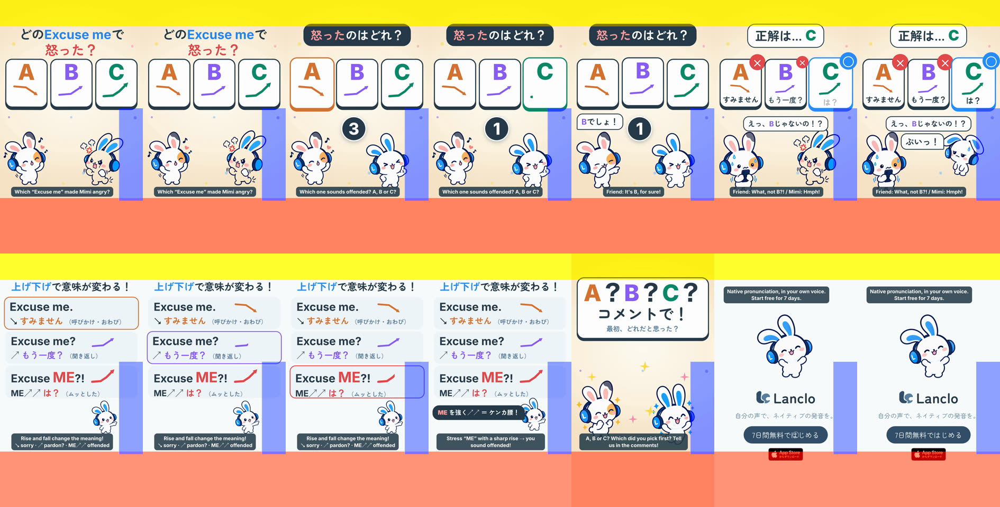

# Can You Hear It? 2 - Excuse Me

[English](README.md)

Lanclo SNS ショート #062。シリーズ「Can You Hear It?（聞き分けクイズ）」第2話。視聴者はコメントで A / B / C を答える。17.8秒、1080×1920、60fps、2カット（日本語のみ／英語字幕つき）。完成版（2026-10-23、オーナー承認済み）。

1フレーム目から毛を逆立てた Mimi、A ↘ / B ↗ / C ↗↗ の3枚のカードとフック「どのExcuse meで怒った？」。カウントダウン 3-2-1 の間に、オーナー本人の声（US）で下がる “Excuse me.”（A）、上がる “Excuse me?”（B）、me を強く急上昇させる “Excuse ME?!”（C）が流れ、問いは「怒ったのはどれ？」。友だちは「Bでしょ！」。正解は C、カードの下に意味（すみません／もう一度？／は？）、Mimi が怒って「ぷいっ！」とそっぽを向く。Mimi のまとめカード「上げ下げで意味が変わる！」：↘ すみません／↗ もう一度？／ME↗↗ は？、3つをもう一度、「ME を強く↗↗ ＝ ケンカ腰！」。最後に「A？B？C？コメントで！」とエンドカード。

学習ポイント（アメリカ英語）：下がる “Excuse me.” は呼びかけ・おわび、上がる “Excuse me?” は「もう一度？」、ME に強勢を置いて急に上げる “Excuse ME?!” は「は？」とムッとした響き。

| 秒 | ビート（id） |
|---|---|
| 0.00–1.80 | `hook`：矢印つき A / B / C カード＋「どのExcuse meで怒った？」、毛を逆立てた Mimi |
| 1.80–6.70 | `play`：「怒ったのはどれ？」、カウントダウン 3（A 2.0秒）→2（B 3.3秒）→1（C 4.35秒）、友だち「Bでしょ！」6.0秒 |
| 6.70–9.40 | `reveal`：正解は… C（7.2秒）、カードの下に意味、友だち「えっ、Bじゃないの！？」、Mimi「ぷいっ！」7.9秒 |
| 9.40–14.80 | `rule`：Mimi のまとめカード、A 9.85秒、B 11.0秒、C 11.95秒、「ME を強く↗↗ ＝ ケンカ腰！」13.45秒 |
| 14.80–16.40 | `ask`：「A？B？C？コメントで！」／最初、どれだと思った？ |
| 16.40–17.80 | `end`：エンドカード、CTA タップ 17.0秒 |

- 声：3つともオーナー本人の登録済み Lanclo ボイス（accent `us`、イントネーションごとに style 指定、`kits/mimi-short/scripts/ownvoice.py`）。WAV は生体データのため Git に入れない（Drive `062. Can You Hear It 2 - Excuse Me/Hear2_ExcuseMe_assets/own-voice/`）。F0 の音響チェックは [PROCESS.md](PROCESS.md)。
- キャスト：Mimi と友だちのみ（ライブラリのポーズ）。Mimi の一人称の台詞はなし（使うなら「僕」）。
- 完成版：Lanclo の Google Drive `002.SNS/062. Can You Hear It 2 - Excuse Me/`（`Hear2_ExcuseMe_2026-10-23.mp4`、`Hear2_ExcuseMe_EN-subs_2026-10-23.mp4`）。
- 再現手順：[source/README.md](source/README.md)。

