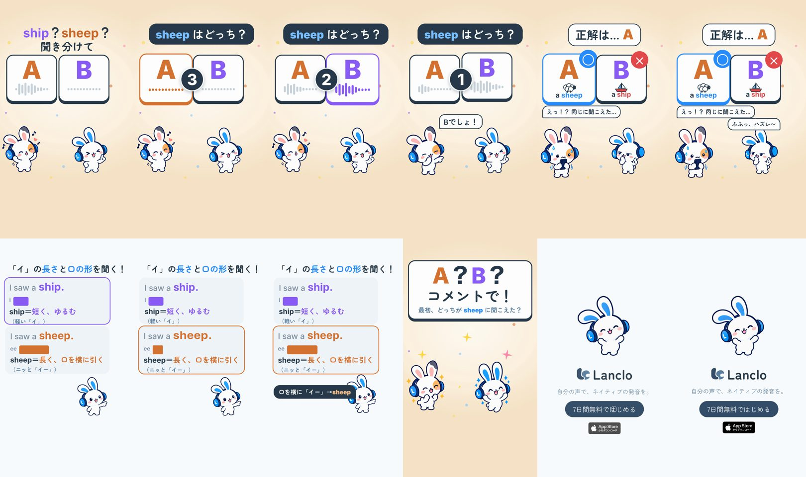

# Can You Hear It? 3 - Ship or Sheep

[日本語](README.ja.md)

Lanclo SNS short #078, episode 3 of the series “Can You Hear It?” (a listening quiz; viewers answer A / B in the comments). 16.2 s, 1080×1920, 60 fps, two cuts (Japanese only / English subtitles). Draft (2026-10-23), waiting for the owner's review.

Two cards, A and B, and the hook 「ship？sheep？聞き分けて」 on frame 1. A countdown 3-2-1 while the owner's own voice (US model) plays “I saw a sheep.” (A) and “I saw a ship.” (B); the question is 「sheep はどっち？」. The Friend shouts 「Bでしょ！」; the answer is A, a sheep and a ship icon appear under the cards, the Friend 「えっ！？ 同じに聞こえた…」, Mimi grins 「ふふっ、ハズレ〜」. Mimi's rule card: 「「イ」の長さと口の形を聞く！」, ship＝短く、ゆるむ（軽い「イ」）, sheep＝長く、口を横に引く（ニッと「イー」）, a vowel-length bar per row grows while the vowel plays, both lines again, 「口を横に「イー」→sheep」. Then 「A？B？コメントで！」 and the end card.

Learning point (US English): ship has the short, lax /ɪ/ (relaxed lips and tongue); sheep has the long, tense /iː/ (lips spread, tongue high and front). Listen for the length and the brightness of the vowel.

| Time (s) | Beat (id) |
|---|---|
| 0.00–1.80 | `hook`: A / B cards + 「ship？sheep？聞き分けて」 |
| 1.80–5.50 | `play`: 「sheep はどっち？」, countdown 3 (A plays at 2.0) → 2 (B at 3.55) → 1; the Friend guesses 「Bでしょ！」 at 4.75 |
| 5.50–7.90 | `reveal`: 正解は… A (6.0), a sheep / a ship under the cards, the Friend 「えっ！？ 同じに聞こえた…」, Mimi 「ふふっ、ハズレ〜」 |
| 7.90–13.10 | `rule`: Mimi's card; “I saw a ship.” at 8.5, “I saw a sheep.” at 9.75; 「口を横に「イー」→sheep」 at 11.25 |
| 13.10–14.80 | `ask`: 「A？B？コメントで！」 / 最初、どっちが sheep に聞こえた？ |
| 14.80–16.20 | `end`: end card, CTA tap at 15.4 |

- Voices: both lines are the owner's registered Lanclo voice, accent `us` with a style per line, via `kits/mimi-short/scripts/ownvoice.py`. WAVs are biometric and not in Git (Drive `078. Can You Hear It 3 - Ship or Sheep/Hear3_Ship_assets/own-voice/`). Vowel length and F1 / F2 checked acoustically: see [PROCESS.md](PROCESS.md).
- Cast: Mimi and her Friend only (library poses). Mimi has no first-person line here (it would be 「僕」).
- Draft files in Lanclo's Google Drive `002.SNS/078. Can You Hear It 3 - Ship or Sheep/`: `Hear3_Ship_draft_2026-10-23.mp4`, `Hear3_Ship_draft_EN-subs_2026-10-23.mp4`, own-voice WAVs in `Hear3_Ship_assets/`.
- Series template: films/mimi-hear-can/README.md “Series template” (two-option form, unchanged layout).
- Rebuild: [source/README.md](source/README.md). Making-of: [PROCESS.md](PROCESS.md). Prompt: [PROMPT.md](PROMPT.md). Credits: [CREDITS.md](CREDITS.md).

