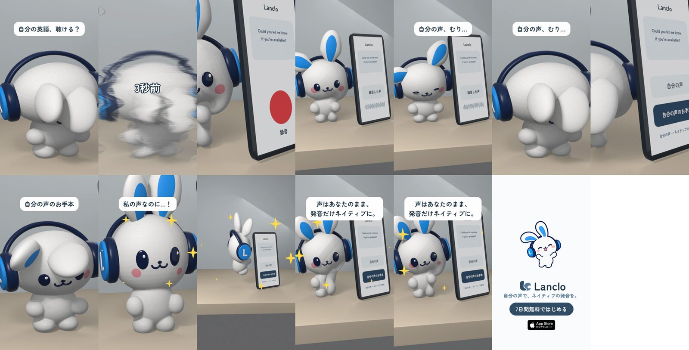
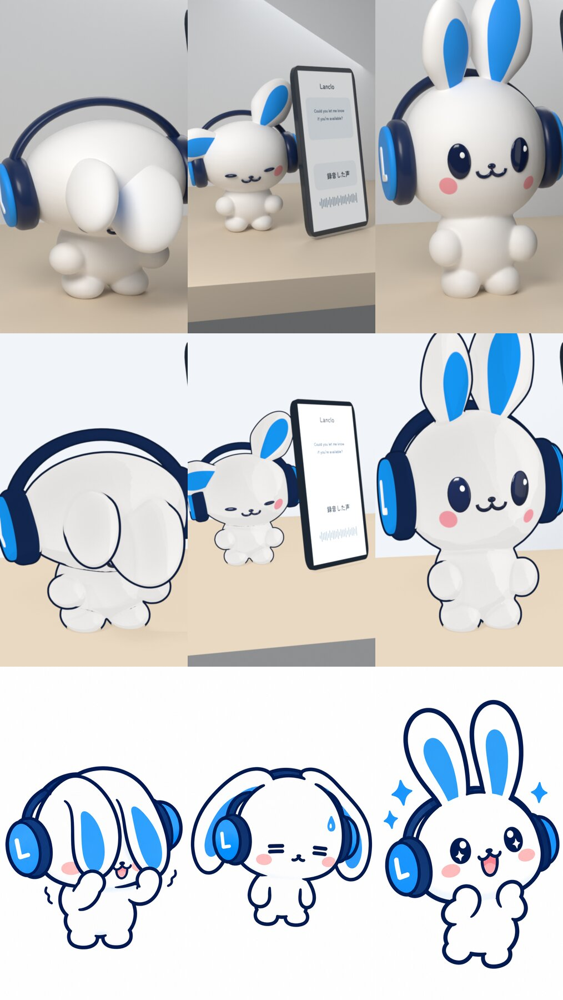
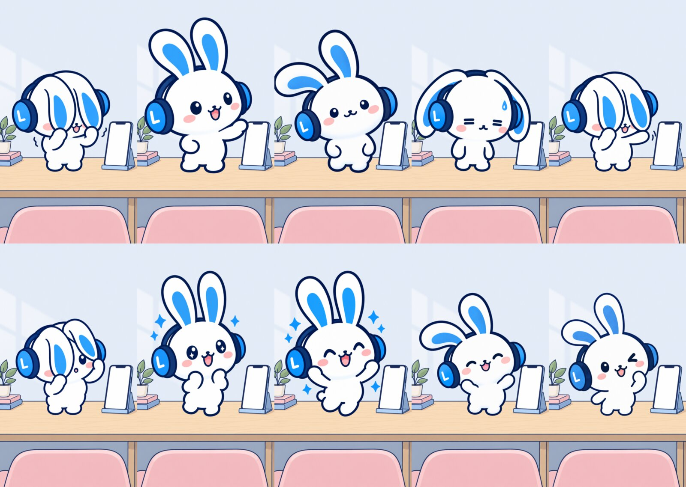
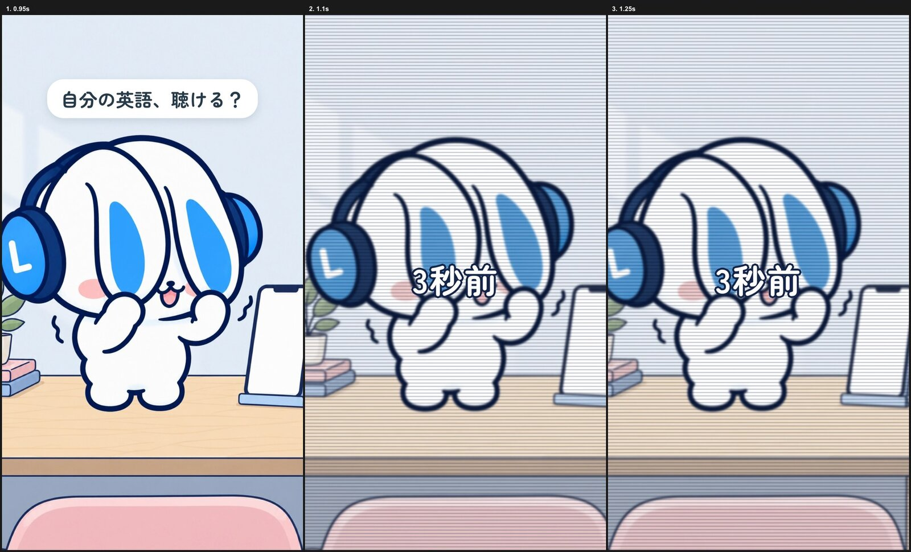
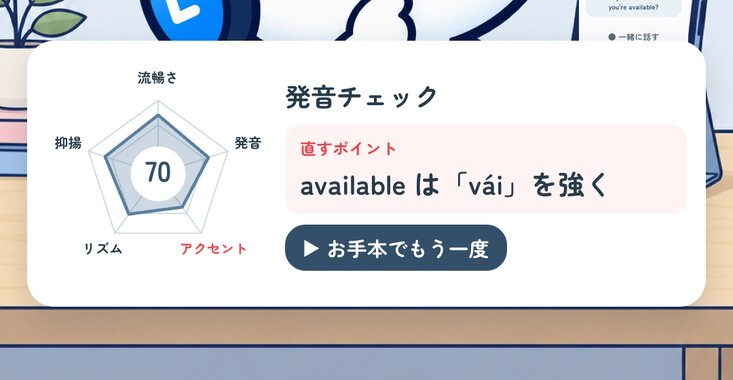

# 制作過程 — 「自分の声、むり」（Mimi 2Dショート）

LancloのマスコットMimiが主役の、15秒の縦型ショート（Instagram Reels / TikTok向け）の制作記録です。依頼者の指示、AIに渡したプロンプト、レビュー、判断を起きた順に残します。もう一度作る・別の話で作るための統合プロンプトは [PROMPT.md](PROMPT.md)、汎用の手順は [2Dキャラクターアニメ制作ガイド](../../docs/2D-CHARACTER-ANIMATION.ja.md)。

- 制作日：2026-10-20
- 役割：Claude Code（構成・リグ・演技・合成・判断）、Codex（`codex-p`：絵の生成とレビュー）
- 道具：Rive CLI 1.6.0、HyperFrames、Blender 5.2（3D版の比較とプリビズ）、ffmpeg、ImageMagick、Python（numpy / scipy / pillow）

## 1. 題材

ストーリー案5つから依頼者が「自分の声、むり」を選んだ。録音した自分の英語が恥ずかしいという共感から、「自分の声のお手本」（Lancloの核の価値）で驚く、という一本。

冒頭のつかみについて：

> 最初の1秒のフックで視聴者を獲得するには？

答え：いちばんの感情（耳で顔を隠してぷるぷる）を先に出し、「自分の英語、聴ける？」と自分ごとの問いを重ね、「3秒前」と巻き戻して本編へ。依頼者は案A（結果を先に見せる）を採用。

## 2. 3Dプリビズとアニマティック

3DのMimi正本（[films/mimi-3d](../mimi-3d/README.ja.md)）で机とスマホのセットを組み、カットごとのポーズとカメラを決めて静止画を描画、本物の声と仮の効果音・字幕で15秒のアニマティックにした。

Codexの絵コンテレビュー（[reviews/storyboard-review.md](reviews/storyboard-review.md)）で直したこと：価値の提示を5.7秒に前倒し、スマホ画面で「録音」と「録音した声」を区別、2回目の顔隠しを0.5秒に短縮、喜んだあと落ち込む戻りを削除、「お手本」を「自分の声のお手本」と明示、耳が立つ瞬間に「私の声なのに…！」。

途中で見つかったリグの不具合：耳を回すと頭の表面がへこむ（耳の骨が体の変形にも効いていた）。耳の骨を変形に使わない設定に直し、3D正本にも反映した。

## 3. 2Dか3Dか

> ちなみに今回3Dモデルでやったけど2Dの方が簡単なの？2Dでアニメって描けるの？

Lanclo本体には既にRiveの2D Mimi（骨で動かすラスター画像）がアプリに入っていることを確認。Duolingoの調べでは、アプリ内のキャラは2DのRive、3Dは「2Dに見せる」ために使う程度。

同じ3ポーズ（顔を隠す／= =／耳ピン）を、3D（Cycles）・3Dトゥーン（blender-npr-eeveeスキルの輪郭線＋自前の2段トゥーン）・2D（Codexが公式の絵柄で描画）で並べた。

> これが一番いい。明らかに。（2Dの段）

以後2Dで制作。Rive CLIは既に入っていた（1.1.0、PATH外）ので1.6.0に更新。Rive用の外部スキルは小規模でキャラクター向けでないため入れず、公式CLIの `rive docs` / `rive schema` を正とした。

## 4. 2Dの作り方

1. **絵**：Codexに公式PNG（master / listening / success）と既に描いたポーズを参照させ、同じ絵柄・同じ向きで描かせる（[prompts/](prompts/)）。机の背景も同じ絵柄で。公式の listening / success / master / thinking はそのまま使用。
2. **切り抜き**：白背景を四隅から塗りつぶして透明化（`scripts/cutout.sh`）。
3. **大きさをそろえる**：ポーズごとに耳や腕の伸び方が違うので、全体の高さでなく「頭の大きさ」が同じに見えるよう拡大率を調整。

4. **リグ**：Lancloの承認済みRiveリグ（`design/mimi-welcome/build_scene.py`）と同じ作り。絵を格子＋ドロネーの網にし、位置からウェイトを決め、5本の骨（頭・耳・左右の手・接地）。カットごとに演技を骨のキーで付ける（`scripts/rig2d.py`）。
5. **書き出し**：`rive --screenshot --advance=N` を1コマずつ（4並列、1秒分で約1分）。Riveの書き出しは背景が透明にならないので、背景もRive内に入れ、カメラの寄りはHyperFramesで画面全体に付ける。
6. **冒頭の試作**（[hf-hook](source/hf-hook/BRIEF.md)）で流れを確認。

> いいかんじ。これで進めて。すごくいい

7. **全カット**：11カットを書き出し、HyperFramesで、スマホ画面のLanclo UI、字幕、再生ラベル、巻き戻し、キラキラ、締めを合成（`source/hf-short/`）。音はLPの声2本＋コードの効果音＋100 BPMの軽いBGM（`scripts/mix.py`）。

Codexの通しレビュー（[reviews/final-cut-review.md](reviews/final-cut-review.md)）は SHIP。改善5点を反映：「自分の声のお手本」字幕を1.2秒に、スマホの文字は読めないので大きな再生ラベル、寄りを控えめに、締めを早く完成、お手本の声に重なるベルを−6 dB。

## 5. 練習と評価まで描く

> 最後自分のネイティブ声聞けて喜んでいるだけでなく、これをもとに練習できるようにしないと。…CTAも1秒くらいでいいかなと

喜びの後の間を、お手本と一緒に話す練習に。話すポーズは口を開けた絵と閉じた絵をCodexに同一ポーズで描かせ（差0.6%）、同じ切り抜き範囲で切って同じ網に重ね、お手本の声の音節の山で口を開ける（最初は音量だけで判定して開きっぱなしになったので、周囲より大きい瞬間だけに）。

> 発音そっくり！というかレーダーチャートで点数出て、指摘を貰えるみたいな。それみて納得的な。

「✓ 発音そっくり！」をやめ、5軸レーダー（流暢さ・発音・アクセント・リズム・抑揚）、点数のカウントアップ、直すポイント1つ、公式「考える」ポーズのMimiが2回うなずく形に。カードは顔を隠さないよう画面下の横長に。

> デモ表示って言葉不要。あと指摘の右下余白あるからバランスよくして

「デモ表示」を外し、右列を縦中央に、「▶ お手本でもう一度」ボタンを追加（指摘→また練習、の循環も伝わる）。

> 最高。これで完成。

## 6. 完成形

| 秒 | 内容 |
|---|---|
| 0–1.0 | 耳で顔を隠してぷるぷる「自分の英語、聴ける？」＋自分の声の英語の語尾 |
| 1.0–1.3 | 巻き戻し「3秒前」 |
| 1.3–4.6 | 録音をタップ →「▶ 録音した声」→ 「= =」で落ち込む「自分の声、むり…」 |
| 4.6–5.7 | もう一度隠れる → 隠れたまま「自分の声のお手本」をタップ |
| 5.7–8.2 | のぞく →「私の声なのに…！」耳ピン、キラキラ → ジャンプ |
| 8.2–9.4 | ガッツポーズ「声はあなたのまま、発音だけネイティブに。」 |
| 9.4–11.4 | お手本と一緒に話す（口パク）「お手本に合わせて、そのまま練習。」 |
| 11.4–13.0 | 発音チェック（レーダー・点数・直すポイント）、うなずく「点数と、直すポイントがわかる。」 |
| 13.0–14.0 | ウインク「明日は、もっと言える。」 |
| 14.0–15.0 | 締め（Lanclo／自分の声で、ネイティブの発音を。／7日間無料／App Store） |

1080×1920、60 fps、15.0秒、H.264 / AAC。

## 学んだこと

- **2Dは公式の絵柄がいちばん感情を運ぶ。** 3Dで作り込むより、承認済みの絵柄で描き足してRiveで動かす方が速く、ブランドとも一致する。
- **Codexに描かせるときは、公式PNGと既に描いたポーズを毎回参照させる**。向き（「L」は画面左のカップ、体は画面右へ向く）、同じ縮尺、白背景、文字なしを明記。
- **口パクの2枚は「口以外を同一に」と指示し、同じ範囲で切り抜く。**
- **Riveの落とし穴**：先に書いた要素が手前、書き出しは1回1コマ、背景は透明にならない。
- **画面上の文字は端末で読める大きさに。** スマホの中のUIは雰囲気だけで、意味は大きなラベルで伝える。
- **カードやラベルはキャラクターの顔を隠さない位置に。** 下端約400 pxはSNSのボタン用に空ける。
- **レビューは絵コンテ段階と完成直前の2回。** どちらもCodexの指摘は具体的で、ほぼ採用できた。
