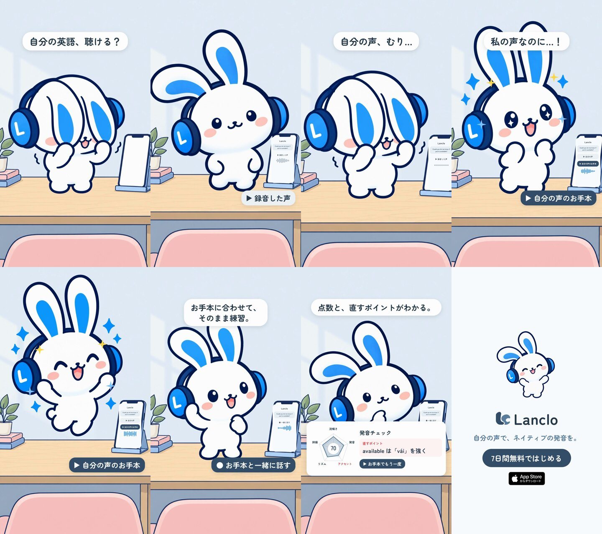

# 自分の声、むり — Mimi 2Dショート

[English](README.md) · **日本語**

録音した自分の英語が恥ずかしいMimiが、「自分の声のお手本」を聴いて驚き、お手本に合わせて練習し、点数と直すポイントで納得するまで。Lancloの核の価値を15秒で見せる縦型ショート。

0:15 / 1080×1920・60 fps / 日本語の字幕・英語の声 / 2D：Codexで描いた公式の絵柄＋Riveの骨＋HyperFrames

## ファイル

- [PROCESS.md](PROCESS.md)：制作過程（依頼者の指示、3Dと2Dの比較、レビュー、判断、学んだこと）
- [PROMPT.md](PROMPT.md)：もう一度作る・別の話で作るための統合プロンプト
- [prompts/](prompts/)：Codexに渡したプロンプトの原文（絵の生成とレビュー）
- [reviews/](reviews/)：Codexのレビュー（絵コンテ、完成直前）
- [source/](source/README.md)：絵、Riveリグ、音、HyperFramesの合成、書き出し手順
- [CREDITS.md](CREDITS.md)：素材と権利
- 汎用の手順：[2Dキャラクターアニメ制作ガイド](../../docs/2D-CHARACTER-ANIMATION.ja.md)

## 再現

[source/README.md](source/README.md) の順に、切り抜き → リグ → Riveの書き出し → 音 → HyperFramesの書き出し。LPの声2本（`source/assets/voice/`）はGitに含めていません。完成MP4もGit外です。
