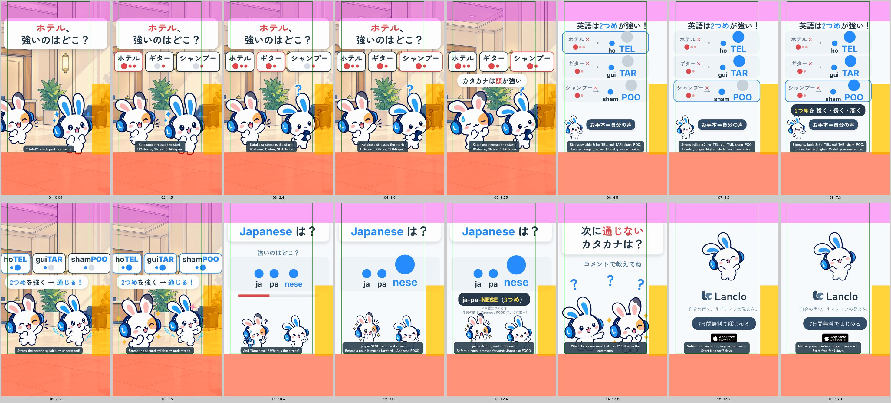

# Katakana Traps 3 - Hotel, Guitar, Shampoo

[日本語](README.ja.md)

Lanclo SNS short #060, episode 3 of “Katakana Traps” (the stress episode). **Draft** (2026-10-23). 16.2 s, 1080×1920, 60 fps, two cuts (Japanese only / English subtitles).

Frame 1: 「ホテル、強いのはどこ？」 and three word chips (ホテル / ギター / シャンプー) pop in, each with one dot per syllable. In a hotel lobby the Friend says the three words the Japanese way, head-high (owner's own voice, learner style); the first dot of each chip lights big and red, Mimi tilts her head. A card: per word, katakana (big dot first) → English (big dot second), ho-TEL, gui-TAR, sham-POO, the model in the owner's own voice while Mimi taps the strong beat; 「2つめを 強く・長く・高く」. Back in the lobby the Friend says all three right. Viewer challenge 「Japanese は？」 for one second, then ja-pa-NESE (the word said alone, twice) with a small footnote that before a noun it moves forward (JApanese FOOD). CTA 「次に通じないカタカナは？」, then the end card.

| Time (s) | Beat id | What |
|---|---|---|
| 0.00–1.20 | `hook` | 「ホテル、強いのはどこ？」 from frame 1; three chips pop in (0.12–0.6) |
| 1.20–4.05 | `slip` | The Friend: “Hoteru / Gitaa / Shanpuu” (three clips of one learner take at 1.25, 1.95, 2.65; pauses cut), chip dots light on the measured syllables, the first one big; Mimi tilts her head at 2.0 (“?”); caption 「カタカナは頭が強い」 at 3.45 |
| 4.05–7.55 | `explain` | Card, three rows (katakana × → English ○); model takes at 4.35 / 5.15 / 5.95, the second dot grows and Mimi bobs on it; tip 「2つめを 強く・長く・高く」 at 6.65; お手本＝自分の声 |
| 7.55–9.75 | `model` | Lobby: the Friend says hotel / guitar / shampoo right (7.7, 8.35, 9.0), chips ho**TEL** / gui**TAR** / sham**POO**; 「2つめを強く → 通じる！」 |
| 9.75–10.75 | `challenge` | 「Japanese は？」「強いのはどこ？」, three equal grey dots, a one-second timer |
| 10.75–12.75 | `reveal` | “Japanese” at 10.85 and 11.75, the third dot grows; 「ja-pa-NESE（3つめ）」 and the footnote 「※単語だけのとき（名詞の前は JApanese FOOD のように前へ）」 |
| 12.75–14.75 | `cta` | 「次に通じないカタカナは？」「コメントで教えてね」 |
| 14.75–16.20 | `end` | End card, CTA tap at 15.35 |

- Cast: Mimi and her Friend only, all library poses (no new art). No side cast, no Kokoro, no app shot.
- Voices: five lines in the owner's registered voice via `kits/mimi-short/scripts/ownvoice.py`; WAVs are biometric and not in Git (Drive `060. Katakana Traps 3 - Hotel Guitar Shampoo/KT3_Hotel_assets/own-voice/`). Stress placement verified acoustically, see [PROCESS.md](PROCESS.md).
- Draft files in Lanclo's Google Drive `002.SNS/060. Katakana Traps 3 - Hotel Guitar Shampoo/` (`KT3_Hotel_draft_2026-10-23.mp4`, `KT3_Hotel_draft_EN-subs_2026-10-23.mp4`).
- Loudness: -14.3 LUFS integrated, -1.6 dBTP (both cuts).
- Rebuild: [source/README.md](source/README.md). Making-of: [PROCESS.md](PROCESS.md). Prompt: [PROMPT.md](PROMPT.md). Credits: [CREDITS.md](CREDITS.md). Series template: [episode 1](../mimi-katakana-mcdonalds/README.md#series-template-episodes-2).

Platform safe zones (TikTok / Reels / Shorts UI) checked: frames below carry the zone overlay.

