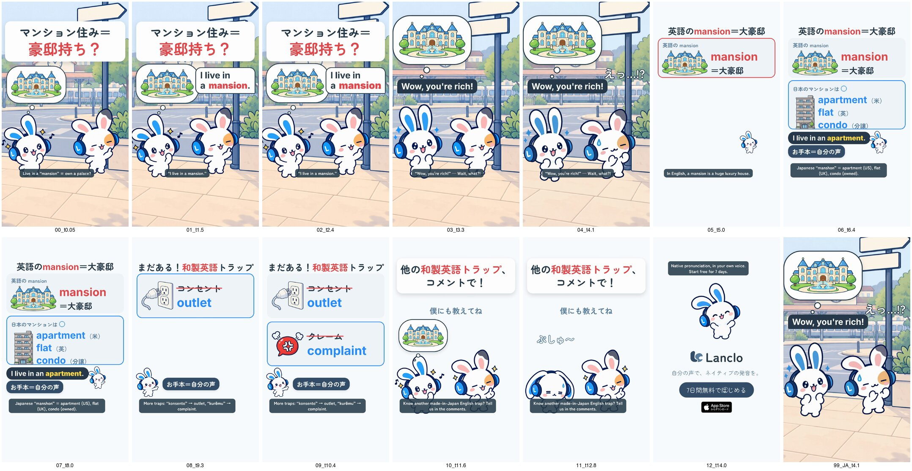

# Katakana Traps 2 - Mansion

[日本語](README.ja.md)

Lanclo SNS short #059, episode 2 of “Katakana Traps” (a meaning trap: the word is said fine, it just means something else). Final, owner approved on 2026-10-23. 15.1 s, 1080×1920, 60 fps, two cuts (Japanese only / English subtitles).

Scene: Mimi and the Friend chatting on a street. Frame 1: 「マンション住み＝豪邸持ち？」 with Mimi's thought bubble of a castle with a fountain. The Friend (owner's own voice): “I live in a mansion.” Mimi's bubble (caption only): “Wow, you're rich!”, the castle grows; the Friend panics. Mimi's card: English mansion＝大豪邸; Japanese マンション = apartment (US) / flat (UK) / condo (owned), with the model “I live in an apartment.” twice in the owner's own voice. Quick-fire trap card: コンセント → outlet, クレーム → complaint (own voice each). CTA 「他の和製英語トラップ、コメントで！」 while Mimi's castle bubble deflates, then the end card.

| Time (s) | Beat id | What |
|---|---|---|
| 0.00–1.25 | `hook` | 「マンション住み＝豪邸持ち？」 from frame 1; Mimi dreaming of a castle with a fountain; the Friend walks up |
| 1.25–4.50 | `slip` | “I live in a mansion.” (own voice, 1.29–2.89); 3.0 Mimi “Wow, you're rich!” (bubble), castle bubble grows; 3.7 the Friend panics 「えっ…!?」 |
| 4.50–8.50 | `explain` | Card: 英語の mansion＝大豪邸 (castle) vs 日本のマンションは apartment（米）/ flat（英）/ condo（分譲） (apartment block); “I live in an apartment.” at 5.5 and 7.0; お手本＝自分の声 |
| 8.50–11.00 | `model` | Quick-fire trap card: コンセント → outlet (8.8), クレーム → complaint (9.8), own voice each |
| 11.00–13.60 | `cta` | 「他の和製英語トラップ、コメントで！」「僕にも教えてね」; 12.1 the castle bubble deflates (ぷしゅ〜), Mimi droops |
| 13.60–15.10 | `end` | End card, CTA tap at 14.2 |

- Cast: Mimi and the Friend only. No side cast, no Kokoro, no app shot.
- Voices: four lines in the owner's registered voice via `kits/mimi-short/scripts/ownvoice.py`; WAVs are biometric and not in Git (Drive `059. Katakana Traps 2 - Mansion/KT2_Mansion_assets/own-voice/`).
- Final files in Lanclo's Google Drive `002.SNS/059. Katakana Traps 2 - Mansion/` (`KT2_Mansion_2026-10-23.mp4`, `KT2_Mansion_EN-subs_2026-10-23.mp4`).
- Rebuild: [source/README.md](source/README.md). Making-of: [PROCESS.md](PROCESS.md). Prompt: [PROMPT.md](PROMPT.md). Credits: [CREDITS.md](CREDITS.md).

