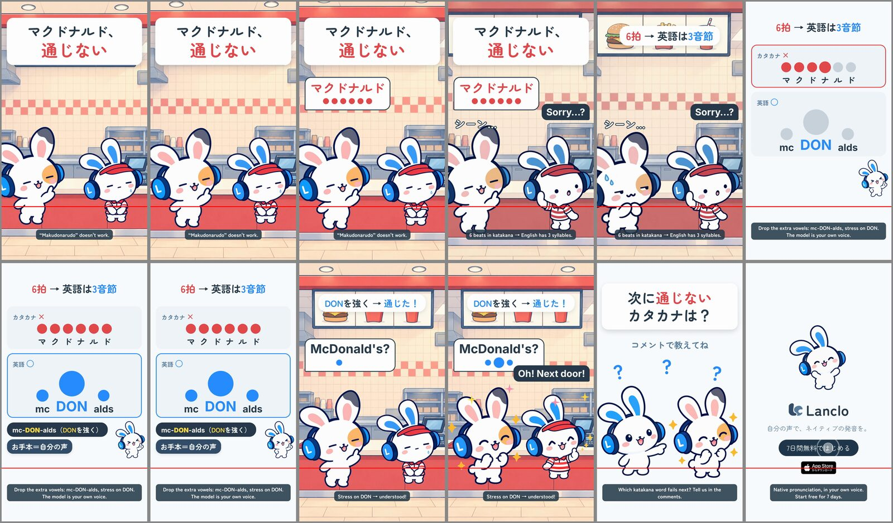

# Katakana Traps 1 - McDonald's

[日本語](README.ja.md)

Lanclo SNS short #058, episode 1 of the new series “Katakana Traps” (one katakana word that fails abroad per episode; the CTA asks viewers for the next word). Final, owner approved on 2026-10-23. 15.5 s, 1080×1920, 60 fps, two cuts (Japanese only / English subtitles).

Scene: a fast-food counter. The Friend asks the clerk (Mimi in a role outfit: striped shirt and visor) for 「マクドナルド」, six even katakana beats, while a six-dot meter fills. Mimi the clerk, blank: “Sorry…?”. Mimi out of role explains on a card: six equal dots vs three dots with a big middle one, mc-DON-alds (DONを強く), the model twice in the owner's own voice. Back at the counter the Friend says it right: “McDonald's?” → “Oh! Next door!”. CTA 「次に通じないカタカナは？」, then the end card.

| Time (s) | Beat id | What |
|---|---|---|
| 0.00–1.30 | `hook` | 「マクドナルド、通じない」 from frame 1; the Friend at the counter, clerk Mimi blank-faced |
| 1.30–4.60 | `slip` | Learner take (owner's voice) “Makudonarudo”, 6 dots light on the measured beats; “Sorry…?” at 2.6; caption 「6拍 → 英語は3音節」 at 3.2 |
| 4.60–9.40 | `explain` | Card: katakana × (6 equal dots, learner take again at 5.0) vs English ○ (mc · DON · alds, middle big; model take at 6.6 and 7.9); 「mc-DON-alds（DONを強く）」; お手本＝自分の声 |
| 9.40–12.00 | `model` | The Friend says it right (model take), 3-dot meter; clerk Mimi smiles “Oh! Next door!”; caption 「DONを強く → 通じた！」 |
| 12.00–14.20 | `cta` | 「次に通じないカタカナは？」「コメントで教えてね」 with Mimi and the Friend |
| 14.20–15.50 | `end` | End card, CTA tap at 14.8 |

- Cast: Mimi (also as the clerk) and her Friend only. No side cast, no Kokoro, no app shot (the optional lesson shot was skipped for tempo).
- Voices: learner and model are the owner's registered voice via `kits/mimi-short/scripts/ownvoice.py`; WAVs are biometric and not in Git (Drive `058. Katakana Traps 1 - McDonalds/KT1_McDonalds_assets/own-voice/`).
- Final files in Lanclo's Google Drive `002.SNS/058. Katakana Traps 1 - McDonalds/` (`KT1_McDonalds_2026-10-23.mp4`, `KT1_McDonalds_EN-subs_2026-10-23.mp4`).
- Rebuild: [source/README.md](source/README.md). Making-of: [PROCESS.md](PROCESS.md). Prompt: [PROMPT.md](PROMPT.md). Credits: [CREDITS.md](CREDITS.md).

## Series template (episodes 2+)

Copy `source/` to `films/mimi-katakana-<word>/source/`, keep the beat ids and the element ids in `hf/index.html`, and swap only the word. Times live in `source/cues.json` (read by `scripts/mix.py`; the same numbers are at the top of the `<script>` in `hf/index.html`).

| Beat | Ids | Swap per episode |
|---|---|---|
| `hook` 0–1.3 | `#hook`, `#scene` (`#plate`, `.learner`, `.other`) | The hook line 「<カタカナ>、通じない」 (or the episode's trap), the plate (`PLATE=` in `scripts/art.sh`) and Mimi's role outfit poses (`art/mimi-<role>-*.png`, codex-p, [prompts/01-codex-mimi-clerk.txt](prompts/01-codex-mimi-clerk.txt)) |
| `slip` 1.3–4.6 | `#say` (`.k` per katakana, `.meter i` per beat), `#sorry`, `#fx-word`, `#beats-cap` | The katakana word, one `.k` + one dot per beat; `LEARNER_BEATS` = measured beat times inside the learner take; the other party's reply; the caption with the episode's rule |
| `explain` 4.6–9.4 | `#card`, `#row-ng`, `#row-ok`, `#c-tip`, `#c-who` | Row ✗: the katakana beats; row ○: the English syllables, the stressed one `.big`; `MODEL_BEATS`; the tip line. Episode 2 (meaning trap) can relabel the rows (カタカナの意味 × / 英語の意味 ○) and use pictures instead of dots; episode 3 (stress) keeps the dots and moves `.big` |
| `model` 9.4–12.0 | `#ok-say`, `#ok-reply`, `#ok-cap`, `#hearts` | The word said right (model take reused), the other party's happy reply |
| `cta` 12.0–14.2 | `#cta`, `#cta-q`, `#cta-sub` | Usually unchanged: 「次に通じないカタカナは？」 |
| `end` 14.2–15.5 | `#end` | Unchanged |

Voices: two lines in `own-voice.json`: `learner-katakana` (custom `style`: the Japanese katakana reading, one clear vowel per beat, flat pitch) and `us-<word>` (custom native style naming the syllables and the stressed one). Verify the learner take acoustically (beat count from band-energy peaks and voiced spans, see PROCESS.md), never by a transcript, and write the measured beat times into `cues.json`. Mimi's Japanese first person is 「僕」. Cast: Mimi (role outfits) and the Friend only.
