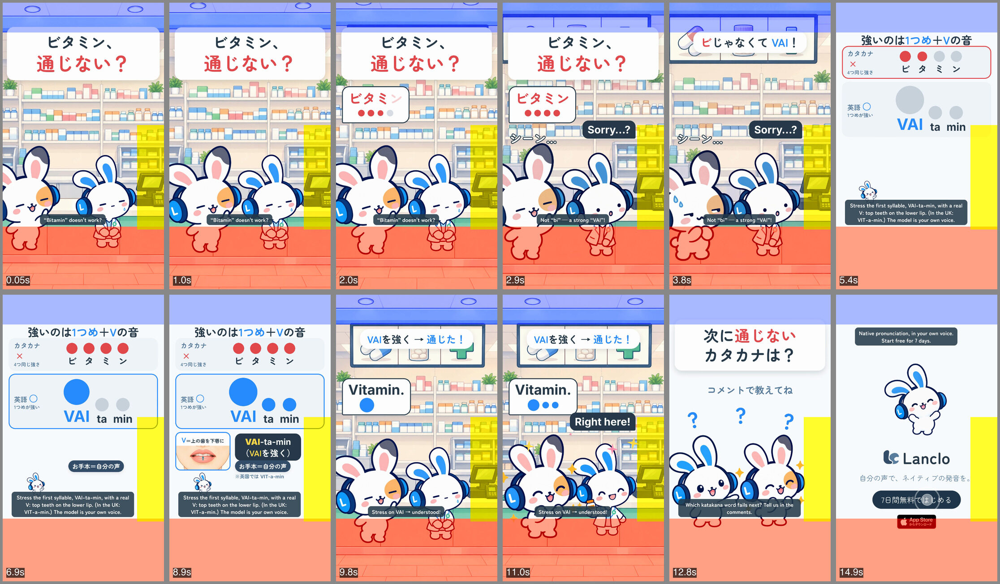

# カタカナの罠 4 - ビタミン

[English](README.md)

Lanclo SNSショート #076。シリーズ「カタカナの罠」第4話（アクセント＋Vの音）。ドラフト v2（2026-10-23、オーナー確認待ち）。15.5秒、1080×1920、60fps、2本（日本語のみ／英語字幕つき）。

1フレーム目から「ビタミン、通じない？」。薬局のカウンターで、友だちが薬剤師（白衣のミミ）に「ビタミン」とカタカナ読み（B で始まる均等な4拍、オーナーの声・学習者スタイル）で言い、4つの点が実測の拍で点灯。薬剤師ミミは無表情で “Sorry…?”、キャプション「ビじゃなくて VAI！」。カードでカタカナ ×（ビ・タ・ミ・ン、同じ大きさの点4つ）と英語 ○（VAI · ta · min、1つめが大）、お手本はオーナー自身の声（米 VAI-ta-min）で2回。V の口の図「V＝上の歯を下唇に」とチップ「VAI-ta-min（VAIを強く）」、小さく「※英国では VIT-a-min」。カウンターに戻り友だちが正しく言えて、薬剤師ミミがビタミンの瓶を見せて “Right here!”。「次に通じないカタカナは？」のあとエンドカード。

| 秒 | ビート | 内容 |
|---|---|---|
| 0.00–1.30 | `hook` | 「ビタミン、通じない？」、カウンターの友だちと無表情の薬剤師ミミ |
| 1.30–4.60 | `slip` | 友だち「ビタミン」、4つの点が点灯、2.6 “Sorry…?”、3.2「ビじゃなくて VAI！」 |
| 4.60–9.40 | `explain` | カード：カタカナ ×（4つ同じ）vs 英語 ○（1つめが大）、お手本2回、V の口の図、チップ、英国の注記 |
| 9.40–12.00 | `model` | 友だちが正しく言う、薬剤師ミミ “Right here!”、「VAIを強く → 通じた！」 |
| 12.00–14.20 | `cta` | 「次に通じないカタカナは？」「コメントで教えてね」 |
| 14.20–15.50 | `end` | エンドカード、14.8 で CTA タップ |

- キャスト：ミミ（薬剤師役も）と友だちのみ。サイドキャスト・Kokoro・アプリ画面なし。
- 絵：ミミの薬剤師ポーズ3つと薬局の背景を codex-p で描画（[prompts/01-codex-mimi-pharmacist.txt](prompts/01-codex-mimi-pharmacist.txt)）。V の口の図は [films/mimi-disaster-very](../mimi-disaster-very/README.md) から再利用。
- 声：オーナーの登録音声で2行（お手本は V の出だしのため1回だけ再生成）。WAV は生体情報のため Git 外（Drive `076. Katakana Traps 4 - Vitamin/KT4_Vitamin_assets/own-voice/`）。アクセントと V の出だしは音響で確認（[PROCESS.md](PROCESS.md)）。
- ドラフト：Lanclo の Google Drive `002.SNS/076. Katakana Traps 4 - Vitamin/`（`KT4_Vitamin_draft_2026-10-23.mp4`、`KT4_Vitamin_draft_EN-subs_2026-10-23.mp4`）。
- ラウドネス：-14.3 LUFS、-2.1 dBTP（2本とも）。

