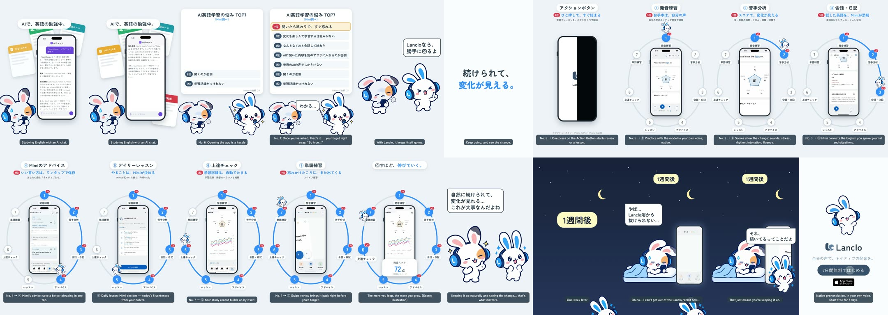

# One loop in Lanclo

**English** · [日本語](README.ja.md)

Mimi's friend studies English with a generic AI chat: she types 「"touch base" ってどういう意味？」 and gets a wall of text, while other study apps (AI chat, flashcards, notes, pronunciation videos; no brands) pile up behind the phone. Mimi presents 「AI英語学習の悩み TOP7（Mimi調べ）」 (marked 「※Mimiの独断です」), counting down from No. 7 to No. 1 「聞いたら終わりで、すぐ忘れる」 while the friend nods 「わかる…」. Mimi: 「Lancloなら、勝手に回るよ」. Copy: 「続けられて、変化が見える。」 One press on the Action Button opens Lanclo (No. 6). Then a loop with Lanclo (the real app, simulator) in the middle and seven stops. Mimi runs round it, and each stop shows a real screen and ticks off a ranked struggle: ① the model in your own voice (No. 5) ② five-angle scores (No. 2) ③ Mimi corrects what you said (No. 3) ④ save a better phrasing in one tap (No. 4) ⑤ the daily lesson Mimi builds ⑥ the learning record (No. 7) ⑦ swipe review that comes back right before you'd forget (No. 1). On the faster laps a score ticks up (labelled 「※数値はイメージ」). The friend: 「自然に続けられて、変化が見れる…これが大事なんだよね」. One week later, in bed at night, swiping review cards: 「やば…Lanclo沼から抜けられない…」. Mimi: 「それ、続いてるってことだよ」. End card.

0:33.3 / 1080×1920, 60 fps / two cuts: Japanese only, and with English subtitles / 2D Mimi and her friend, simulator recordings in a phone frame / no voices (speech bubbles)

Rebuild: [source/README.md](source/README.md). Process: [PROCESS.md](PROCESS.md). Prompt: [PROMPT.md](PROMPT.md). Credits: [CREDITS.md](CREDITS.md). Final MP4s in Lanclo's Google Drive `002.SNS/018. One Loop in Lanclo/`.
