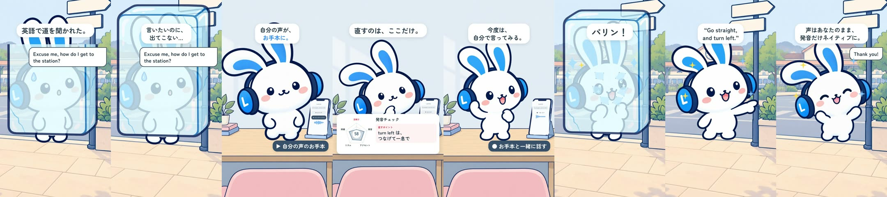
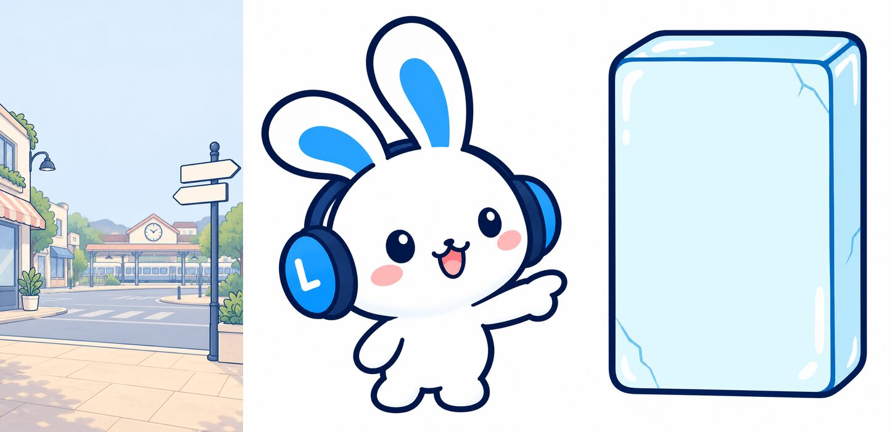
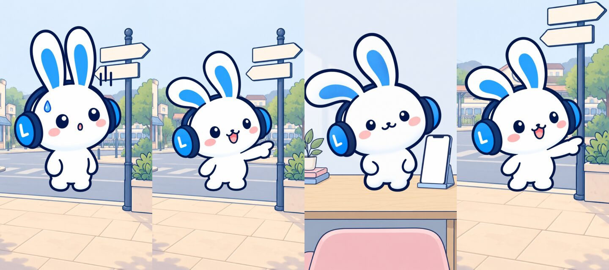
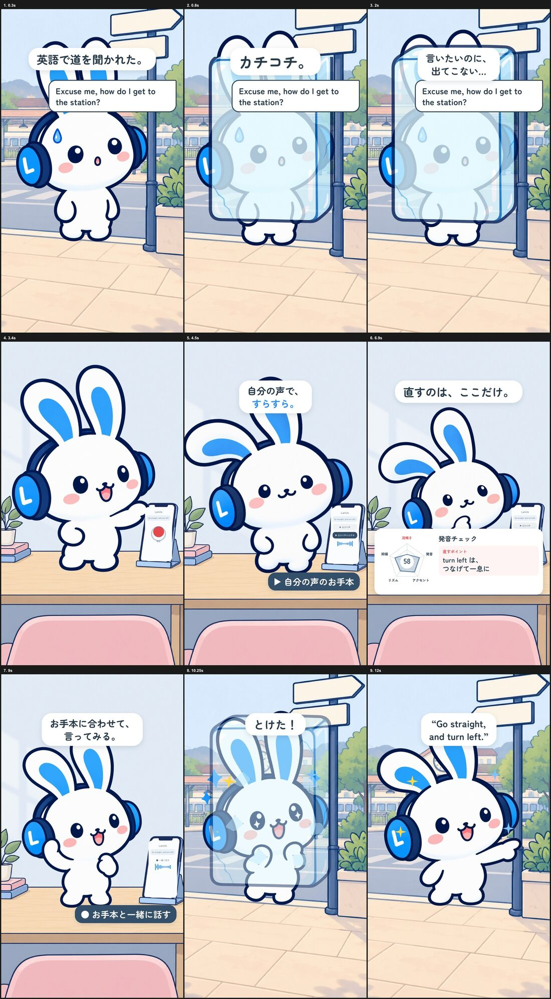

# 制作過程 — 「道を聞かれて固まる」（Mimi 2Dショート 3本目）

Mimiショート3本目の制作記録です。共通キットの作り方は [films/mimi-think-sink](../mimi-think-sink/PROCESS.md)、統合プロンプトは [PROMPT.md](PROMPT.md)。

- 制作日：2026-10-20
- 役割：Claude Code（構成・演技・音・編集・判断）、Codex（`codex-p`：絵の生成とレビュー）
- 道具：Rive CLI 1.6.0、HyperFrames 0.8.181、Kokoro TTS、ffmpeg、ImageMagick、Python

## 1. 進め方

2本目「think が sink に」の承認時の指示：

> 最高。これで。これも整理してmainに残して次へいこう。

ストーリー案の2つ目「道を聞かれて固まる」を、別のworktree（`feat/mimi-ep02-michi`）で作った。

## 2. 見立て

2本目で効いた「言葉を文字どおりの物で見せる」（sink＝流し台）を引き継ぎ、「固まる」を氷漬けにした。外で話しかけられて固まり、机で練習し、外に戻って答えられる、の3幕。新しく要るのは街角の背景・道を指すポーズ・氷だけ。

## 3. 絵

Codexに公式PNG、ライブラリのポーズ（reach、confident）、机の背景を添付して描かせた（[prompts/01-codex-street-pose-props.txt](prompts/01-codex-street-pose-props.txt)）。

- 街角の背景は、リグの足の位置（480, 1330）が車道に乗ってしまった。背景を上下に切り出して拡大し、右寄せで道しるべを残すよう3回調整して歩道に乗せた。
- 指すポーズは頭が小さく見えたので高さを1000→1100。

## 4. 編集と音

- 氷は編集で重ねた。最初は小さく耳とヘッドホンがはみ出したので、体全体を包む大きさに。
- 通行人の吹き出しが2行の字幕に触れたので、キットの吹き出しを少し下げた（460 px）。
- キットに足したもの：凍る音・割れる音、こもった声（`muffle`）、吹き出し。どれも次の回で使える。

## 5. レビュー

完成版の2コマ/秒のシートをCodexにレビューさせた（[prompts/02-codex-final-cut-review.txt](prompts/02-codex-final-cut-review.txt)、[reviews/final-cut-review.md](reviews/final-cut-review.md)）。

| 指摘 | 採否 |
|---|---|
| 冒頭は質問を読んでから氷が来る2段階。質問の最中に氷を | 採用：氷を0.35秒から張る |
| 「自分の声で、すらすら。」はMimiが既に話せているとも読める | 採用：「自分の声が、お手本に。」 |
| カードの直すポイントが小さい | 採用：文字を大きく（キット全体で44 px）、「つなげて一息で」 |
| 聴く場面と練習の場面が音なしで区別しにくい | 採用：「今度は、自分で言ってみる。」 |
| 価値の一文が遅く短い | 不採用：シリーズで締めの流れをそろえる |
| 割れているのに「とけた！」は合わない | 採用：「パリン！」 |

## 6. 承認と記録

> いいね。次へ

承認後、指すポーズ・街角の背景・氷をLancloの `design/mimi-2d` にPR（native-voice-clone #463）。リグは `--bg street` のように背景を名前で選べるようにした。キットへ同期し、作品側の切り抜きは消してライブラリのものを使う形にした。

## 学んだこと

- 新しい背景は、リグの足の位置に合わせて切り出す。描かせるときに「立つ位置の高さ」を指定しても、ずれる前提で調整する。
- 見立てネタ（物で言葉を見せる）はシリーズの型として使える。
- 画面外の話し手は吹き出しだけで足りる。新しいキャラクターを描かずに済む。
