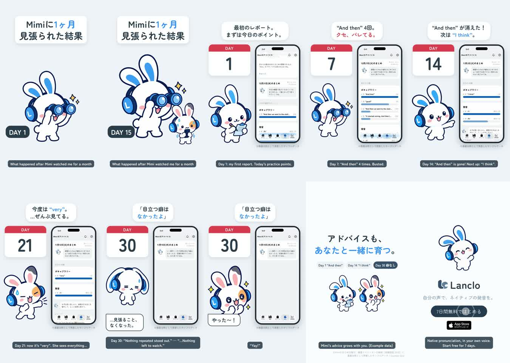

# Mimiに1ヶ月見張られた結果 — 2D Mimiショート

[English](README.md) · **日本語**

1フレーム目から「Mimiに1ヶ月見張られた結果」。双眼鏡のMimiがぐっと寄り、友だちが震え、日数が1から30へ。そこから実アプリの「Mimiのまとめ」のタイムラプス（例として用意したデータで5日分を録画）：1日目は最初のレポート（今日の練習のポイント）、7日目は “And then” 4回、14日目は “And then” が消えて “I think”、21日目は “very”、30日目は「いい調子！この7日間は目立つ癖はなかったよ。」— Mimiはしょんぼり（「…見張ること、なくなった。」）、友だちは「やった〜！」。コピー「アドバイスも、あなたと一緒に育つ。」画面に「サンプルデータ」と表示。

0:18.6 / 1080×1920・60fps / 日本語の字幕と吹き出し、声なし / 公式2Dポーズ＋GSAP、実アプリ（シミュレーター、QAフィクスチャ＋撮影用の日付パッチ）＋HyperFrames

2本：日本語のみ（`mimi-month.mp4`）と英語字幕つき（`mimi-month-en.mp4`）。下書きはLanclo Google Drive `002.SNS/036. Watched by Mimi for a Month/`（`Month_draft_2026-10-21.mp4`、`Month_draft_EN-subs_2026-10-21.mp4`、素材は `Month_assets/`）。

ファイルの案内は [README.md](README.md) を参照。
