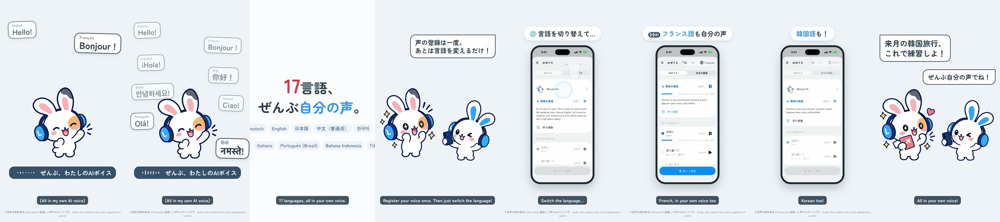

# Your voice in every language — a 2D Mimi short

**English** · [日本語](README.ja.md)

Within the first second, Mimi's friend greets in language after language — Hello! Bonjour ! ¡Hola! 你好！ 안녕하세요! Ciao! Olá! नमस्ते! … — back to back, each bubble popping as its word starts, all in one and the same voice. The copy card says「17言語、ぜんぶ自分の声。」(17 languages, all your own voice) over the app's 17 study languages. Mimi: "Register your voice once. Then just switch the language!" The real app (simulator, fixture data): AI Voice → 🌐 language menu → Français → 読み込み中… → the 将来の発音 passage in French, 試聴 plays; then 한국어 shows the Korean passage. The friend: "I'll practise for my Korea trip next month!" — end card.

0:19.55 / 1080×1920, 60 fps / Japanese speech bubbles and captions / official 2D poses + GSAP, real app (simulator) + HyperFrames

**The voice is the owner's own registered Lanclo voice** (Gemini gemini-3.8-flash-tts, the voice registered in Lanclo's dedicated Gemini project), one and the same speaker in every language: Hello! Bonjour ! ¡Hola! 你好！ 안녕하세요! Ciao! Olá! नमस्ते! and the app's French passage, each with a native-pronunciation direction for its language (`source/own-voice.json`). German, Russian, Turkish, Vietnamese and Japanese in the final burst are bubbles only. The clips are biometric data: not in Git (Drive `Multilang_assets/own-voice/`); Git keeps `source/own-voice.json` and `source/own-voice.receipt.json`. The on-screen note reads ※音声は制作者本人がLancloに登録した声のAIボイスです. The friend on screen is a female character speaking with the owner's (male) voice.

Two cuts: Japanese only (`mimi-multilang.mp4`) and with English subtitles (`mimi-multilang-en.mp4`); final files in Lanclo's Google Drive `002.SNS/022. Your Voice in Every Language/` (`Multilang_2026-10-21.mp4`, `Multilang_EN-subs_2026-10-21.mp4`, raw take in `Multilang_assets/`).

## Files

- [PROCESS.md](PROCESS.md) (Japanese): the owner's directions and the decisions.
- [PROMPT.md](PROMPT.md) (Japanese): a consolidated instruction to remake it.
- [prompts/](prompts/): the Codex prompt for the two new poses and its log.
- [source/](source/README.md): app capture (walkthrough + capture-only patch), poses, voices, sound, HyperFrames edit, build steps.
- [CREDITS.md](CREDITS.md): materials and rights.
