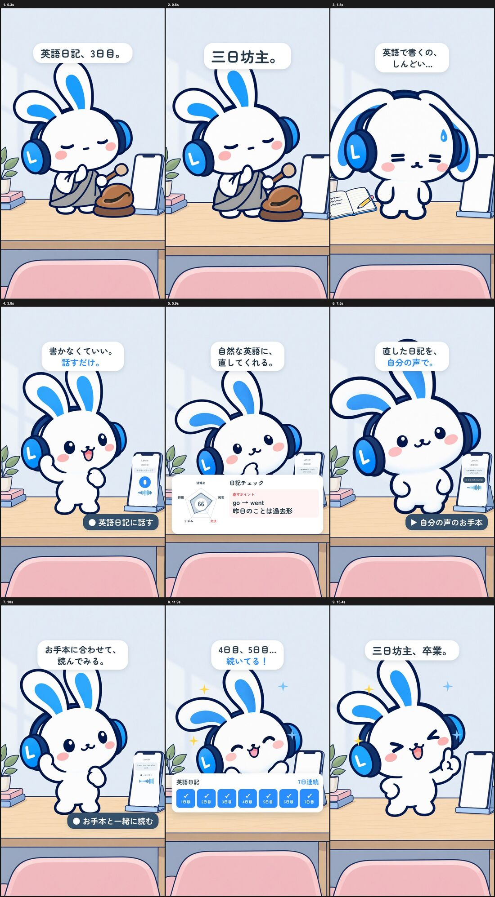
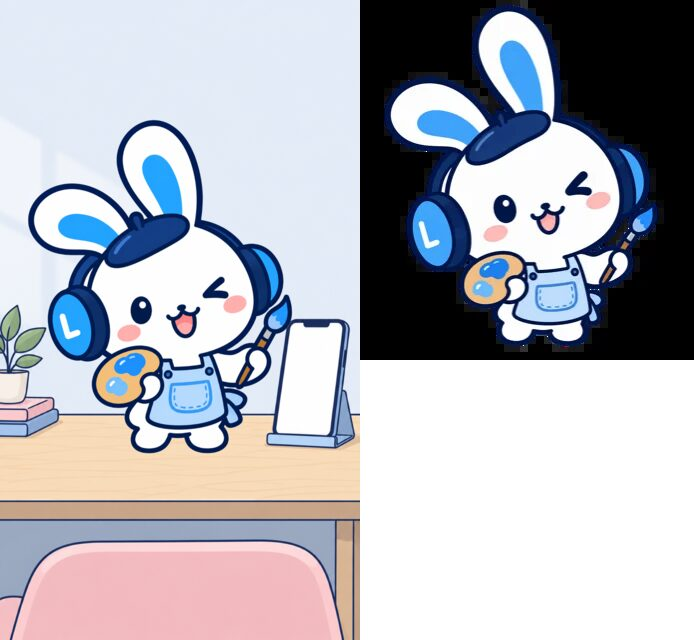
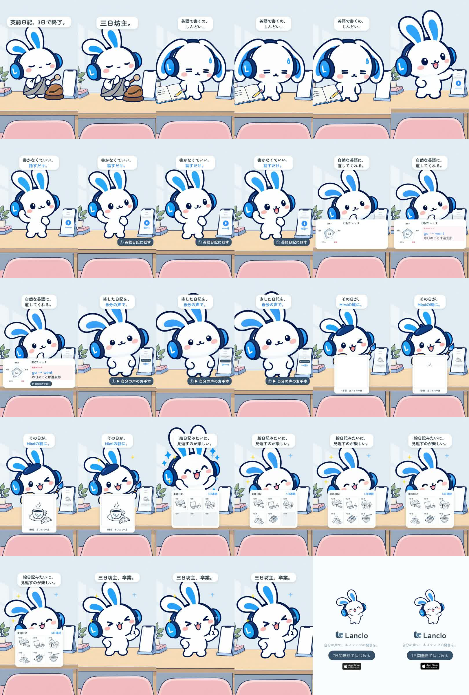

# 制作過程 — 「日記、3日で終わる」（Mimi 2Dショート 4本目）

Mimiショート4本目の制作記録です。共通キットは [films/mimi-think-sink](../mimi-think-sink/PROCESS.md)、統合プロンプトは [PROMPT.md](PROMPT.md)。

- 制作日：2026-10-20
- 役割：Claude Code（構成・演技・音・編集・判断）、Codex（`codex-p`：絵の生成とレビュー）
- 道具：Rive CLI 1.6.0、HyperFrames 0.8.181、Kokoro TTS（2026-10-21に依頼者本人の声へ差し替え）、ffmpeg、ImageMagick、Python

## 1. 見立て

3本目の承認時の指示：

> いいね。次へ

ストーリー案3つ目「日記、3日で終わる」。シリーズの型（言葉を文字どおりに見せる）で、三日坊主を本当のお坊さん（衣と木魚）にした。

## 2. 最初の版とレビュー

最初の版は、話す → 日記チェック → 自分の声で聴く → お手本と一緒に読む → カレンダーに✓が並ぶ、で締めた。

Codexのレビュー（[reviews/final-cut-review.md](reviews/final-cut-review.md)）：

| 指摘 | 採否 |
|---|---|
| 冒頭の「3日目」だけでは挫折が読めない | 採用：「英語日記、3日で終了。」を大きく |
| "Today..." なのに「昨日のことは過去形」は矛盾 | 採用：声を "Yesterday... I go to cafe." と "Yesterday, I went to a cafe." に作り直し |
| 「自分の声」が字幕頼み。ラベルを「ミミの声で再生」に | 不採用：シリーズの表記「自分の声のお手本」をそろえる |
| カードで「go → went」が弱い | 採用：60 pxで大きく |
| 話す・聞く・読むの区別がつきにくい | 採用：ラベルに①②③ |

## 3. 依頼者の提案で作り直し

> いいね。ただイラスト生成もついてくるから楽しく振り返れて3日坊主卒業っていうシナリオの方が機能紹介にもなるのでは？どうする？

英語日記は、その日をMimiが絵にしてカレンダーに並べる。それを「続く理由」にした方が機能紹介にもなる、という提案。採用し、後半を作り直した。

- 8.0–9.8秒：絵描きMimiが描き、額の中でカフェの絵が描き上がる。
- 9.8秒〜：絵のカレンダー。1〜3日目に過去の絵、今日の4日目にカフェ、5・6日目が続く。
- 時間を空けるため「お手本と一緒に読む」を外した（自分の声のお手本は聴く場面に残る）。
- 絵はアプリの英語日記の見本の絵（`films/lanclo-one-line/source/assets/journal-art.png`）を切り出して使用。
- 絵描きMimiはアプリの公式イラストが334 pxで粗いので、同じデザインでCodexに描き直させた（[prompts/03-codex-artist-hires.txt](prompts/03-codex-artist-hires.txt)）。

作り直した部分だけ、Codexにもう一度レビューさせた（[prompts/04-codex-revised-cut-review.txt](prompts/04-codex-revised-cut-review.txt)、[reviews/revised-cut-review.md](reviews/revised-cut-review.md)）。

| 指摘 | 採否 |
|---|---|
| 絵がしばらく白いまま | 採用：0.7秒で描き上がり、そのまま見せる |
| 大きな絵がカレンダーの小さなマスになり、つながりが見えにくい | 採用：今日の4日目を青枠で強調してから5・6日目 |
| 「三日坊主、卒業。」の時にカレンダーが消える | 採用：最後までカレンダーを出しておく |

## 4. 承認と記録

> いいね。他の機能も。

お坊さん・絵描きMimi・紙の日記をLanclo `design/mimi-2d` にPR（native-voice-clone #465）。台本はNotionのContent Calendarに入れた。

## 学んだこと

- 機能紹介の回は、機能の一番楽しいところをオチの理由にする（「続く理由」＝絵）。依頼者の視点が効いた。
- 台本の英語と字幕の説明は、時制や日付まで矛盾しないか確認する（Today と過去形）。
- アプリの公式イラストは小さいことがある。動画で大きく使うなら同じデザインで描き直す。

## 依頼者本人の声に差し替え（2026-10-21）

> 「今まで英語で発音シーンがあった動画、この声で変えて。010以外。」

Gemini `gemini-3.8-flash-tts`（Lanclo専用プロジェクトに登録された依頼者本人の声 "Lanclo private practice"）を `kits/mimi-short/scripts/ownvoice.py` で呼び、`source/own-voice.json` の行を作った。声の素材は依頼者の生体データなのでGitに入れない（Gitには `own-voice.json` と `own-voice.receipt.json` だけ。WAVはDriveの エピソードフォルダの `<接頭辞>_assets/own-voice/`）。

- `rough` "Yesterday... I go to cafe."：`learner`。最初の版は話し部分が3.9秒（Yesterdayだけで1.6秒）と遅すぎたので、「普通の速さで、Yesterdayの後に短い間だけ」と足して1回作り直し（2.48秒）。
- `model` "Yesterday, I went to a cafe."：`us`（2.10秒）。
- 本物の声はKokoroより長いので、話すショット `talk` を1.8→2.8秒、お手本を聴く `listen` を1.6→2.2秒に延ばした。話す声は3.35〜5.83秒、お手本は7.45〜9.55秒。それより後（日記チェック、絵、カレンダー、締め、エンドカード）は+1.0秒／+1.6秒ずらし、全体は16.6秒。口パク（`lipsync-rough.json`）とうなずきを作り直し、字幕・タグ・波形・カメラ・効果音も同じ時刻に合わせた。
- 画面のMimiは女の子のキャラクターだが、声は依頼者（若い男性）の声になる。絵は変えていない。
- Kokoroの声2本（`af_heart`）と `scripts/voices.sh` は使わなくなったので消した。
