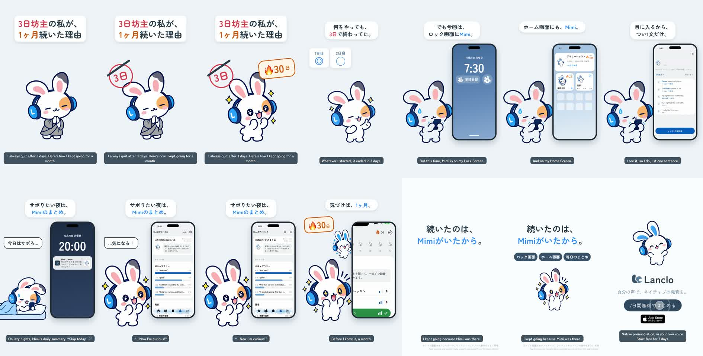

# 3日坊主の私が、1ヶ月続いた理由 — 2D Mimiショート

[English](README.md) · **日本語**

1フレーム目から「3日坊主の私が、1ヶ月続いた理由」。Mimiの友だちが小さな「3日坊主」（お坊さん）で登場し、赤い「3日」のハンコに線が引かれ「🔥30日」が飛び込む。いつもの3日坊主（1日目◎・2日目◯・3日目△・4日目✕で寝る）のあと、Lancloのウィジェットが何度も引き戻す：ロック画面のMimi（英語日記・フレーズを追加）、ホーム画面のデイリーレッスン（連続日数のバッジ）、タップで実アプリのデイリーレッスン。サボりたい夜は20:00の練習リマインダーが、気づきがある日の実際の文言「Mimiが今日のまとめで気づいたことがあるよ。見てみよう！」で届き、Mimiのまとめに自分の癖。1ヶ月後、実アプリのホームに連続30日。コピー「続いたのは、Mimiがいたから。」

0:19.0 / 1080×1920・60fps / 日本語の字幕と吹き出し、声なし / 公式2Dポーズ＋GSAP、実アプリ（シミュレーター、QAフィクスチャ）＋HyperFrames

2本：日本語のみ（`mimi-quitter.mp4`）と英語字幕つき（`mimi-quitter-en.mp4`）。完成版はLanclo Google Drive `002.SNS/029. How a Quitter Kept Going for a Month/`（`Quitter_2026-10-21.mp4`、`Quitter_EN-subs_2026-10-21.mp4`、素材は `Quitter_assets/`）。

ファイルの案内は [README.md](README.md) を参照。
