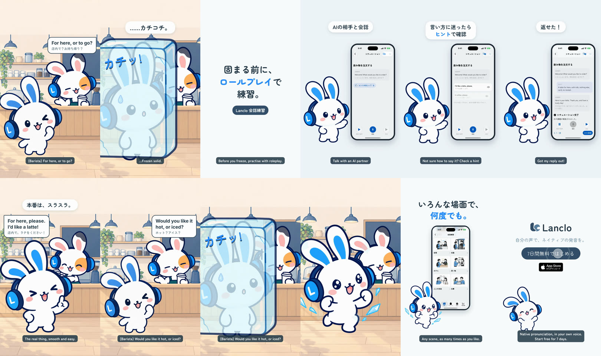

# Roleplay — Frozen at the café

**English** · [日本語](README.ja.md)

At a café counter, Mimi's friend (in a barista's apron) asks "For here, or to go?" and Mimi freezes solid — カチッ. She practises in Lanclo's 会話練習 (roleplay): picks the café scene, talks with the AI conversation partner, opens ヒントがほしい？ for example answers, records her reply and gets シチュエーション完了. Back at the counter she orders smoothly ("For here, please. I'd like a latte!") — until the barista asks something new, "Would you like it hot, or iced?", and she freezes again. This time she breaks out grinning and dives into more scenes. Copy: 「いろんな場面で、何度でも。」 Self-contained (no Action Button tie-in).

0:18.0 / 1080×1920, 60 fps / two cuts: Japanese only, and with English subtitles / 2D Mimi and her friend beside a simulator recording (QA fixture) / English lines voiced (the barista with Kokoro, Mimi's order in the owner's own registered Lanclo voice), everything Japanese on screen

Rebuild: [source/README.md](source/README.md). Process: [PROCESS.md](PROCESS.md). Prompt: [PROMPT.md](PROMPT.md). Credits: [CREDITS.md](CREDITS.md). Final MP4s and the raw take in Lanclo's Google Drive `002.SNS/017. Roleplay - Frozen at the Cafe/`.
