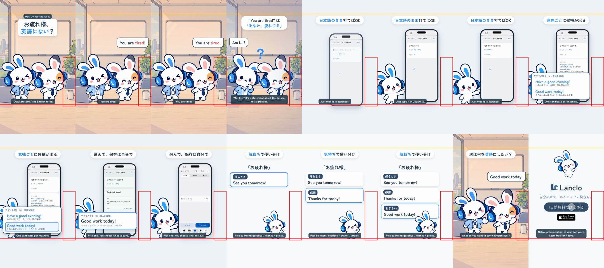

# How Do You Say It? 2 — Otsukaresama

**English** · [日本語](README.ja.md)

Episode 2 of the feature-led series "How Do You Say It?" ([episode 1](../mimi-say-yoroshiku/README.md) is the template). At the end of the workday the Friend waves at Mimi, the colleague, and says "You are tired!" — Mimi is puzzled: "Am I…?". "You are tired" is a statement about the person, not a greeting. In the app the Friend types 「仕事終わりにお疲れ様」 in Japanese, taps フレーズを作成, and Lanclo's composer returns its real answer: two candidates, one per meaning (意味を選択): "Have a good evening!" (leaving) and "Good work today!" (praise). The Friend picks "Good work today!" and saves it. Mimi's card splits お疲れ様 by intent: leaving "See you tomorrow!" / thanks "Thanks for today!" / praise "Good work today!". Closes with 「次は何を英語にしたい？」.

0:18.05 / 1080×1920, 60 fps / two cuts: Japanese captions only, and with English subtitles (`kits/mimi-short/render-cuts.sh`) / -14 LUFS, true peak ≤ -1.5 dBTP / platform safe zones kept (bottom 420 px, right action rail, top 200 px) / the owner's own voice for the English lines / 2D Mimi and her Friend (pose swap + HyperFrames) beside a simulator recording of the iOS app

Status: final, owner approved on 2026-10-23. Final files in Drive `002.SNS/064. How Do You Say It 2 - Otsukaresama/` as `Say2_Otsukaresama_2026-10-23.mp4` and `Say2_Otsukaresama_EN-subs_2026-10-23.mp4`.

## Files

- [PROCESS.md](PROCESS.md) (Japanese): the making-of, the owner's words, which real composer answer is shown.
- [PROMPT.md](PROMPT.md) (Japanese): a consolidated instruction.
- [process/](process/): the composer's real answers (`compose-probe-otsukare.jsonl`) and frames.
- [source/](source/README.md): rebuild steps.
- [CREDITS.md](CREDITS.md).

## Reproduce

Follow [source/README.md](source/README.md). The simulator take and the own-voice WAVs are in Lanclo's Google Drive (`002.SNS/064. How Do You Say It 2 - Otsukaresama/Say2_Otsukaresama_assets/`).
