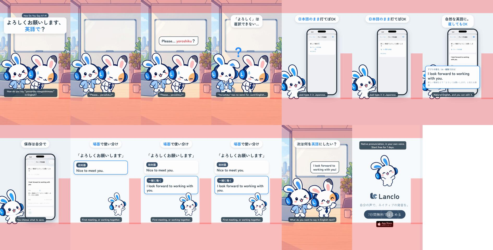

# How Do You Say It? 1 — よろしくお願いします

[English](README.md) · **日本語**

機能紹介シリーズ「How Do You Say It?」の第1話（シリーズの型）。1対1の英語がない日本語を、Lanclo の実際のフレーズ作成に入れる。初出勤でお辞儀のまま固まる友だちの "Please... yoroshiku?" に、同僚役の Mimi は困惑。アプリで「新しい職場でよろしくお願いします」と日本語のまま打ち、「フレーズを作成」で作成機能の本物の答え "I look forward to working with you." が出る（編集できる）、保存。Mimi のカードで場面ごとに：初対面 "Nice to meet you." / 一緒に働く "I look forward to working with you."。締めは「次は何を英語にしたい？」。

0:18.6 / 1080×1920・60fps / 日本語字幕のみと英語字幕つきの2本 / 英語はオーナー本人の声 / 2DのMimiと友だち（ポーズ切り替え＋HyperFrames）＋iOSアプリのシミュレーター録画

状態：完成版（2026-10-23、オーナー承認済み）。完成版は Drive `002.SNS/063. How Do You Say It 1 - Yoroshiku Onegaishimasu/` の `Say1_Yoroshiku_2026-10-23.mp4`、`Say1_Yoroshiku_EN-subs_2026-10-23.mp4`。

制作の経緯は [PROCESS.md](PROCESS.md)、統合プロンプトは [PROMPT.md](PROMPT.md)、作り直しとシリーズの型は [source/README.md](source/README.md)。
