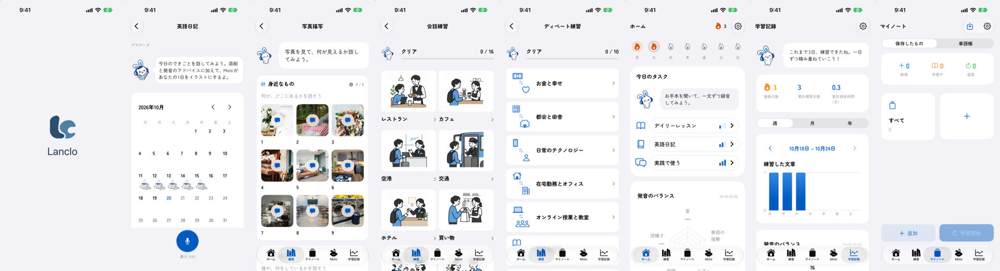
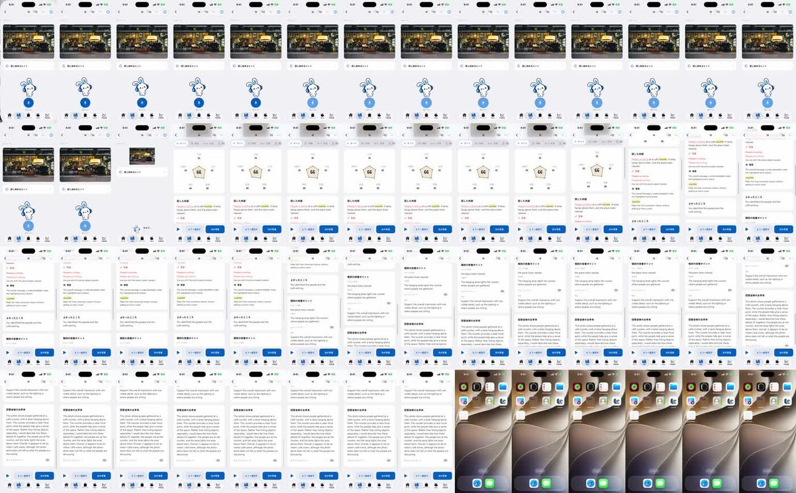
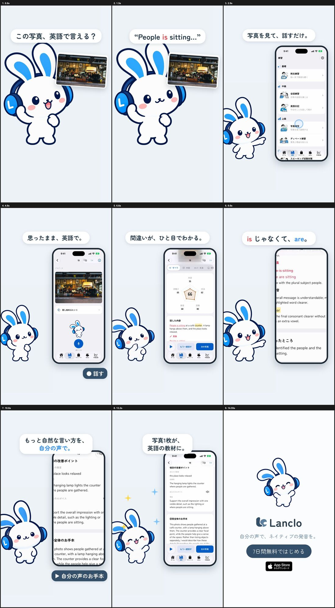

# 制作過程 — 「写真で英語」（Mimiショート 5本目・実画面）

Mimiが実際のLancloアプリを使う最初の回の記録です。統合プロンプトは [PROMPT.md](PROMPT.md)。

- 制作日：2026-10-20
- 役割：Claude Code（構成・録画・演技・音・編集・判断）、Codex（`codex-p`：レビュー）
- 道具：Xcode・iOSシミュレーター（XCUITest、`simctl io recordVideo`）、Rive CLI 1.6.0、HyperFrames 0.8.181、Kokoro TTS、ffmpeg

## 1. 依頼

> いいね。他の機能も。あとMimiが実際にアプリを触っているような動画もつくりたい。実際の画面も見せて

## 2. 実画面をどう撮るか

Lancloのアプリには、UIテスト用に決まったデモデータを表示するモード（`--uitesting --visual-fixtures` と機能ごとの `--qa-…`）がある。シミュレーターでビルドして起動すると、ホーム・英語日記・写真描写・会話練習・ディベート・学習記録・マイノートが個人データなしで表示できた。

操作は既存のUIテスト（`DescribeUITests.swift`）を読み、同じクラス名の操作手順テストに差し替えて実行し、その間 `simctl io recordVideo` で録画した。アプリのリポジトリは変えず、使い捨て（のちにキャッシュ）のチェックアウトで差し替える。

途中で起きたこと：

- 最初のビルドでディスクが満杯（残り189 MB）になり失敗。自分の作った中間ファイル（シミュレーター用ビルド、再ビルド確認のclone、Riveの連番）を消してやり直した。
- `Full` テストプランを指定しないとUIテストが実行されない（`-testPlan Full`）。
- 録画は可変フレームレート（画面が止まっている間はコマがない）。`-ss` で切ると違う瞬間になったので、全体を60 fpsにそろえてからコマ単位で切るようにした。

時間の内訳：初回のビルドが約7分、録画そのものは約1分。2回目以降はビルドをキャッシュから差分で済ませるよう、録画スクリプトを共通キット（`kits/mimi-short/app-capture/`）に移した。

## 3. 話と組み方

Mimiの答えはアプリのデモの書き起こし（"People is sitting at a café counter."）に合わせ、お手本はデモの改善例（"The hanging lamp lights the counter where people are gathered."）と同じ文にした。画面と声が一致する。

Mimiは平らな背景で書き出し、編集で縮小して左へ。スマホの枠は時間指定のない入れ物にした（中の動画と二重に時刻を付けるとHyperFramesのエラー）。

## 4. レビュー

[prompts/02-codex-final-cut-review.txt](prompts/02-codex-final-cut-review.txt)、[reviews/final-cut-review.md](reviews/final-cut-review.md)

| 指摘 | 採否 |
|---|---|
| 冒頭の写真が小さい | 採用：約1.5倍に、Mimiを少し小さく |
| 「自分の声」が伝わりにくい | 採用：「自分の声が、自然な英語のお手本に。」 |
| 直しが小さい | 採用：寄り＋「People is sitting → People are sitting」の大きなカード |
| 66点に目が行き、フィードバックが読めない | 採用：フィードバック部分に寄る |
| 操作の場面が長い | 採用：メニュー0.8秒・一覧0.4秒に短縮 |
| 字幕とスマホが重なる | 採用：スマホを下げて小さく |
| ラベルを「自分の声でお手本再生」に | 不採用：シリーズの表記をそろえる |

## 5. 承認と記録

> いいね。整理してマージ。

完成動画と、アプリの元の録画・切り出しをLancloのGoogle Drive（002.SNS/008. English from a Photo、2026-10-21にNotionのIDごとのフォルダへ移動）に保管。台本はNotionのContent Calendarに。

## 学んだこと

- 実画面は、アプリのQA用デモデータで撮ると個人データを出さずに済み、何度でも同じ画面が撮れる。
- 操作はUIテストで自動化する。録画は1分、切り出しは秒数の表だけで済む。
- 実画面の文字はスマホでは読めない。伝えたい1点は寄りと大きなカードで出す。
