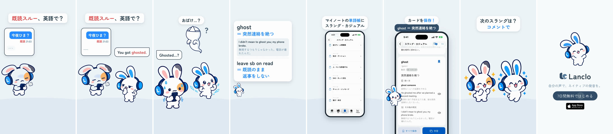

# Real Slang 3 - Ghosted — a 2D Mimi short

**English** · [日本語](README.ja.md)

Status: **draft in progress** (2026-10-23): picture, app take and edit done; the four own-voice clips are not generated yet (shared TTS daily quota), so the mix is provisional (bed + SFX only).

Episode 3 of the series **Real Slang** (one card from Lanclo's official Slang & casual word deck per episode; template [mimi-slang-no-cap](../mimi-slang-no-cap/README.md#series-template-real-slang-episodes-24-hangry-ghosted-mid)). Hook from the first frame:「既読スルー、英語で？」 ("Left on read" — how do you say it in English?) over a chat: the Friend's message 「今夜ひま？」 is read (既読 21:03), the typing dots vanish, no reply. Mimi: "You got ghosted." A little faceless ghost floats out of the chat; the Friend: "Ghosted…?" (「おばけ…？」). A meaning card in the deck's wording, all rows in within 0.9 s: ghost ＝ 突然連絡を絶つ, the deck example "I didn't mean to ghost you; my phone broke." with its translation, and the second card of the unit, leave sb on read ＝ 既読のまま返事をしない. The real app (simulator, shipped deck content): My Notes → 単語帳 → スラング・カジュアル → ユニット8 SNS・ネット文化 → the "ghost" card → save. Comment prompt:「次のスラングは？コメントで」. End card with the CTA tap.

0:17.1 / 1080×1920, 60 fps / four English clips in the owner's voice, Japanese captions and cards / official 2D poses + GSAP, real app (simulator) + HyperFrames

Notion Content Calendar ID 070. Two cuts: Japanese only (`mimi-slang-ghosted.mp4`) and with English subtitles (`mimi-slang-ghosted-en.mp4`); drafts in Lanclo's Google Drive `002.SNS/070. Real Slang 3 - Ghosted/` (`Slang3_Ghosted_draft_2026-10-23.mp4`, `Slang3_Ghosted_draft_EN-subs_2026-10-23.mp4`; raw take and own-voice WAVs in `Slang3_Ghosted_assets/`).

| Beat (id) | Time (s) | What |
|---|---|---|
| hook | 0.0–3.0 | Hook card + the read chat from frame 1 (typing dots gone at 0.8); the Friend (friend-sigh) stares at it; Mimi (tease) "You got ghosted." (bubble + own voice, from 1.0) |
| gag | 3.0–5.0 | A little ghost floats out of the chat with a "?"; the Friend (friend-shock) "Ghosted…?";「おばけ…？」 |
| meaning | 5.0–9.4 | Deck card, every row in by 5.85: ghost row + "Ghost.", the example row + the example (own voice), the leave sb on read row |
| app | 9.4–13.8 | 単語帳 deck list → スラング・カジュアル units → ユニット8 → the "ghost" card → save; counts masked |
| cta | 13.8–15.6 | Both bunnies cheer;「次のスラングは？コメントで」 |
| end | 15.6–17.1 | End card, CTA tap at 16.2 |

Changes from the series template: the meaning card reveals its rows within 0.9 s instead of over 3.6 s (never half empty for more than about 0.5 s); unit 8 is below the fold of the unit list, so the walkthrough swipes once before tapping it.

## Files

- [PROCESS.md](PROCESS.md) (Japanese): the owner's words, the feature check and the decisions.
- [PROMPT.md](PROMPT.md) (Japanese): a consolidated instruction to remake it.
- [prompts/](prompts/): the Codex prompts for the ghost prop and their logs.
- [source/](source/README.md): app capture, voices, sound, HyperFrames edit, build steps.
- [CREDITS.md](CREDITS.md): materials and rights.
