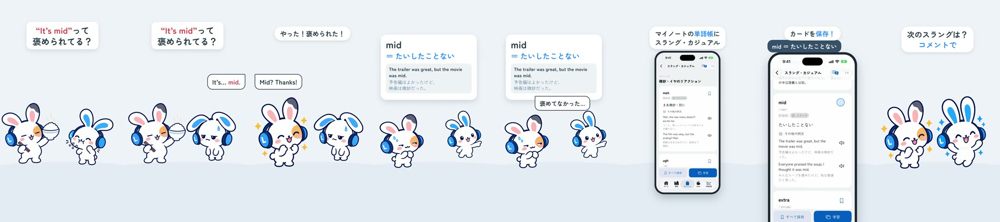

# Real Slang 4 - Mid — a 2D Mimi short

**English** · [日本語](README.ja.md)

Status: **draft** (2026-10-23, waiting for the owner's review). Two own-voice lines (`thanks`, `mid`) are still missing: the shared TTS quota ran out (HTTP 429); their bubbles are on screen, the audio follows after the quota reset.

Episode 4 of the series **Real Slang** (template: [films/mimi-slang-no-cap](../mimi-slang-no-cap/README.md#series-template-real-slang-episodes-24-hangry-ghosted-mid)). Hook from the first frame: 「"It's mid"って褒められてる？」 (Is "It's mid" a compliment?). The Friend proudly serves a rice bowl; Mimi chews and says flatly "It's… mid." The Friend is delighted: "Mid? Thanks!" (「やった！褒められた！」). The deck card in the deck's own wording: mid ＝ たいしたことない, with the deck example "The trailer was great, but the movie was mid." / 「予告編はよかったけど、映画は微妙だった。」; the Friend deflates (「褒めてなかった…」). The real app (simulator, shipped deck content): My Notes → 単語帳 → スラング・カジュアル → ユニット2 微妙・イヤのリアクション → the "mid" card → save. Comment prompt 「次のスラングは？コメントで」, end card with the CTA tap.

0:15.9 / 1080×1920, 60 fps / English clips in the owner's voice, Japanese captions and cards / library 2D poses + GSAP, real app (simulator) + HyperFrames

Notion Content Calendar ID 071. Two cuts: Japanese only (`mimi-slang-mid.mp4`) and with English subtitles (`mimi-slang-mid-en.mp4`); drafts in Lanclo's Google Drive `002.SNS/071. Real Slang 4 - Mid/` (`Slang4_Mid_draft_2026-10-23.mp4`, `Slang4_Mid_draft_EN-subs_2026-10-23.mp4`; raw take and own-voice WAVs in `Slang4_Mid_assets/`).

| Beat (id) | Time (s) | What |
|---|---|---|
| hook | 0.0–3.2 | Hook card from frame 1; the Friend (friend-proud) holds up a rice bowl, Mimi chews (chew), then flat: "It's…" (0.85) "mid." (1.9) |
| gag | 3.2–5.0 | The Friend (friend-yay) "Mid? Thanks!";「やった！褒められた！」 |
| meaning | 5.0–8.4 | Deck card: mid ＝ たいしたことない + "Mid." (5.0), the example row at 5.45 (no half-empty card for more than 0.45 s); the Friend deflates (friend-shrink, 5.7),「褒めてなかった…」 (6.3); Mimi points |
| app | 8.4–12.8 | 単語帳 deck list → スラング・カジュアル units → ユニット2 → the real scroll (sped up) → the "mid" card → save (bookmark at 11.65); counts masked |
| cta | 12.8–14.4 | Both bunnies cheer;「次のスラングは？コメントで」 |
| end | 14.4–15.9 | End card, CTA tap at 15.0 |

## Files

- [PROCESS.md](PROCESS.md) (Japanese): the owner's words, the feature check and the decisions.
- [PROMPT.md](PROMPT.md) (Japanese): a consolidated instruction to remake it.
- [prompts/](prompts/README.md): no new art in this episode.
- [source/](source/README.md): app capture, voices, sound, HyperFrames edit, build steps.
- [CREDITS.md](CREDITS.md): materials and rights.
