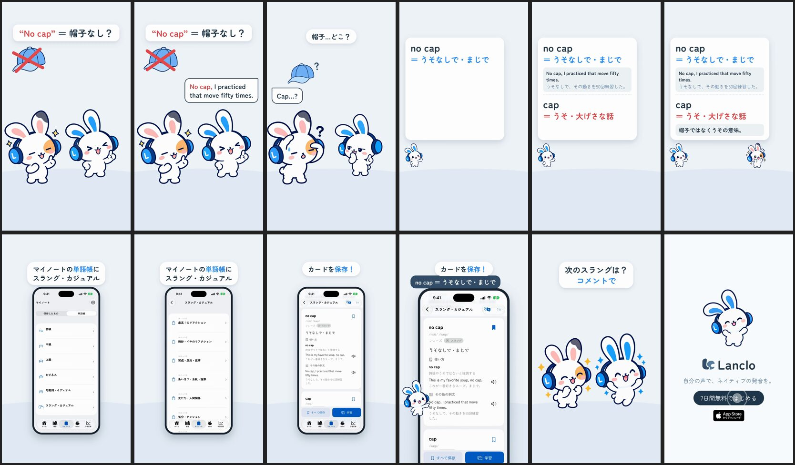

# Real Slang 1 - No Cap — a 2D Mimi short

**English** · [日本語](README.ja.md)

Status: **final** (2026-10-23, owner approved).

Episode 1 of the series **Real Slang**: one card from Lanclo's official Slang & casual word deck per episode. Hook from the first frame:「"No cap" = 帽子なし？」 ("No cap" = no hat?) over a crossed-out baseball cap. Mimi brags with the deck's own example, "No cap, I practiced that move fifty times." The Friend pats his head and looks for a hat: "Cap…?" (「帽子…どこ？」). A meaning card in the deck's wording: no cap ＝ うそなしで・まじで (with that example and its translation), cap ＝ うそ・大げさな話, and the deck's tip 「帽子ではなくうその意味。」. The real app (simulator, shipped deck content): My Notes → 単語帳 → スラング・カジュアル → ユニット3 賛成・反対・返事 → the "no cap" card → save. Comment prompt:「次のスラングは？コメントで」. End card with the CTA tap.

0:17.4 / 1080×1920, 60 fps / three English clips in the owner's voice, Japanese captions and cards / official 2D poses + GSAP, real app (simulator) + HyperFrames

Notion Content Calendar ID 068. Two cuts: Japanese only (`mimi-slang-no-cap.mp4`) and with English subtitles (`mimi-slang-no-cap-en.mp4`); finals in Lanclo's Google Drive `002.SNS/068. Real Slang 1 - No Cap/` (`Slang1_NoCap_2026-10-23.mp4`, `Slang1_NoCap_EN-subs_2026-10-23.mp4`; raw take and own-voice WAVs in `Slang1_NoCap_assets/`).

| Beat (id) | Time (s) | What |
|---|---|---|
| hook | 0.0–3.4 | Hook card + crossed-out cap from frame 1; Mimi (confident) "No cap, I practiced that move fifty times." (bubble + own voice, from 0.25) |
| gag | 3.4–5.3 | The Friend (friend-search) pats his head, "Cap…?"; the cap floats with a "?";「帽子…どこ？」 |
| meaning | 5.3–9.7 | Deck card: no cap row + "No cap." (5.4), the example row + the example again (6.75), cap row (8.1), tip (8.9) |
| app | 9.7–14.1 | 単語帳 deck list → スラング・カジュアル units → ユニット3 → the "no cap" card → save (bookmark at 12.95); counts masked |
| cta | 14.1–15.9 | Both bunnies cheer;「次のスラングは？コメントで」 |
| end | 15.9–17.4 | End card, CTA tap at 16.5 |

## Series template (Real Slang, episodes 2–4: hangry, ghosted, mid)

Copy `source/` to `films/mimi-slang-<word>/source/` and keep the beat ids (`hook`, `gag`, `meaning`, `app`, `cta`, `end`), the layout and the series look (kit colours: words blue `#2a8dff`, the "lie / wrong" side red `#e5484d`, text `#273b4b`, grey card fills `#eef2f5`; hook 74 px, bubbles 56 px, captions `.caption.small`).

1. **Card content**: read the entry from `packages/core/decks/source/slang-casual/<unit>.json` on `origin/main` of the product repo (`git -C ~/Develop/native-voice-clone show origin/main:packages/core/decks/source/slang-casual/<NN>.json`). Use only its `meaning.ja` / `meaning.en`, `examples`, `usage` and `tip`, quoted exactly (the EN subtitles carry `meaning.en`). Check the term is also in the shipped catalogue `native-ios/Lanclo/Resources/official-decks.json`.
2. **Voices** (`own-voice.json`, paid, only these): the example sentence for the hook beat, one reaction word for the gag, the term alone for the meaning card (an isolated take, never cut from the sentence). Place clips whole; measure head/tail 10 ms ≤ -38 dB vs peak.
3. **Deck card capture** (how this episode did it): base = `films/mimi-decks-fine` (origin/main). The walkthrough `source/app-capture/SlangWalkthrough.swift` replaces `OfficialDecksUITests.swift` and launches exactly like `OfficialDecksUITests/testBundledJapaneseCatalogBrowseAndSave`: `--uitesting --visual-fixtures --qa-notes --qa-route /vocabulary`, Japanese, **no** `--qa-official-decks` (that is a small test fixture; without it the app loads the bundled real deck content), no `PATCH`. Change `DECK_UNIT`, `CARD_ID` (the entry `id`, e.g. `cap-slang` style ids: check the JSON), `NEXT_ID` and `UNIT_FIRST_TERM` at the top. It taps 単語帳 → `decks.deck.slang-casual` → `decks.unit.<N>`, swipes fast until `decks.card.<id>` is near the top, taps `decks.save.<id>` (bookmark; a tag menu opens and is dismissed by a tap at the top), then one slow swipe to the next card. Hold the shared lock: `until mkdir /tmp/lanclo-capture.lock 2>/dev/null; do sleep 15; done`, capture, `rmdir` (also on failure).
4. **Cut** with `scripts/app_track.sh` after measuring the take (scene changes: `ffmpeg -vf "scale=300:-1,select='gt(scene,0.004)',metadata=print"`). The fast swipes leave no scroll frames in the recording, so the edit slides the card clip up (`#a-scroll`).
5. **Masks** (counts are never shown): the deck list's 「N語・保存済みN」 lines (`#mask-list`, six rows at 30.1/40.7/51.3/61.9/72.5/83.1 % of the screen) and the unit list's (`#mask-units`, 25.7/38.8/51.8/65.0/78.0 %). The rows only move if the unit list scrolls; check a frame. Unit and card screens show no counts.
6. Swap the hook text and the gag prop (`art/cap.webp` here; a new prop via codex-p with the cast references, cut out, checked on a dark background).

## Files

- [PROCESS.md](PROCESS.md) (Japanese): the owner's words, the feature check and the decisions.
- [PROMPT.md](PROMPT.md) (Japanese): a consolidated instruction to remake it.
- [prompts/](prompts/): the Codex prompt for the new pose and prop, and its log.
- [source/](source/README.md): app capture, voices, sound, HyperFrames edit, build steps.
- [CREDITS.md](CREDITS.md): materials and rights.
