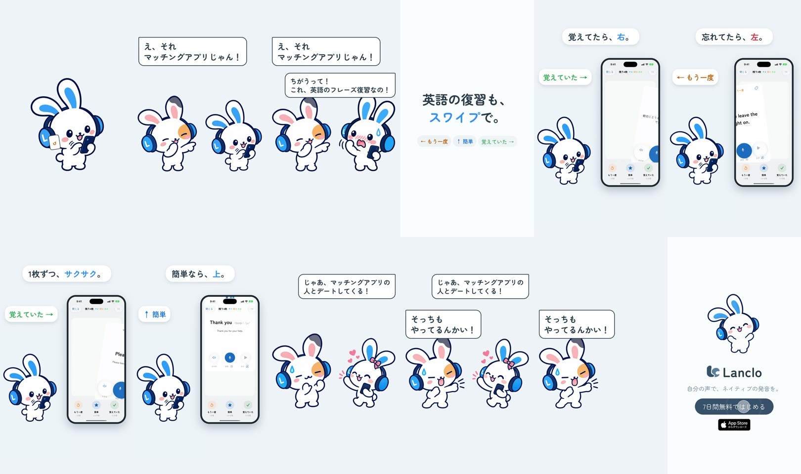

# Swipe review ("That's a dating app!")

**English** · [日本語](README.ja.md)

Mimi is flicking cards right and left on her phone. Her friend teases: "That's a dating app!" Mimi: "No! It's my English phrase review!" A white card says 「英語の復習も、スワイプで。」, then the real Lanclo review cards in the simulator: right = remembered (覚えていた), left = again (もう一度), up = easy (簡単), and the "again" card comes back. Mimi: "Then I'm off on a date with my match!" Friend: "So you ARE using one?!" End card with the CTA tap.

0:17.4 / 1080×1920, 60 fps / Japanese speech bubbles and captions, no voices / 2D Mimi and her friend (cut-outs + one Rive shot, HyperFrames) beside a simulator recording with fixture notes

## Files

- [PROCESS.md](PROCESS.md) (Japanese): the making-of, with the owner's idea.
- [PROMPT.md](PROMPT.md) (Japanese): a consolidated instruction for this episode.
- [prompts/](prompts/): Codex prompts and logs for the new Mimi and friend poses.
- [source/](source/README.md): app capture, app track, shot, sound, edit.
- [CREDITS.md](CREDITS.md).

## Reproduce

Follow [source/README.md](source/README.md). The raw simulator take is kept in Lanclo's Google Drive (`002.SNS/014. Swipe Review/Swipe_assets/`).
