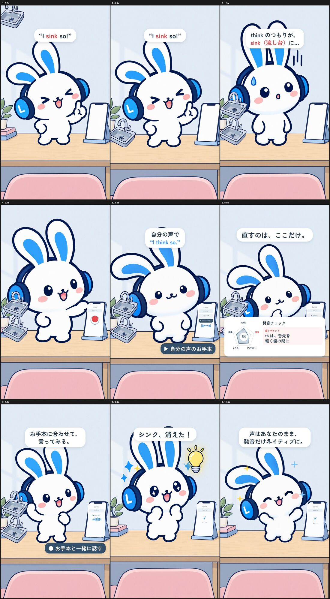
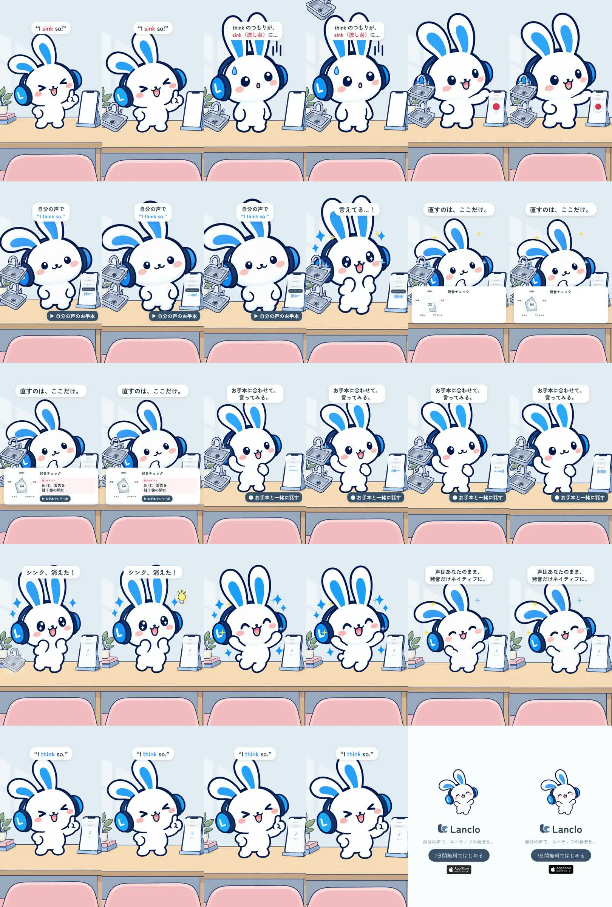

# 制作過程 — 「think が sink に」（Mimi 2Dショート 2本目）

LancloのマスコットMimiの15秒ショート2本目の制作記録です。依頼者の指示、AIに渡したプロンプト、レビュー、判断を起きた順に残します。統合プロンプトは [PROMPT.md](PROMPT.md)、1本目の記録は [films/mimi-jibun-no-koe](../mimi-jibun-no-koe/PROCESS.md)。

- 制作日：2026-10-20
- 役割：Claude Code（構成・キット化・リグ・演技・音・編集・判断）、Codex（`codex-p`：絵の生成とレビュー）
- 道具：Rive CLI 1.6.0、HyperFrames 0.8.181、Kokoro TTS（ローカル、2026-10-21に依頼者本人の声へ差し替え）、ffmpeg、ImageMagick、Python（numpy / scipy / pillow）

## 1. 題材と進め方

1本目の完成後、ストーリー案4つ（think が sink に／道を聞かれて固まる／日記、3日で終わる／写真で英語）を出した。

> １、２、３、４それぞれいいストーリー。作っていこう

> 各動画だけど子Worktree作ってそれぞれ作成していってほしい。でも共通化した方がよさそうだからまず１から作ろうか。それレビューして問題なければ次にいく

そこで、1話ごとに別のworktreeとブランチで作り、この回で共通部分を `kits/mimi-short/` に切り出すことにした。

## 2. 共通キット

1本目の `source/` から、どの回でも同じものを抜き出した（[kits/mimi-short](../../kits/mimi-short/README.md)）。

- **素材の正本はLanclo側**：ポーズ・背景・小道具の正本は Lanclo の `design/mimi-2d`。キットにはその写しを `sync-library.sh` で取り込み、`library/SOURCE` に元のコミットを書く。作品リポジトリだけで作り直せ、正本は1か所のまま。
- **リグ**：ライブラリの `rig2d.py` と同じ作りに、作品用の3つを足した。承認前のポーズを使う `add_pose()`、任意の声から口パクを付ける `lipsync()`（パターンをJSONに残すので声がなくても作り直せる）、全ショットを一度に作る `build_shots()`。
- **音**：`sfx.Mix`（声・効果音・BGMの3系統、声の間はBGMを下げる、-14 LUFS）、100 BPMのBGM、締めの和音、効果音（タップ、シュッ、ぽふっ、ぴょん、金属音、ポフッ、チーン、ベル）。
- **見た目**：`kit.css` / `kit.js`（カメラ、スマホUI、字幕、ラベル、レーダーカード、キラキラ、エンドカード）。HyperFramesはプロジェクト内のファイルしか読めないので、`stage.sh` で `assets/kit/` に写して使う。

1本目はそのまま残し、キットに移し替えていない（承認済みの作品を作り直す理由がない）。

## 3. 声

Kokoro（ローカルのTTS）で "I sink so!" と "I think so." を作った。声は2種類試し、`af_heart` を採用（`af_sky` は少し長く、間延びした）。

注意：文字起こし（HyperFramesのtranscribe）に sink のほうを通すと "I think so" と返ってきた。言語モデルがありがちな文に寄せるためで、発音の確認には使えない。聞き分けは依頼者が耳で確認した。

## 4. 絵

新しく要るのは得意げ・ぼうぜんの2ポーズと、シンク・電球の小道具だけ。Codexに公式PNGとライブラリのポーズを添付して描かせた（[prompts/01-codex-poses-and-props.txt](prompts/01-codex-poses-and-props.txt)）。

- 電球は周りの柔らかい光まで描かれ、そのまま切り抜くと白っぽい縁が残った。切り抜きの許容値を上げて（`FUZZ=30`）光を消し、光は編集のdrop-shadowで付けた。
- ぼうぜんは驚きとして両耳を立てて描かせた（公式は左右非対称）。依頼者はそのまま承認。
- 頭の大きさをそろえるため、ショットの最初のコマを並べて高さを調整（ぼうぜん 1090→1180）。

## 5. ショットと編集

11ショット（[source/scripts/shots.py](source/scripts/shots.py)）。既存の演技はライブラリのまま使い、得意げ・ぼうぜん・話すの3つだけ作品側で作った。シンクと電球はRiveに入れず、編集で落として弾ませて消す（`elastic` で着地、`back.in` で消える、白い煙）。

途中で見つかったこと：

- `xargs -I` は置き換え後のコマンドが255バイトまで。絶対パスにすると書き出しが「command line cannot be assembled」で止まった。パスは環境変数、コマ番号だけを引数で渡すように直し、ライブラリにも戻した。
- 2音のチャイムの合成で長さがずれて足し算できなかった。両方を同じ長さに詰めて修正。

## 6. レビュー

完成版の2コマ/秒のシートをCodexに短尺動画のディレクターとしてレビューさせた（[prompts/02-codex-final-cut-review.txt](prompts/02-codex-final-cut-review.txt)、[reviews/final-cut-review.md](reviews/final-cut-review.md)）。

| 指摘 | 採否 |
|---|---|
| 冒頭は字幕とシンクが別々に来る。シンクをすぐ見せ、早めに着地 | 採用：0.05秒から落とし、0.45秒（"sink" の語）に着地。字幕も大きく |
| 1–2秒の説明字幕が小さく、つながりが読みにくい | 採用：「think のつもりが／sink＝流し台!?」に、大きく |
| 「自分の声で "I think so."」は「言ってみて」とも読める | 採用（文言は調整）：「自分の声が "I think so."」 |
| カードの直すポイントが小さい | 採用：文字を大きく |
| エンドカードが1秒には小さい | 不採用：1本目で依頼者が承認した締め。シリーズでそろえる |

## 7. 承認と記録

> 最高。これで。これも整理してmainに残して次へいこう。

承認後、新しいポーズと小道具、リグの改良（`add_pose` / `lipsync` / `build_shots`、`xargs` の修正、`FUZZ`）を Lanclo の `design/mimi-2d` にPRで戻し（native-voice-clone #461）、キットへ同期。作品側の切り抜きは消し、ライブラリのものを使う形にした。声2本は自前のTTSなのでGitに入れた。

## 学んだこと

- 2本目以降は「新しい絵2〜4枚＋作品の演技2〜3個＋合図の表」だけで1本になる。共通部分はキットで固定し、作品ごとに直さない。
- 言い間違いネタは、文字起こしで確認できない。人の耳で確かめる。
- 小道具は編集側で動かすと、Riveの書き出しを待たずに何度でも直せる。
- 見立て（sink＝流し台）は冒頭0.5秒以内に物を出し、字幕と同時に読ませる。

## 8. 依頼者本人の声に差し替え（2026-10-21）

> 「今まで英語で発音シーンがあった動画、この声で変えて。010以外。」

Gemini `gemini-3.8-flash-tts`（Lanclo専用プロジェクトに登録された依頼者本人の声 "Lanclo private practice"）を `kits/mimi-short/scripts/ownvoice.py` で呼び、`source/own-voice.json` の行を作った。声の素材は依頼者の生体データなのでGitに入れない（Gitには `own-voice.json` と `own-voice.receipt.json` だけ。WAVはDriveの エピソードフォルダの `<接頭辞>_assets/own-voice/`）。

- `wrong` "I sink so!"：`learner`（日本人学習者の発音）。最初の版は1.26秒と長くゆっくりだったので、「得意げに、速く、sinkの s をはっきり」と指示を足して1回作り直し（0.96秒）。文字起こし（whisper）は "think" に補正してしまうため、4 kHz以上の音の強さで「s」の摩擦音（強い）を確かめた。
- `right` "I think so."：`us`（アメリカ英語のお手本、0.76秒）。
- どちらも頭に約0.3秒の無音があるので、`mix.py` で `start=` で切り、合図の時刻を最初の音に合わせた。1回目の "I sink so!" は0.09秒から（"sink" の s が0.29秒、1台目のシンクが0.45秒に落ちる）、2回目は1.22秒から2.18秒まで（以前の0.92倍速はやめ、等速）。お手本・練習・最後の "I think so." の時刻は変えていない。練習の口パクは新しい声から作り直した（`lipsync-right.json`、practiceショットを再書き出し）。
- 画面のMimiは女の子のキャラクターだが、声は依頼者（若い男性）の声になる。絵は変えていない。
- Kokoroの声2本（`af_heart`）と `scripts/voices.sh` は使わなくなったので消した。
