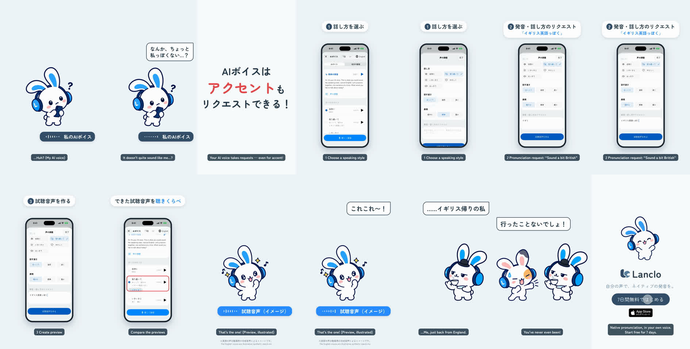

# Voice tuning — a 2D Mimi short

**English** · [日本語](README.ja.md)

Sequel to [mimi-voice](../mimi-voice/README.md). Mimi hears her AI voice and tilts her head:「なんか、ちょっと私っぽくない…？」(it doesn't quite sound like me). The copy card says「AIボイスは アクセントも リクエストできる！」(your AI voice takes requests, even for accent). The real app (simulator, fixture data) shows 声の調整 (Tune your voice): pick a speaking style (落ち着いて / ゆっくり / 穏やか), type「イギリス英語っぽく」(sound a bit British) into 発音・話し方のリクエスト, the 試聴音声を作る (Create preview) button, then the previews side by side in すべてのボイス. A British-sounding preview plays (synthetic stand-in, labelled イメージ), Mimi in a tiny bowler hat with a teacup:「……イギリス帰りの私」(me, just back from England) — her friend:「行ったことないでしょ！」(you've never even been!). End card.

0:17.4 / 1080×1920, 60 fps / Japanese speech bubbles and captions, one English sentence / official 2D poses + GSAP, real app (simulator) + HyperFrames

Two cuts: Japanese only (`mimi-tuning.mp4`) and with English subtitles (`mimi-tuning-en.mp4`); drafts in Lanclo's Google Drive `002.SNS/023. Voice Tuning/` (`Voice_Tuning_draft_2026-10-21.mp4`, `Voice_Tuning_draft_EN-subs_2026-10-21.mp4`, raw take in `Tuning_assets/`).

## Files

- [PROCESS.md](PROCESS.md) (Japanese): the owner's direction and the decisions.
- [PROMPT.md](PROMPT.md) (Japanese): a consolidated instruction to remake it.
- [prompts/](prompts/): the Codex prompt for the three new poses and its log.
- [source/](source/README.md): app capture (walkthrough + capture-only patch), poses, voices, sound, HyperFrames edit, build steps.
- [CREDITS.md](CREDITS.md): materials and rights.
