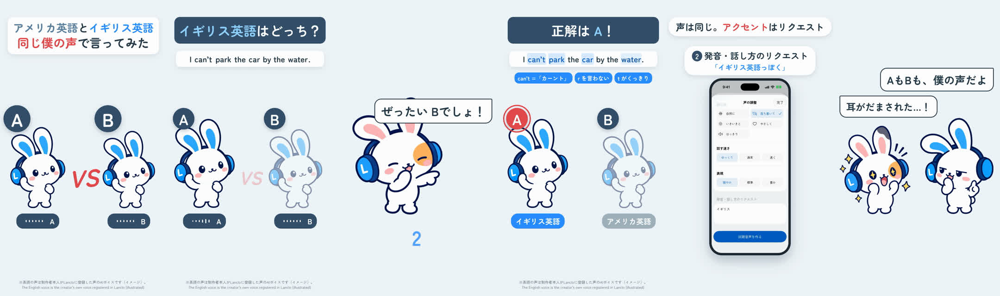

# US vs UK English in my own voice — a 2D Mimi quiz short

**English** · [日本語](README.ja.md)

A listening quiz, spun off from [mimi-tuning](../mimi-tuning/README.md) (#23). Frame 1: two identical Mimis, **A VS B**, and the hook「アメリカ英語とイギリス英語、同じ僕の声で言ってみた」(American and British English, said in the same voice — mine). The question「イギリス英語はどっち？」(Which one is British?): A and B say "I can't park the car by the water." — both the owner's own registered Lanclo voice, one British, one American. Mimi's friend: 「ぜったい Bでしょ！」(It's B, for sure!) over a 3-2-1 — then「正解は A！」(A is British), the friend「えっ」(huh?), and A once more with the British markers lighting up word by word: can't =「カーント」, r を言わない (no r), t がくっきり (a crisp t). How: the real app (simulator, fixture data) — 声の調整 (Tune your voice), 落ち着いて, then「イギリス英語っぽく」typed into 発音・話し方のリクエスト. Mimi:「AもBも、僕の声だよ」(A and B are both my voice), friend:「耳がだまされた…！」(my ears got fooled). End card.

0:18.9 / 1080×1920, 60 fps / Japanese captions and speech bubbles, one English sentence in two accents / official 2D poses + GSAP, real app (simulator) + HyperFrames

Two cuts: Japanese only (`mimi-us-uk.mp4`) and with English subtitles (`mimi-us-uk-en.mp4`); drafts in Lanclo's Google Drive `002.SNS/030. US vs UK English in My Own Voice/` (`US_UK_draft_2026-10-21.mp4`, `US_UK_draft_EN-subs_2026-10-21.mp4`, raw take and voices in `US_UK_assets/`).

## Files

- [PROCESS.md](PROCESS.md) (Japanese): the owner's direction and the decisions.
- [PROMPT.md](PROMPT.md) (Japanese): a consolidated instruction to remake it.
- [prompts/](prompts/): no new generation prompts (existing poses only); the voice lines are in `source/own-voice.json`.
- [source/](source/README.md): app track (reused mimi-tuning take), voices, sound, HyperFrames edit, build steps.
- [CREDITS.md](CREDITS.md): materials and rights.
