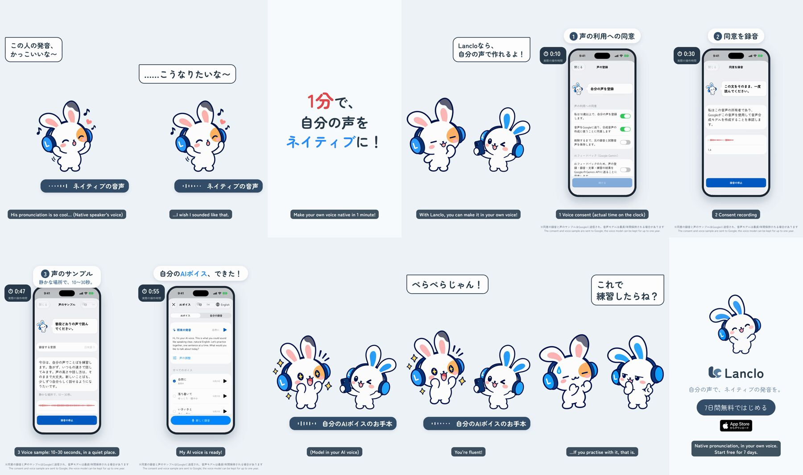

# AI voice in 1 minute — a 2D Mimi short

**English** · [日本語](README.ja.md)

Mimi's friend loves a native speaker's English and wishes she sounded like that. The hook card promises「1分で、自分の声をネイティブに！」(make your own voice native in 1 minute), Mimi shows Lanclo's real AI voice setup (voice consent, the consent statement read once, a 10–30 second voice sample; 55 s of real time on the simulator take), and the same sentence then plays in the friend's own voice. 「ぺらぺらじゃん！」— Mimi:「これで練習したらね？」(only if you practise with it).

0:18.7 / 1080×1920, 60 fps / Japanese speech bubbles and captions, English model sentence / official 2D poses + GSAP, real app (simulator) + HyperFrames

Two cuts: Japanese only (`mimi-voice.mp4`) and with English subtitles (`mimi-voice-en.mp4`); drafts in Lanclo's Google Drive `002.SNS/015. AI Voice in 1 Minute/` (`AI_Voice_draft_2026-10-21.mp4`, `AI_Voice_draft_EN-subs_2026-10-21.mp4`, raw take in `AIV_assets/`).

## Files

- [PROCESS.md](PROCESS.md) (Japanese): the owner's directions and the decisions.
- [PROMPT.md](PROMPT.md) (Japanese): a consolidated instruction to remake it.
- [prompts/](prompts/): the Codex prompt for the four new poses and its log.
- [source/](source/README.md): app capture (walkthrough + capture-only patch), poses, voices, sound, HyperFrames edit, build steps.
- [CREDITS.md](CREDITS.md): materials and rights.
